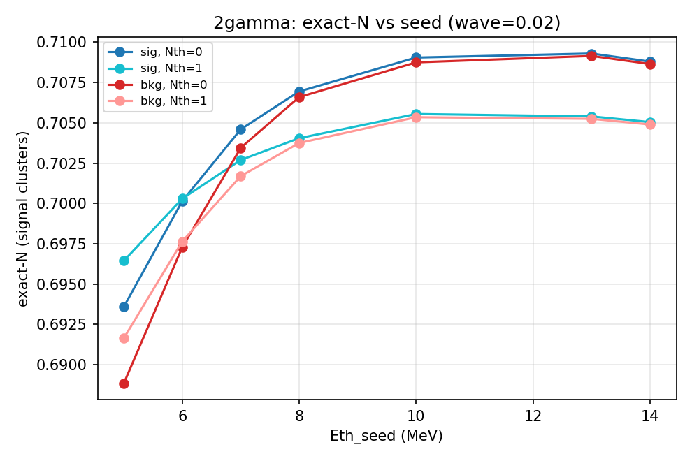
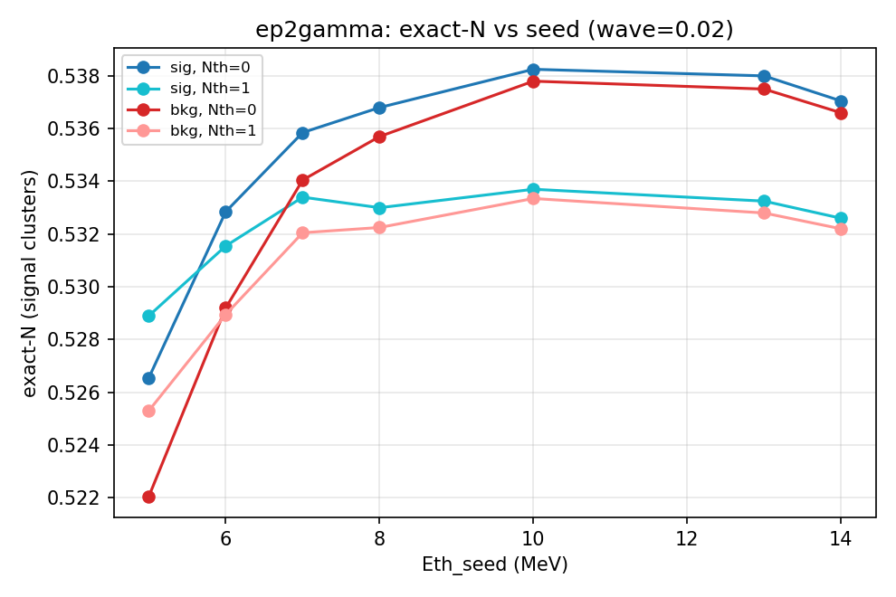
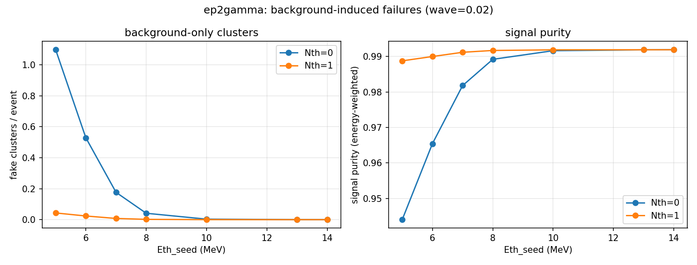
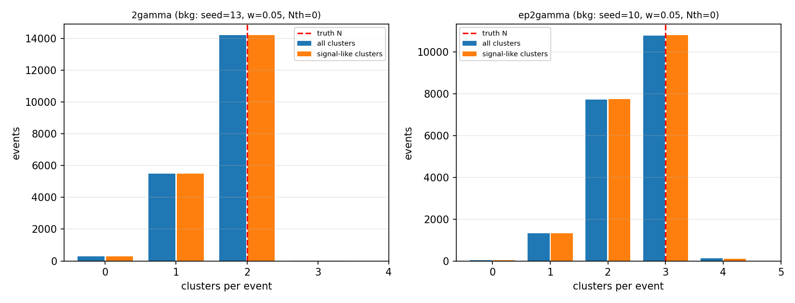
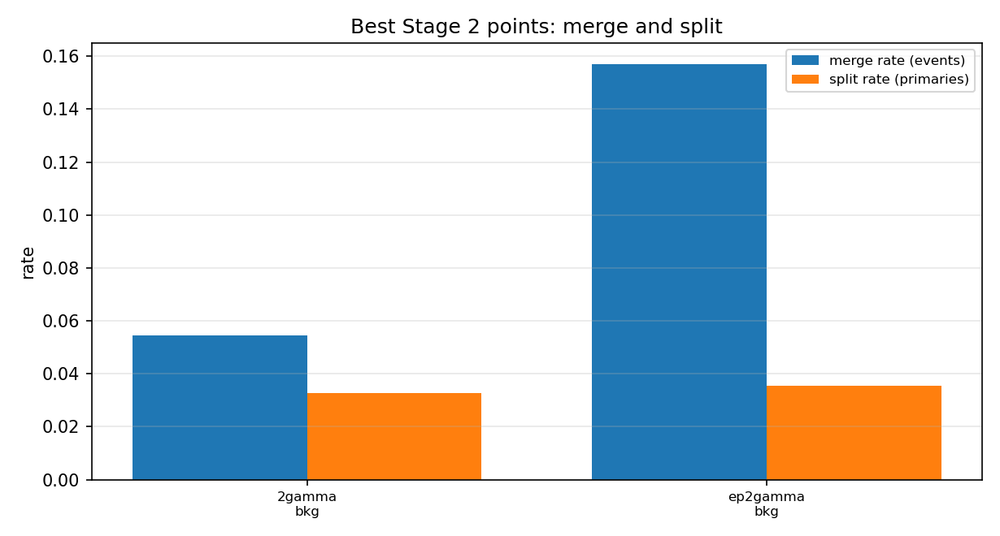

# Stage 2 报告（修正版）：2γ / e+2γ + γ 本底

**日期**：2026-11-09  
**阶段**：Stage 2 / 方案 B（修正）  
**状态**：✅ 完成  
**代码**：`pytrial/stitching.py`、`pytrial/evaluation/{counts,matching,background,energy,io}.py`  
**驱动**：`pytrial/results/multiparticle/stage2/{generate,evaluate}.py`、`run_stage2.sh`  
**数据**：`data/stitched_{2gamma,ep2gamma}_{sig,bkg}.root`（各 20 000 事例，无沉积能量筛选）  
**结果**：`results/stage2_metrics.csv`（112 行）、`results/points/*.json`、图

---

## 0. 修正说明与一页结论

### 0.1 上一版的错误

上一版对拼接事例做了**沉积能量筛选**：

* 2γ：要求两个 gamma 各自 `E_sig > 45 MeV`；
* e+2γ：要求三者总 `E_sig ∈ [100,125] MeV`，且每个源 `>1 MeV`。

这些筛选把“探测器泄漏/沉积涨落”当成了事例选择条件，导致样本有偏：

* 2γ 的平均沉积信号能量从无筛选的 **90.85 MeV** 被抬到 104.69 MeV；
* e+2γ 的平均沉积信号能量从 **137.29 MeV** 被压到 113.67 MeV，正电子平均沉积能量从 **46.60 MeV** 被压到 26.39 MeV；
* 因而上一版关于“e+2γ 的软正电子是主要瓶颈”的结论，主要是 **100–125 MeV 窗口**造成的选择效应，不是算法本身的属性。

**本版修正**：两个场景都不做任何沉积能量筛选；2γ 取两个不同的 `gamma_iso` 事例，e+2γ 取一个 `ep_iso` + 两个不同的 `gamma_iso` 事例；每个拼接事例只注入一次 γ 本底。上一版的数字与结论作废。

### 0.2 一页结果

| 场景 / 工作点 | all-event exact-N（信号簇） | 条件 exact（所有源 `E_sig>0`） | 假团簇/事例 | 信号纯度 | 本底捕获 | 合并率（事例） | 分裂率（初级） | 效率 |
|:--|--:|--:|--:|--:|--:|--:|--:|--:|
| **2γ**：seed13, Nth0, wave0.05 | **0.7098** | **0.9213**（77.0% 事例） | 0.0001 | 0.9920 | 5.9% | 5.44% | 3.26% | 0.8322 |
| **e+2γ**：seed10, Nth0, wave0.05 | **0.5392** | **0.7741**（69.5% 事例） | 0.0032 | 0.9917 | 9.3% | 15.72% | 3.54% | 0.8062 |

**要点**：

1. **不做能量筛选后，all-event exact 包含零沉积/严重泄漏的事例**：2γ 只有 77.0% 的事例两个 gamma 都有非零沉积，e+2γ 只有 69.5% 的事例三个源都有非零沉积。零沉积事例没有任何簇射可供找回，是 all-event exact 的主要缺口。
2. **条件 exact（所有源 `E_sig>0`）更接近“聚类算法本身”的性能**：2γ **0.9213**，e+2γ **0.7741**。这个条件指标只用于诊断，不是主结果；主结果仍是 all-event 0.7098 / 0.5392。
3. **e+2γ 不再有“软正电子”问题**：修正后正电子平均沉积能量 46.60 MeV，与两个 gamma（45.27/45.42 MeV）相当；all-event 0.5392、条件 0.7741，远好于上一版被窗口压低的结果。e+2γ 的剩余失败主要是 **30.5% 零沉积** + **15.7% 合并（条件 20.0%）**，不是软正电子。
4. **本底在最佳高种子点几乎不影响 exact**：2γ Δexact = −0.02 pp，e+2γ Δexact = −0.05 pp，均远小于 0.32–0.35 pp 的统计误差；假团簇分别 0.0001 和 0.0032/事例。
5. **低种子 + Nth=0 会产生大量假团簇**：seed5 时 2γ 假团簇 1.126/事例、纯度 0.920；e+2γ 1.098/事例、纯度 0.944。高种子（10–14）或 `Nth=1` 可压到 ~0；在高种子下 `Nth=1` 会损失约 0.4–0.5 pp 的 exact，而在低种子下 `Nth=1` 反而略好。
6. **Stage 3 的分离度曲线解释了 2γ 的总体合并率**：2γ 两个簇射的 50% 合并半径约 **3.41 pitch（157.7 mm）**；Stage 2 的 all-event 合并率 5.44%（可重建事例条件 7.06%）与这条曲线在物理分离度分布上的积分一致（详见 `../stage3/README.md`）。

---

## 1. 定义核对：用户的说明与项目定义是否契合

**结论：完全契合。** 上一版的问题是“事例选择”，不是定义。

| 用户的说明 | 项目中的定义 / 验证 |
|:--|:--|
| 所有单粒子事例的初始能量为 53.085 MeV | 原始 MC `G4Run0/SimPrimaryVertex.Ek0` 对 `ep_iso` 和 `gamma_iso` 的 **min = max = 53.085 MeV**；PDGID 分别为 −11（正电子）和 22（gamma）。 |
| 性能评估中的“信号能量”是单粒子在晶体中沉积的总能量 | `data/processed/edep_of_each_evt_*_bkg.root` 的 no-bkg 版本只有 `Edeps` 分支，长度 568；`Σ Edeps` 就是该单粒子的沉积信号能量。示例：gamma 事例 0 为 0.000 MeV（零沉积），事例 1/2 为 53.085 MeV（完全沉积）。 |
| 事例中沉积的总能量 = 信号能量 + 泊松抽样插入的本底能量 | `*_bkg.root` 的 `Edeps` = 信号 + 本底；示例差值 14.042 / 20.488 / 4.934 MeV，对应 `NBkg` = 3 / 4 / 1。本底模型 `n_bkg=2.42466`，`k~Poisson(n_bkg)`，568 晶体均匀，N(5,2²) 截断；**每事例一次**。 |
| 本底数量按 `bkg_est_add/README.md` 的单事例数量 | `n_bkg = 2.424660396855316` hit/event；本版每个拼接事例抽一次；91% 的事例至少一个本底 hit，平均本底能量约 12.1 MeV。 |

**上一版的偏差**：把“信号沉积能量”误用为**事例筛选条件**（`E_sig>45`、总 `E_sig∈[100,125]`）。这会优先选泄漏小/能量高的子样本；本版已全部移除。现在 `E_sig` 只出现在评估的分母/响应中，不再用于选事例。

---

## 2. 场景与样本

### 2.1 两个场景

| 场景 | 信号 | 构造 | N | 事例数 | 源沉积能量均值（MeV） | 总 `E_sig` 均值 |
|:--|:--|:--|--:|--:|:--|--:|
| `2gamma` | γ + γ | 两个**不同**的 `gamma_iso` 事例 | 2 | 20 000 | 45.53 / 45.31 | 90.85 |
| `ep2gamma` | e+ + γ + γ | 一个 `ep_iso` + 两个**不同**的 `gamma_iso` 事例 | 3 | 20 000 | 46.60 / 45.27 / 45.42 | 137.29 |

* 源样本：`ep_iso` / `gamma_iso` 前 100 000 事例；
* 随机种子 `20261106`；每个事件内不允许重复源事例，跨事件允许复用（统计涨落）；
* **不做任何沉积能量筛选**；每个源事例的主粒子能量固定为 53.085 MeV；
* `E_sig` 的分布完全来自探测器泄漏/沉积涨落：
  * 2γ：min 0，max 106.17 MeV；**77.0%** 的事例两个 gamma 都 `E_sig>0`；
  * e+2γ：min 0，max 160.18 MeV；**69.5%** 的事例三个源都 `E_sig>0`。

### 2.2 本底

按 `pytrial/bkg_est_add` 的模型，对每个拼接事例独立抽一次：

| 量 | 值 |
|:--|--:|
| `n_bkg` | 2.42466 hit/event |
| hit 数 | `Poisson(n_bkg)` |
| 晶体 | 568 个中均匀、有放回 |
| 单 hit 能量 | N(5, 2²) 截断于 0，均值 5.0011 MeV |
| 2γ 平均本底能量 / 有本底事例 | 12.11 MeV / 91.3% |
| e+2γ 平均本底能量 / 有本底事例 | 12.14 MeV / 90.8% |

每个场景写两个文件：`*_sig.root`（信号-only 对照）和 `*_bkg.root`（信号+本底）；`Truth*` 与源索引完全相同。

---

## 3. 真值与评估

### 3.1 数据格式

| 分支 | 类型 | 含义 |
|:--|:--|:--|
| `Edeps` | `vector<float>[568]` | 信号 + 本底总能量（重建用） |
| `NTrack` | `int` | 信号粒子数 N |
| `Species` | `vector<int>[N]` | 0=正电子，1=gamma |
| `SourceIdx` | `vector<int>[N]` | 源事例索引 |
| `PrimaryEnergy` | `vector<float>[N]` | 53.085 MeV |
| `SourceEnergy` | `vector<float>[N]` | 每个源的沉积能量（可为 0） |
| `SignalEnergy` | `float` | 信号沉积总能量 |
| `BkgEnergyTotal` | `float` | 本底总能量 |
| `NBkg` | `int` | 本底 hit 数 |
| `TruthCrystal` / `TruthPrimary` / `TruthEnergy` | 稀疏 | 每个初级的信号贡献 |
| `BkgCrystal` / `BkgEnergy` | 稀疏 | 本底 hit |

生成自洽检查：`Σ TruthEnergy − SignalEnergy` 最大 7.6×10⁻⁶ MeV；`Σ Edeps_bkg − (SignalEnergy+BkgEnergyTotal)` 最大 3.1×10⁻⁵ MeV。

### 3.2 指标

* **all-event exact-N**：所有 20 000 事例中，信号簇数（`e_sig≥1 MeV`）恰好等于 N 的比例；
* **条件 exact-N**：只统计所有源 `E_sig>0` 的事例（2γ：两个都 >0；e+2γ：三个都 >0）。这是诊断量，不是事例选择；零沉积事例仍在 all-event 主结果中；
* **匹配**：重叠矩阵 `M[i,j]`，精确指派（小矩阵穷举，等价匈牙利），效率、匹配纯度、匹配率、合并、分裂；
* **本底**：假团簇/事例、信号纯度、本底捕获、领头簇本底占比；
* **能量**：信号捕获、领头簇信号收束、逐初级响应。

> 本版仍使用 `e_sig≥1 MeV` 区分“信号簇”和“纯本底假簇”；这是**指标定义**，不是事例筛选。

---

## 4. 扫描网格

| 项 | 值 |
|:--|:--|
| 场景 | `2gamma`, `ep2gamma` |
| 版本 | `sig`, `bkg` |
| `Eth_seed` | 5, 6, 7, 8, 10, 13, 14 MeV |
| `Eth_wave` | 0.02, 0.05 MeV |
| `Nth` | 0, 1 |
| 点数 | 2 × 2 × 7 × 2 × 2 = **112 次重建** |
| 每点事例数 | 20 000 |
| 运行时间 | 约 30 分钟（单进程） |

---

## 5. 结果

### 5.1 2γ：all-event 0.710，条件 0.921

**最佳点**（seed13, Nth0, wave0.05）：

| 指标 | `sig` | `bkg` |
|:--|--:|--:|
| exact-N（总团簇） | 0.7100 | 0.7098 |
| exact-N（信号簇） | 0.7100 | **0.7098** |
| 欠分裂（信号簇） | 0.2885 | 0.2887 |
| 过分裂（信号簇） | 0.0015 | 0.0016 |
| 平均团簇数（总 / 信号） | 1.6992 / 1.6992 | 1.6992 / 1.6990 |
| 假团簇/事例 | 0 | **0.0001** |
| 信号纯度 | 1.0000 | **0.9920** |
| 本底捕获 | — | 0.0592 |
| 领头簇本底占比 | — | 0.0113 |
| 效率 | 0.8322 | 0.8322 |
| 匹配纯度 | 0.9832 | 0.9831 |
| 匹配率 | 0.8487 | 0.8487 |
| 合并率（事例 / 初级） | 5.42% / 5.42% | 5.44% / 5.44% |
| 分裂率（初级） | 3.29% | 3.26% |
| 信号捕获 | 0.9805 | 0.9806 |
| 领头簇信号收束 | 0.6381 | 0.6376 |
| 能量偏差 / RMS | −1.95% / 4.21% | −1.94% / 4.19% |

**条件 exact**：

| 选择（诊断） | 事例数 | 比例 | exact-N（信号簇） |
|:--|--:|--:|--:|
| 全部 | 20 000 | 1.000 | **0.7098** |
| 两个源都 `E_sig>0` | 15 405 | 0.770 | **0.9213** |
| 两个源都 `E_sig>1` | 15 386 | 0.769 | 0.9225 |
| 两个源都 `E_sig>5` | 15 366 | 0.768 | 0.9237 |

* **all-event 0.710 与条件 0.921 的差距，主要来自 23.0% 的事例至少一个 gamma 零沉积**：零沉积事例不可能有两个信号簇，任何聚类算法都无法找回。
* 上一版 `E_sig>45` 的样本 exact 0.9266，其实非常接近这里的条件 0.9213；上一版的筛选本质上是在选“两个 gamma 都沉积良好”的事例，因此数字看起来高，但**不代表无筛选的物理样本**。
* all-event 合并 5.4%、分裂 3.3%、效率 0.832；在可重建事例上合并 **7.06%**、分裂 **3.76%**、效率 **0.9429**——这些才是算法本身的几何/拓扑表现。



*图 1：2γ 的 all-event exact-N（信号簇）随种子变化（wave=0.02）。seed≥10 进入 0.709–0.710 平台；Nth=0 在高种子略好。*


*图 2：2γ 的假团簇/事例与信号纯度（wave=0.02）。seed=5/Nth=0 假团簇 1.13/事例、纯度 0.920；seed≥10 后假团簇 ~0，纯度 0.992。*

**参数表（wave=0.05, bkg）**：

| seed | Nth | exact | 假团簇/事例 | 纯度 | 本底捕获 | 效率 | 合并（事例） | 分裂（初级） |
|--:|--:|--:|--:|--:|--:|--:|--:|--:|
| 5 | 0 | 0.6892 | 1.1264 | 0.9199 | 0.6430 | 0.8336 | 5.42% | 3.33% |
| 5 | 1 | 0.6920 | 0.0331 | 0.9882 | 0.0879 | 0.8308 | 5.44% | 3.29% |
| 6 | 0 | 0.6976 | 0.5433 | 0.9517 | 0.3743 | 0.8334 | 5.43% | 3.31% |
| 6 | 1 | 0.6980 | 0.0169 | 0.9898 | 0.0759 | 0.8307 | 5.44% | 3.27% |
| 7 | 0 | 0.7039 | 0.1825 | 0.9764 | 0.1780 | 0.8332 | 5.43% | 3.30% |
| 7 | 1 | 0.7024 | 0.0065 | 0.9911 | 0.0659 | 0.8306 | 5.44% | 3.25% |
| 8 | 0 | 0.7072 | 0.0415 | 0.9880 | 0.0898 | 0.8331 | 5.44% | 3.30% |
| 8 | 1 | 0.7044 | 0.0014 | 0.9918 | 0.0608 | 0.8305 | 5.44% | 3.24% |
| 10 | 0 | 0.7094 | 0.0028 | 0.9917 | 0.0619 | 0.8328 | 5.44% | 3.28% |
| 10 | 1 | 0.7060 | 0.0002 | 0.9920 | 0.0594 | 0.8302 | 5.45% | 3.23% |
| 13 | 0 | **0.7098** | 0.0001 | 0.9920 | 0.0592 | 0.8322 | 5.44% | 3.26% |
| 13 | 1 | 0.7059 | 0.0001 | 0.9920 | 0.0590 | 0.8298 | 5.45% | 3.21% |
| 14 | 0 | 0.7093 | 0.0001 | 0.9920 | 0.0591 | 0.8319 | 5.44% | 3.25% |
| 14 | 1 | 0.7056 | 0.0000 | 0.9920 | 0.0590 | 0.8296 | 5.46% | 3.20% |

* seed 从 5 提到 13，exact 从 0.689 升到 0.710；假团簇从 1.13（Nth0）/0.033（Nth1）降到 ~0；本底捕获从 64%（seed5/Nth0）降到 5.9%。
* `Nth=1` 在高种子处只损失 0.3–0.5 pp exact，但能把假团簇压到 0.0002 以下；如果对假团簇极敏感，可用 seed10–14/Nth1。
* wave 0.02 vs 0.05：最佳点差约 0.07 pp（0.7091 vs 0.7098），在统计误差内；本报告用 0.05。

### 5.2 e+2γ：all-event 0.539，条件 0.774

**最佳点**（seed10, Nth0, wave0.05）：

| 指标 | `sig` | `bkg` |
|:--|--:|--:|
| exact-N（总团簇） | 0.53965 | 0.5388 |
| exact-N（信号簇） | 0.53965 | **0.5392** |
| 欠分裂（信号簇） | 0.4555 | 0.4560 |
| 过分裂（信号簇） | 0.0049 | 0.0048 |
| 平均团簇数（总 / 信号） | 2.4785 / 2.4785 | 2.4811 / 2.4779 |
| 假团簇/事例 | 0 | **0.0032** |
| 信号纯度 | 1.0000 | **0.9917** |
| 本底捕获 | — | 0.0929 |
| 领头簇本底占比 | — | 0.0147 |
| 效率 | 0.8064 | 0.8062 |
| 匹配纯度 | 0.9653 | 0.9652 |
| 匹配率 | 0.8200 | 0.8198 |
| 合并率（事例 / 初级） | 15.65% / 10.68% | 15.72% / 10.72% |
| 分裂率（初级） | 3.56% | 3.54% |
| 信号捕获 | 0.9804 | 0.9804 |
| 领头簇信号收束 | 0.4671 | 0.4665 |
| 能量偏差 / RMS | −2.13% / 4.74% | −2.12% / 4.72% |

**条件 exact**：

| 选择（诊断） | 事例数 | 比例 | exact-N（信号簇） |
|:--|--:|--:|--:|
| 全部 | 20 000 | 1.000 | **0.5392** |
| 三个源都 `E_sig>0` | 13 890 | 0.695 | **0.7741** |
| 三个源都 `E_sig>1` | 13 699 | 0.685 | 0.7849 |
| 三个源都 `E_sig>5` | 13 605 | 0.680 | 0.7903 |

* **all-event 0.539 与条件 0.774 的差距，主要来自 30.5% 的事例至少一个源零沉积**；这与 2γ 的机制相同。
* 上一版 100–125 MeV 窗口把正电子压到 26.4 MeV，造成“软正电子”假象；修正后正电子平均 46.60 MeV，与 gamma 相当，条件 exact 0.774，**软正电子问题不再成立**。
* 剩余的主要失败是 **合并 15.7% all-event / 20.0% 条件**（三体拓扑、近距离簇射）和少量分裂 3.5% all-event / 4.1% 条件；不是阈值漏掉软簇射。



*图 3：e+2γ 的 all-event exact-N（信号簇）随种子变化（wave=0.02）。seed=10 达到 0.539；高种子平台 0.538–0.539。*



*图 4：e+2γ 的假团簇/事例与信号纯度（wave=0.02）。seed=5/Nth=0 假团簇 1.10/事例、纯度 0.944；seed≥10 后假团簇 ~0，纯度 0.992。*

**参数表（wave=0.05, bkg）**：

| seed | Nth | exact | 假团簇/事例 | 纯度 | 本底捕获 | 效率 | 合并（事例） | 分裂（初级） |
|--:|--:|--:|--:|--:|--:|--:|--:|--:|
| 5 | 0 | 0.5231 | 1.0979 | 0.9440 | 0.6592 | 0.8072 | 15.70% | 3.57% |
| 5 | 1 | 0.5266 | 0.0428 | 0.9889 | 0.1250 | 0.8048 | 15.74% | 3.54% |
| 6 | 0 | 0.5304 | 0.5291 | 0.9654 | 0.3975 | 0.8070 | 15.70% | 3.57% |
| 6 | 1 | 0.5303 | 0.0235 | 0.9901 | 0.1113 | 0.8047 | 15.77% | 3.53% |
| 7 | 0 | 0.5353 | 0.1766 | 0.9818 | 0.2053 | 0.8067 | 15.70% | 3.55% |
| 7 | 1 | 0.5333 | 0.0077 | 0.9912 | 0.0978 | 0.8045 | 15.77% | 3.52% |
| 8 | 0 | 0.5371 | 0.0413 | 0.9893 | 0.1205 | 0.8065 | 15.71% | 3.54% |
| 8 | 1 | 0.5337 | 0.0019 | 0.9918 | 0.0920 | 0.8043 | 15.78% | 3.50% |
| 10 | 0 | **0.5392** | 0.0032 | 0.9917 | 0.0929 | 0.8062 | 15.72% | 3.54% |
| 10 | 1 | 0.5346 | 0.0001 | 0.9919 | 0.0900 | 0.8040 | 15.78% | 3.49% |
| 13 | 0 | 0.5389 | 0.0003 | 0.9919 | 0.0899 | 0.8054 | 15.73% | 3.52% |
| 13 | 1 | 0.5341 | 0.0000 | 0.9920 | 0.0897 | 0.8033 | 15.80% | 3.47% |
| 14 | 0 | 0.5380 | 0.0001 | 0.9920 | 0.0896 | 0.8048 | 15.75% | 3.50% |
| 14 | 1 | 0.5334 | 0.0000 | 0.9920 | 0.0895 | 0.8029 | 15.82% | 3.47% |

* seed 从 5 提到 10，exact 从 0.523 升到 0.539；假团簇从 1.10（Nth0）/0.043（Nth1）降到 ~0；本底捕获从 66%（seed5/Nth0）降到 9.3%。
* `Nth=1` 在高种子处损失 0.4–0.5 pp exact，换来 ~0.0001 的假团簇；按分析需求取舍。
* wave 0.02 vs 0.05：最佳点差约 0.14 pp（0.5378 vs 0.5392），在统计误差内。

### 5.3 2γ 与 e+2γ 的对比

| 指标（最佳 bkg 点） | 2γ | e+2γ |
|:--|--:|--:|
| all-event exact-N（信号） | 0.7098 | 0.5392 |
| 条件 exact（所有源 >0） | 0.9213 | 0.7741 |
| 零沉积事例比例 | 23.0% | 30.5% |
| 效率 | 0.8322 | 0.8062 |
| 合并率（事例） | 5.44% | 15.72% |
| 分裂率（初级） | 3.26% | 3.54% |
| 假团簇/事例 | 0.0001 | 0.0032 |
| 信号纯度 | 0.9920 | 0.9917 |
| 本底捕获 | 5.9% | 9.3% |
| 能量偏差 / RMS | −1.94% / 4.19% | −2.12% / 4.72% |

* all-event exact 的差距（0.710 vs 0.539）主要来自 **e+2γ 更高的零沉积比例**（30.5% vs 23.0%）和 **更高的合并率**（15.7% vs 5.4%）；条件 exact 的差距（0.921 vs 0.774）则主要来自合并/三体拓扑。
* e+2γ 的合并率按初级是 10.72%，按事例是 15.72%；三体事件中任意一对合并都会让 exact-3 失败。

**条件指标（所有源 `E_sig>0`，诊断）**：

| 场景 | n | 条件 exact | 条件合并（事例） | 条件分裂（初级） | 条件效率 |
|:--|--:|--:|--:|--:|--:|
| 2γ | 15 405 | 0.9213 | 7.06% | 3.76% | 0.9429 |
| e+2γ | 13 890 | 0.7741 | 20.04% | 4.07% | 0.9030 |

* 条件指标与 all-event 的差异完全来自零沉积事例：2γ 23.0%，e+2γ 30.5%。
* 条件合并率（7.06% / 20.04%）才是与 Stage 3 条件分离度曲线同口径的量；all-event 合并率（5.44% / 15.72%）被零沉积事例稀释。



*图 5：最佳本底点的团簇数分布（左：2γ seed13/Nth0；右：e+2γ seed10/Nth0）。蓝=总团簇，橙=信号簇（`e_sig≥1 MeV`），红虚线=真值 N。2γ 的 1 簇尾部对应一个 gamma 零/低沉积或合并；e+2γ 的 2 簇尾部对应三体中的一个源零沉积/合并。*



*图 6：最佳本底点的合并率（事例）与分裂率（初级）。e+2γ 的合并约为 2γ 的 2.9 倍。*

---

## 6. 本底影响（配对比较）

`*_sig` 与 `*_bkg` 使用完全相同的信号事例与真值，可直接配对：

| 场景 / 工作点 | Δexact-N（信号） | 假团簇/事例 | 纯度 | 本底捕获 | Δ合并（事例） | Δ分裂（初级） | Δ效率 |
|:--|--:|--:|--:|--:|--:|--:|--:|
| 2γ / seed13 Nth0 | **−0.02 pp** | 0.0001 | 0.9920 | 5.9% | +0.02 pp | −0.03 pp | ~0 |
| e+2γ / seed10 Nth0 | **−0.05 pp** | 0.0032 | 0.9917 | 9.3% | +0.06 pp | −0.02 pp | −0.01 pp |

* 两个最佳点的本底代价都远小于统计误差（20k 事例的 exact 标准误约 0.32 pp / 0.35 pp），在统计上不可分辨。
* 本底的主要威胁仍然是**低种子阈值下的假团簇**，而不是对真实簇的能量污染：
  * 2γ seed5 Nth0：假团簇 1.126/事例，纯度 0.920，本底捕获 64.3%；
  * e+2γ seed5 Nth0：假团簇 1.098/事例，纯度 0.944，本底捕获 65.9%；
  * seed10–14 Nth0：假团簇 0.0001–0.0032，纯度 0.992，本底捕获 6–9%；
  * seed5 Nth1：假团簇 0.033/0.043，纯度 0.988/0.989；exact 反而比 seed5 Nth0 高约 0.3 pp（0.6920 vs 0.6892 / 0.5266 vs 0.5231，统计涨落），所以低种子时 Nth1 是更好的选择。
* 结论：**高种子 + Nth0 是这两个场景的最佳折中**；如果必须用低种子，选 Nth1 压假团簇。

---

## 7. 关键发现

1. **用户的定义与项目完全一致**：`Edeps`（no-bkg）= 单粒子沉积信号能量；`Edeps`（bkg）= 信号 + 泊松本底；`Ek0=53.085 MeV`；`n_bkg=2.42466`，每事例一次。上一版的错误是**用 `E_sig` 筛事例**，本版已移除。
2. **2γ：all-event 0.710，条件 0.921**。23.0% 的事例至少一个 gamma 零沉积；零沉积事例无法被任何聚类算法找回。条件 0.921 与上一版 `E_sig>45` 的 0.927 接近，说明上一版数字高是因为筛选了“沉积良好”的子样本，而不是算法在无筛选样本上真的那么好。
3. **e+2γ：all-event 0.539，条件 0.774**。30.5% 的事例至少一个源零沉积；条件 0.774 远好于上一版被 100–125 MeV 窗口压低的 0.31–0.49。**“软正电子瓶颈”是选择效应，不成立**；修正后正电子平均 46.60 MeV，与 gamma 相当。
4. **e+2γ 的主要聚类失败是合并（15.7% 事例 / 10.7% 初级；条件 20.0% 事例）**，其次是分裂（3.5% all-event / 4.1% 条件）；三体拓扑下任意一对近距离簇射合并都会让 exact-3 失败。
5. **本底在最佳点可忽略**（Δexact ≤0.05 pp，假团簇 0.0001–0.0032，纯度 0.992）；低种子 + Nth0 会产生 ~1.1 假团簇/事例，是高种子工作点的主要理由。
6. **2γ 的总体合并率 5.44% 由 Stage 3 分离度曲线解释**：50% 合并半径 3.41 pitch ≈ 157.7 mm；>5 pitch 的条件 exact-2 为 0.989，3–5 pitch 为 0.767，2–3 pitch 为 0.166，≤2 pitch 几乎为 0。详见 `../stage3/README.md`。
7. **阈值不是 2γ 的限制因素**：Stage 3 在 seed5–14、Nth0/1 的曲线几乎完全重合；2γ 的瓶颈是几何重叠。e+2γ 的阈值影响主要是低种子假团簇；修正后高种子（10–14）反而略好（0.539 vs 0.523），说明没有软簇射被高阈值漏掉。

---

## 8. 推荐工作点

| 场景 | 目标 | 推荐 | 依据 |
|:--|:--|:--|:--|
| 2γ | 最佳 all-event exact / 本底干净 | **seed=10–14, Nth=0, wave=0.05** | exact 0.709–0.710；假团簇 ≤0.003；纯度 0.992 |
| 2γ | 极低假团簇 | seed=10–14, Nth=1, wave=0.05 | exact 0.706；假团簇 ≤0.0002；代价 ~0.4 pp |
| e+2γ | 最佳 all-event exact / 本底干净 | **seed=10–14, Nth=0, wave=0.05** | exact 0.538–0.539；假团簇 ≤0.003；纯度 0.992 |
| e+2γ | 极低假团簇 | seed=10–14, Nth=1, wave=0.05 | exact 0.533–0.535；假团簇 ≤0.0001；代价 ~0.4–0.5 pp |
| 任一 | 需要低种子 | seed=5–8, Nth=1 | 2γ exact 0.692–0.704；e+2γ 0.527–0.534；假团簇 0.002–0.043 |
| 任一 | 不推荐（有本底） | seed=5–7, Nth=0 | 假团簇 0.18–1.13/事例，纯度 0.92–0.98 |

> 如果目标是“聚类算法在可重建事例上的性能”，应报告条件 exact（2γ 0.921，e+2γ 0.774）；如果目标是“物理事例的总体重建效率”，应报告 all-event exact（0.710 / 0.539），并把零沉积/泄漏作为探测器接受度的一部分。两者不要混用。

---

## 9. 复现

```bash
cd pytrial/results/multiparticle/stage2
bash run_stage2.sh
```

`run_stage2.sh` 会：

1. `generate.py`：从 `data/processed/edep_of_each_evt_{ep_iso,gamma_iso}.root` 前 100k 事例拼接；
   * 2γ：两个不同的 `gamma_iso`；
   * e+2γ：一个 `ep_iso` + 两个不同的 `gamma_iso`；
   * 无沉积能量筛选；每个拼接事例一次本底；写 `_sig`/`_bkg` 两版；
2. `evaluate.py`：112 点重建 + 评估，写 CSV/JSON/图。

Stage 3 分离度曲线：

```bash
cd ../stage3
bash run_stage3.sh
```

（Stage 3 的晶体位置表已生成：`data/utilities/ecal_module_positions.npz`，568/568 模块，pitch 46.24 mm。）

---

## 10. 局限

1. **all-event exact 包含零沉积/严重泄漏事例**：这是物理样本的一部分；条件 exact 是诊断量，不是事例选择。报告时必须注明用的是哪一个。
2. **固定主粒子能量 53.085 MeV**：没有能量谱；不同能量下的阈值/合并半径可能不同，需要新样本。
3. **统计量**：每点 20 000 事例；all-event exact 的二项标准误约 0.32 pp（2γ，p≈0.71）、0.35 pp（e+2γ，p≈0.54）；条件 exact 约 0.22 pp（2γ）和 0.36 pp（e+2γ）。表中 <0.5 pp 的差异多数在 1–2σ 内，应看趋势。
4. **本底模型系统误差**：剂量换算（1 Sv=1 Gy、未做 CsI/空气修正）和 N(5,2²) 沉积谱是 O(1) 不确定度；绝对数字只在该模型下有效。
5. **无 timing**：本底与信号时间无关；timing 可进一步压假团簇。
6. **e+2γ 没有分离度控制**：Stage 3 只做了 2γ；三体的合并率 15.7% 不能直接归因于某个分离度，需要 Stage 5/三体分离度研究。
7. **Stage 3 的技术性零沉积排除**：质心需要 `E_sig>0`；Stage 3 的 2γ 样本排除了 12.3% 的零沉积 gamma，因此其条件样本均值 103.13 MeV 高于 Stage 2 的 all-event 90.85 MeV。这不是物理能量筛选，但比较时要注意。
8. **采样**：跨事件允许复用源事例；事件内不允许重复。20k 事例的统计量足够看平台，但极端尾部（零沉积/合并）的精确比例有 ~0.3–0.5 pp 的统计误差。
9. **重建代码**：`reconstruction.py` 的 gap-jumping 回退仍关闭（与 26-11-06 本底报告一致）；所有点同一版本。

---

## 11. 下一步

* **Stage 3（C）**：✅ 已完成。2γ 分离度曲线：50% 合并半径 **3.41 pitch ≈ 157.7 mm**；10% 半径 **7.43 pitch ≈ 343.6 mm**；曲线在 seed5–14、Nth0/1 下几乎不变。报告：`../stage3/README.md`。
* **Stage 4（D）**：下一次对话。晶体集不相交对照（N=2）：选两个 gamma 的点亮晶体集完全不相交的事例，测量无共享晶体时的 exact-2/合并率，与 Stage 3 同分离度箱比较；判断合并主要来自共享晶体还是传播/种子拓扑。
* **Stage 5（E）**：Poisson 多重数 + 混合种类，真实感基准。
* **Stage 6（F）**：固定总能量/能量归一；暂缓，不执行。

---

*报告完。所有数字来自 `results/stage2_metrics.csv`、`results/points/*.json` 与 `meta.json`；Stage 3 数字来自 `../stage3/results/`。*
