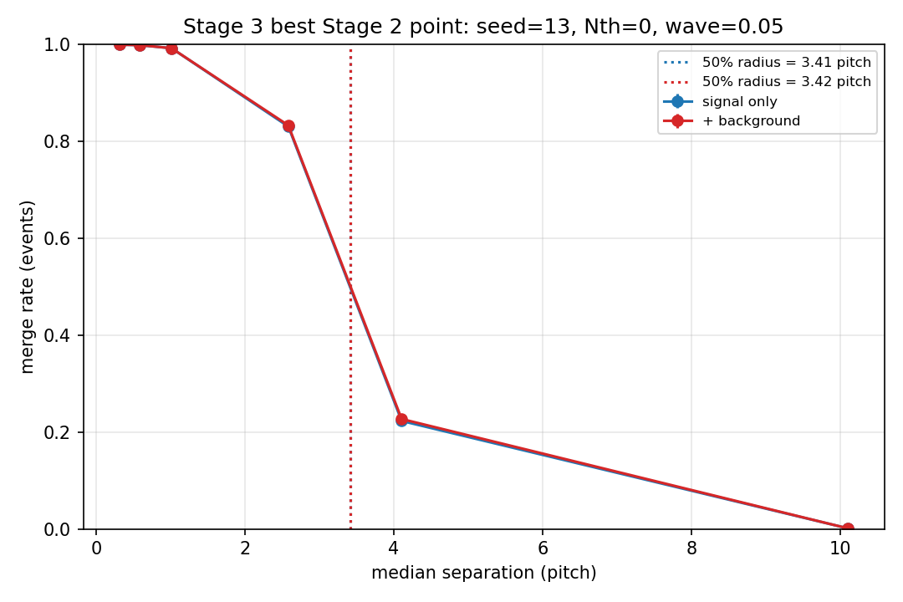
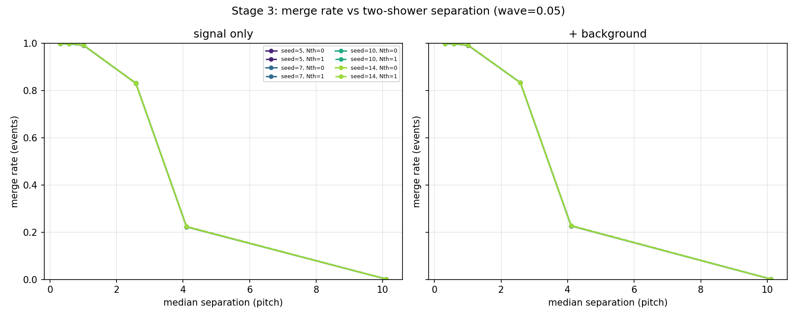

# Stage 3 报告：2γ 分离度曲线

**日期**：2026-11-09  
**阶段**：Stage 3 / 方案 C  
**状态**：✅ 完成  
**数据**：`data/stage3_2gamma_{sig,bkg}.root`（15 000 事例，6 个分离度箱 × 2 500）  
**代码**：`pytrial/geometry.py`、`pytrial/stitching.py`、`pytrial/evaluation/{matching,background,separation,io}.py`  
**驱动**：`pytrial/results/multiparticle/stage3/{generate,evaluate}.py`、`run_stage3.sh`

---

## 0. 一页结论

两个 53.085 MeV gamma 的簇射，其能量加权质心距离（以 46.24 mm 晶距为单位）与当前算法的表现：

| 分离度箱（pitch） | 中位分离（pitch） | 合并率 | exact-2（信号簇） | 效率 | 匹配纯度 |
|:--|--:|--:|--:|--:|--:|
| 0–0.5 | 0.314 | **0.9992** | 0.0008 | 0.4962 | 0.5154 |
| 0.5–1 | 0.579 | **0.9984** | 0.0012 | 0.4957 | 0.5175 |
| 1–2 | 1.011 | **0.9920** | 0.0056 | 0.4955 | 0.5318 |
| 2–3 | 2.582 | **0.8328** | 0.1660 | 0.5755 | 0.6525 |
| 3–5 | 4.105 | **0.2268** | 0.7672 | 0.8671 | 0.9346 |
| >5 | 10.105 | **0.0012** | 0.9892 | 0.9758 | 0.9987 |

**要点**：

1. **50% 合并半径 = 3.41 pitch ≈ 157.7 mm**（signal-only；+background 为 3.42 pitch ≈ 158.1 mm）；**10% 合并半径 = 7.43 pitch ≈ 343.6 mm**（+background 7.48 pitch ≈ 345.8 mm）。
2. 当前算法在 **≤2 pitch** 时几乎 100% 把两个簇射合成一个；**2–3 pitch** 才开始有 17% 的事例分开；要到 **3–5 pitch** 才有 77% 的 exact-2；**>5 pitch** 达到 98.9%。这是一个很宽、很清晰的几何过渡。
3. **在 seed=5–14、Nth=0/1 的整个测试范围内，分离度曲线几乎完全不变**（合并率差 ≤0.1%，50% 半径差 ≤0.003 pitch）。对这些 51.5 MeV 的高能簇射，阈值不是限制因素；限制来自**拓扑重叠/传播**。
4. **本底对曲线几乎无影响**：假团簇 ≤0.0008/事例，信号纯度 0.992，本底捕获约 4.6–6.9%；合并率与 signal-only 差 ≤0.004。
5. 在 ≤2 pitch 时，合并簇中的两个初级大约各占一半能量（匹配纯度 ~0.52，效率 ~0.50）：一个初级拿到合并簇，另一个拿不到独立簇。**这是“合并”，不是“分裂”**；分裂率只有 2–6%。
6. Stage 2 修正版的 2γ 总体 exact（~0.71）可以理解为这条分离度曲线在物理分离度分布上的积分（再叠加泄漏/零沉积事例）；Stage 3 把“分离度”这个变量单独隔离出来。

---

## 1. 方法

### 1.1 晶体位置

用原始 MC `data/raw/ep_iso.root` 的 `G4Run0/ECALSimHit`（`ModID`, `x`）取前 500 000 个 hit，按模块平均得到 568 个晶体中心：

* 568/568 个模块有 hit；
* 估计晶距 **46.24 mm**（最近邻距离中位数）；
* 保存为 `data/utilities/ecal_module_positions.npz`。

```bash
python3 pytrial/geometry.py \
  --raw data/raw/ep_iso.root \
  --out data/utilities/ecal_module_positions.npz \
  --n-hits 500000
```

### 1.2 事例构造

* 从 `gamma_iso` 前 100 000 个事例中取 **两个不同的事例** 拼接，N=2；
* **不做任何沉积能量筛选**（两个主光子都是 53.085 MeV，能量已由样本固定）；
* 唯一的“技术性”要求：每个源事例的沉积能量 `E_sig = Σ Edeps > 0`，否则能量加权质心没有定义。100 000 个 gamma 事例中有 **87 747** 个满足；12.3% 的零沉积事例不进入本分离度研究。
* 每个初级用其 568 个晶体的沉积能量计算质心：

```text
c = Σ_i E_i · x_i / Σ_i E_i
```

* 分离度 `s = |c_1 − c_2| / pitch`，按 6 个箱生成：
  `[0, 0.5, 1, 2, 3, 5, ∞)` pitch；
* 每箱目标 **2 500** 事例，共 **15 000**；用 KD-tree / 随机抽样定向生成，保证每箱统计量；
* 每个拼接事例注入 **一次** γ 本底（`n_bkg=2.42466`，Poisson，568 晶体均匀，N(5,2²) 截断），同时写 signal-only 与 +background 两个文件，信号真值与分离度完全相同。

> 本分离度样本是**条件样本**：每箱等统计量，不是物理分离度分布。因此这里测的是“给定分离度下的合并率”，不能把 6 个箱的平均当作物理平均；物理平均见 Stage 2。

### 1.3 数据与自洽检查

| 项 | 值 |
|:--|--:|
| 事例数 | 15 000（每箱 2 500） |
| 晶体数 | 568 |
| 晶距 | 46.24 mm |
| 源能量均值（两个初级） | 51.58 / 51.55 MeV |
| 信号沉积总能量均值 | 103.13 MeV（min 2.04, max 106.17） |
| 本底 hit 均值 | 2.40 / 事例 |
| 有本底的事例 | 91.0% |
| 本底能量均值 | 12.00 MeV |
| `Σ TruthEnergy − SignalEnergy` 最大偏差 | 7.6×10⁻⁶ MeV |
| `Σ Edeps_bkg − (SignalEnergy+BkgEnergyTotal)` 最大偏差 | 3.1×10⁻⁵ MeV |
| 存储分离度 vs 由质心重算的最大偏差 | 2.3×10⁻⁵ mm |

### 1.4 评估网格

| 项 | 值 |
|:--|:--|
| `Eth_seed` | 5, 6, 7, 8, 10, 13, 14 MeV |
| `Eth_wave` | 0.05 MeV |
| `Nth` | 0, 1 |
| 版本 | signal-only, +background |
| 点数 | 7 × 2 × 2 = **28 次重建** |
| 每点事例数 | 15 000 |

评估量：

* **合并率**：两个初级的“最佳团簇”（`argmax_i M[i,j]`）相同的事例比例；
* **分裂率**：初级的“最佳团簇”只包含其 `<90%` 信号能量的初级比例；
* **exact-2（信号簇）**：`e_sig ≥ 1 MeV` 的团簇数恰好为 2；
* **效率**：匈牙利匹配下 `M[assigned,j]/E_j` 的均值；
* **匹配纯度**：`M[i,assigned]/Σ_j M[i,j]`（信号簇）；
* **假团簇 / 信号纯度 / 本底捕获**：同 Stage 2；
* **50%/10% 合并半径**：用箱中位分离度与合并率做线性插值，取第一次向下穿过 0.5/0.1 的位置。

---

## 2. 结果

### 2.1 主曲线（seed=13, Nth=0, wave=0.05）



*图 1：合并率 vs 中位分离度（pitch）；signal-only 与 +background 几乎重合。虚线为 50% 合并半径（3.41/3.42 pitch）。*

| 箱（pitch） | 中位分离（pitch） | n | 合并率 | 分裂率 | exact-2 | 效率 | 匹配纯度 | 假团簇/事例 | 信号纯度 | 本底捕获 |
|:--|--:|--:|--:|--:|--:|--:|--:|--:|--:|--:|
| 0–0.5 | 0.314 | 2500 | 0.9992 | 0.0218 | 0.0008 | 0.4962 | 0.5154 | 0.0000 | 0.9944 | 0.048 |
| 0.5–1 | 0.579 | 2500 | 0.9984 | 0.0312 | 0.0012 | 0.4957 | 0.5175 | 0.0004 | 0.9946 | 0.046 |
| 1–2 | 1.011 | 2500 | 0.9920 | 0.0570 | 0.0056 | 0.4955 | 0.5318 | 0.0008 | 0.9944 | 0.047 |
| 2–3 | 2.582 | 2500 | 0.8328 | 0.0366 | 0.1660 | 0.5755 | 0.6525 | 0.0004 | 0.9939 | 0.052 |
| 3–5 | 4.105 | 2500 | 0.2268 | 0.0410 | 0.7672 | 0.8671 | 0.9346 | 0.0004 | 0.9920 | 0.068 |
| >5 | 10.105 | 2500 | 0.0012 | 0.0366 | 0.9892 | 0.9758 | 0.9987 | 0.0008 | 0.9921 | 0.069 |

* signal-only 的合并率/效率与上表差 ≤0.004；本底把信号纯度从 1.000 降到 0.992–0.995，把合并率最多抬高 0.004。
* `exact-2` 在 ≤2 pitch 几乎为 0；这是“两个簇射被合成一个”的直接后果，不是分裂（分裂率仅 2–6%）。
* 效率在 ≤2 pitch 约 0.50：匈牙利只能把一个合并簇分给一个初级，另一个初级效率为 0；匹配纯度 ~0.52 说明合并簇中两个初级的能量大致各半。

### 2.2 50%/10% 合并半径

| 版本 | 50% 半径（pitch） | 50% 半径（mm） | 10% 半径（pitch） | 10% 半径（mm） |
|:--|--:|--:|--:|--:|
| signal-only（seed13/Nth0） | 3.410 | 157.7 | 7.430 | 343.6 |
| +background（seed13/Nth0） | 3.418 | 158.1 | 7.477 | 345.8 |
| signal-only（全部 14 个 seed/Nth） | 3.410–3.412 | 157.7–157.8 | 7.425–7.450 | 343.3–344.5 |
| +background（全部 14 个 seed/Nth） | 3.418–3.421 | 158.0–158.2 | 7.473–7.497 | 345.5–346.7 |

* 50% 半径约 **3.4 pitch（158 mm）**，10% 半径约 **7.4–7.5 pitch（344–346 mm）**。
* 由于只有 6 个箱，插值是粗粒度的；半径的统计不确定度主要来自箱边界，而不是 2 500/箱的统计量（合并率的标准误 ≤0.01）。
* **本底把 50% 半径只推大 0.008 pitch（0.4 mm）**，10% 半径推大 0.05 pitch（2 mm），在箱宽面前可忽略。

### 2.3 seed / Nth 的依赖性



*图 2：不同 seed（5/7/10/14）与 Nth（0 实线，1 虚线）的合并率曲线；所有曲线在图上几乎完全重合。*

* 14 个 signal-only 组合的 50% 半径全部落在 **3.410–3.412 pitch**；+background 全部在 **3.418–3.421 pitch**。
* 合并率在每一箱的 seed/Nth 差异 ≤0.001–0.004；图 2 中曲线重叠到肉眼不可分。
* **解释**：两个 gamma 的沉积能量均值约 51.6 MeV，远高于 seed=5–14 的所有阈值；每个高能簇射都有足够多点亮邻居，因此 `Nth=0/1` 也不改变结果。限制来自两个簇射在拓扑上共享/相邻晶体，而不是阈值。
* 这与 Stage 2 的 e+2γ 形成对比：那里软正电子会被高 seed/Nth 漏掉，所以阈值有影响；在 2γ 的高能、双簇射样本里，阈值不是主要矛盾。

### 2.4 本底的影响

* 假团簇/事例：0.0000–0.0008（各箱，seed13/Nth0 的 bin-to-bin 波动）；
* 信号纯度：0.9944–0.9946（≤2 pitch）→ 0.9920（3–5 pitch）；
* 本底捕获：4.6%（0.5–1 pitch）→ 6.9%（>5 pitch）；
* 合并率：与本底版本的差 ≤0.004；50% 半径差 0.008 pitch。
* 结论：在这个高能 2γ 样本、seed≥5 的条件下，本底几乎不影响分离度曲线；它主要贡献少量假团簇和 ~5–7% 的本底能量捕获，而不是改变合并几何。

---

## 3. 与 Stage 2 的关系

Stage 2 修正版（无沉积能量筛选）的 2γ 总体结果是：

* 20 000 个随机 2γ 事例，平均沉积信号能量 **90.85 MeV**（因为包含零/低沉积事例；Stage 3 的条件样本均值 103.13 MeV）；
* 最好的 seed/Nth 点（seed=13, Nth=0）all-event exact-N（信号簇）**0.7098**（条件 0.9213），合并率 **5.44%**（条件 7.06%），分裂率 **3.26%**（条件 3.76%）；
* 这个 0.71 不是“算法突然变差”，而是 Stage 3 曲线的物理平均：
  * >5 pitch 的 exact-2 是 0.989，但随机 2γ 中只有一部分落在 >5 pitch；
  * 3–5 pitch 的 exact-2 是 0.767；
  * 2–3 pitch 只有 0.166；
  * ≤2 pitch 几乎为 0；
  * 再加上零/低沉积事例（仅 77.0% 的事件两个 gamma 都有非零沉积；没有可找的第二个簇）和泄漏。
* Stage 2 的 all-event 合并率 5.44%（可重建事例条件 7.06%）与这条曲线在物理分离度分布上的积分一致：大多数事例分离很大（合并率 ~0），少量近距离事例贡献了几乎全部合并；all-event 数字被零沉积事例稀释。

> **因此，Stage 3 的结论比 Stage 2 的单一 exact 数字更有解释力**：当前算法的主要几何限制是“两个簇射的质心距离小于约 3.4 pitch（158 mm）时，50% 概率被合并；小于约 2 pitch 时几乎必然合并”。这为后续算法改进（势垒感知传播、局部极大种子、merge/split 后处理）提供了明确的靶点。

---

## 4. 关键发现

1. **50% 合并半径 3.41 pitch ≈ 158 mm；10% 半径 7.43 pitch ≈ 344 mm**。当前算法需要 >4 pitch 才能可靠地分开两个 51.5 MeV 的 EM 簇射；≤2 pitch 基本无法分开。
2. **过渡很陡**：2–3 pitch 的 exact-2 只有 16.6%，3–5 pitch 升到 76.7%，>5 pitch 达到 98.9%；合并率对应从 0.8328 降到 0.2268 再降到 0.0012。
3. **阈值不是限制因素**：seed 5–14、Nth 0/1 的曲线几乎完全重合；这些高能簇射对种子/近邻要求不敏感，限制来自拓扑重叠。
4. **本底几乎不改变曲线**：假团簇 ≤0.0008/事例，纯度 0.992，本底捕获约 4.6–6.9%；50% 半径只变 0.008 pitch。
5. **失败模式是合并，不是分裂**：≤2 pitch 时效率 ~0.50、匹配纯度 ~0.52，说明合并簇中两个初级各占约一半能量；分裂率只有 2–6%。
6. **Stage 2 的总体 exact（~0.71）可以由 Stage 3 曲线 + 物理分离度分布 + 泄漏/零沉积解释**；不需要假设算法在某个阈值上“突然失效”。

---

## 5. 局限

1. **条件样本**：每箱 2 500 是定向生成的，不是物理分离度分布；曲线是“给定分离度下的合并率”，不能直接用 6 箱平均代替物理平均。物理平均见 Stage 2。
2. **技术性零沉积排除**：质心需要 `E_sig>0`；12.3% 的 gamma 事例零沉积，不进入本样本。这不是 45 MeV 或 100–125 MeV 之类的物理能量筛选；Stage 2 的总体性能仍包含这些事例。
3. **固定主粒子能量**：两个 gamma 都是 53.085 MeV；没有能量谱。分离度曲线对更低能/更高能簇射的依赖需要新样本。
4. **只测 2γ**：e+2γ 的软正电子/三体拓扑不在本阶段；Stage 2 修正版会给出其总体性能。
5. **质心距离是 3D 标量**：没有利用簇射方向/朝向；两个簇射在探测器中的相对方向可能影响合并概率，本阶段只按距离分箱。
6. **箱宽较粗**：50%/10% 半径由 6 个箱线性插值，真实过渡可能更平滑；如果需要更精确的半径，可在 2–5 pitch 加密箱。
7. **本底模型系统误差**：同 Stage 2，剂量/沉积谱假设是 O(1) 不确定度；本阶段结论对“本底几乎不影响曲线”是稳健的，但绝对捕获率不是。
8. **统计量**：每箱 2 500，合并率标准误 ≤0.01；50% 半径的插值不确定度主要来自箱边界。

---

## 6. 复现

```bash
cd pytrial/results/multiparticle/stage3

# 1) 生成晶体位置表（一次即可）
python3 ../../../geometry.py \
  --raw ../../../../data/raw/ep_iso.root \
  --out ../../../../data/utilities/ecal_module_positions.npz \
  --n-hits 500000

# 2) 生成分离度样本 + 评估（28 点 × 15k）
bash run_stage3.sh
```

输出：

| 路径 | 内容 |
|:--|:--|
| `data/stage3_2gamma_{sig,bkg}.root` | 15 000 事例，每箱 2 500 |
| `meta.json` | 晶距、箱边界、每箱中位数、能量/本底统计、自洽检查 |
| `results/stage3_metrics.csv` | 28 点 × 6 箱 = 168 行 |
| `results/fits.json` | 每个 seed/Nth/版本的 50%/10% 半径 |
| `results/merge_rate_vs_separation.png` | 全部 seed/Nth 曲线 |
| `results/merge_rate_best.png` | 主曲线 + 50% 半径 |

---

## 7. 下一步（Stage 4）

**Stage 4 / 方案 D：晶体集不相交对照（N=2）**

* 用 Stage 3 的晶体位置与逐初级真值，选出两个 gamma 的**点亮晶体集完全不相交**的事例；
* 这些事例在几何上没有共享晶体，理论上不存在“同一晶体被两个簇射共享”的歧义；
* 测量其 exact-2、合并率、效率，作为**无重叠上限**；
* 与 Stage 3 的同分离度箱对照：如果 disjoint 样本在 2–3 pitch 仍大量合并，说明限制来自传播/种子拓扑，而不是共享晶体；如果 disjoint 样本明显更好，说明共享晶体是主因。
* 交付：disjoint 样本、`disjoint_vs_stage3.png`、Stage 4 报告。

Stage 5（Poisson 多重数 + 混合种类）和 Stage 6（固定总能量）仍按原计划；Stage 6 暂缓。

---

*报告完。所有数字来自 `results/stage3_metrics.csv`、`results/fits.json` 与 `meta.json`。*
