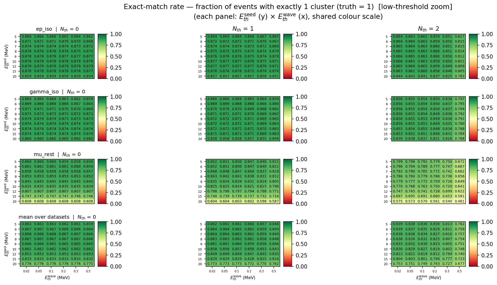
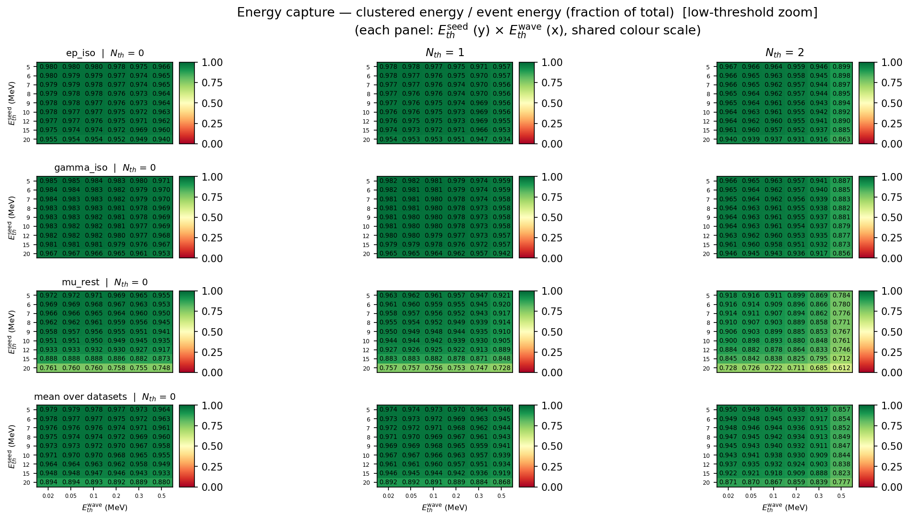
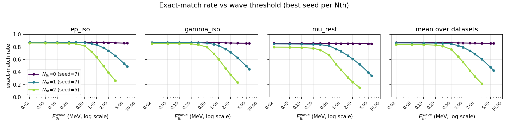
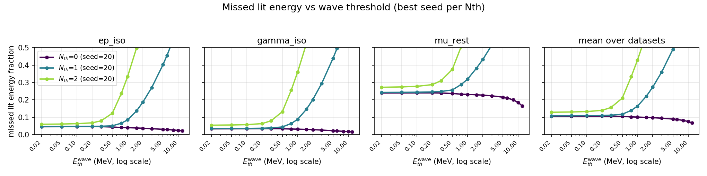

# 精细参数扫描 II（2026-10-16-refined，低阈值与种子轴加密）

本文件是 [26-10-16](../26-10-16/README.md) 的后续，专门解决该报告 §7 未决事项的**第 2、3 条**：

* **第 2 条**：三个 `Nth` 的最优点都顶在 `Eth_wave` 网格下界 0.1 MeV，需要补 0.02 / 0.05 MeV
  确认平台位置，并检查更低阈值是否会让噪声重新导致过分裂；
* **第 3 条**：`Eth_seed` 在 7–15 MeV 几乎平坦，需要在 5–10 MeV 之间加密（对能谱较软的
  `mu_rest` 尤其重要）。

结果放在**新目录** `pytrial/results/sweep/26-10-16-refined/`，上一轮结果原样保留。

---

## 1. 扫描配置（相对上一轮的变化）

| 项 | 26-10-16 | **26-10-16-refined（本轮）** |
|:--|:--|:--|
| `Eth_seed` (MeV) | 5, 7, 10, 12, 15, 20 | **5, 6, 7, 8, 9, 10**, 12, 15, 20 |
| `Eth_wave` (MeV) | 0.1 … 12（16 点） | **0.02, 0.05**, 0.1, 0.2, 0.3, 0.5, 0.75, 1.0, 1.5, 2.0, 3.0, 5.0, 6.0, 8.0, 10.0, 12.0（16 点） |
| `Nth` | 0, 1, 2 | 0, 1, 2 |
| 数据集 / 事例数 | 3 × 50 000 | 3 × 50 000 |
| 点数 | 420 | **124 × 3 × 3 = 1116，0 失败** |
| 拓扑 | `ecal_neighbor_info.root` | 同左 |

新增点：
* 低阈值：`Eth_wave = 0.02, 0.05`（第 2 条）；
* 种子加密：`Eth_seed = 6, 8, 9`（第 3 条）。
* 为控制规模，去掉上轮的信息量较低的 `Eth_wave = 2.5, 4.0`；其余 14 个波前阈值与上轮完全一致，
  可直接逐点对比。

复现（一条命令，网格写在脚本里）：

```bash
cd pytrial
bash sweeps/run_refined.sh              # 扫描 + 分析；结果写入 26-10-16-refined/
bash sweeps/run_refined.sh --force      # 强制重算
bash sweeps/run_refined.sh --csv-only   # 只从缓存重建 CSV + 图
```

`config.py` 的 `ETH_SEED_VALUES` / `ETH_WAVE_VALUES` 现支持
`ECAL_SWEEP_SEEDS` / `ECAL_SWEEP_WAVES` 覆盖，`RESULTS_DATE` 与工作区缓存 `TAG` 已解耦，
因此不同 campaign 可以并存而不互相污染。

---

## 2. 结果一：`Eth_wave < 0.1 MeV` 的平台已确认

在每个 `Nth` 各自最优 seed 下（三数据集平均）：

| `Nth` | seed | `Eth_wave` | exact-match | 能量捕获 | 未簇化能量 | `frac_3plus` | 平均团簇数 |
|--:|--:|--:|--:|--:|--:|--:|--:|
| 0 | 7 | **0.02** | **0.8678** | 0.9764 | 0.0236 | 0.00013 | 0.8828 |
| 0 | 7 | 0.05 | 0.8677 | 0.9761 | 0.0239 | 0.00013 | 0.8829 |
| 0 | 7 | 0.10 | 0.8677 | 0.9755 | 0.0245 | 0.00013 | 0.8830 |
| 0 | 7 | 0.20 | 0.8673 | 0.9739 | 0.0261 | 0.00013 | 0.8833 |
| 1 | 7 | **0.02** | **0.8641** | 0.9723 | 0.0277 | 0.00008 | 0.8741 |
| 1 | 7 | 0.05 | 0.8638 | 0.9717 | 0.0283 | 0.00008 | 0.8738 |
| 1 | 7 | 0.10 | 0.8634 | 0.9708 | 0.0292 | 0.00008 | 0.8733 |
| 1 | 7 | 0.20 | 0.8620 | 0.9683 | 0.0317 | 0.00008 | 0.8720 |
| 2 | 5 | **0.02** | **0.8393** | 0.9504 | 0.0496 | 0.00003 | 0.8468 |
| 2 | 5 | 0.05 | 0.8381 | 0.9488 | 0.0512 | 0.00003 | 0.8454 |
| 2 | 5 | 0.10 | 0.8358 | 0.9460 | 0.0540 | 0.00002 | 0.8427 |
| 2 | 5 | 0.20 | 0.8295 | 0.9383 | 0.0617 | 0.00001 | 0.8356 |

**结论：0.02 → 0.1 MeV 的变化可以忽略。**

| `Nth` | Δexact (0.1 − 0.02) | Δ能量捕获 (0.1 − 0.02) | Δ未簇化能量 |
|--:|--:|--:|--:|
| 0 | −0.0001 | −0.0009 | +0.0009 |
| 1 | −0.0007 | −0.0015 | +0.0015 |
| 2 | −0.0035 | −0.0044 | +0.0044 |

即 **0.1 MeV 已经落在平台上**；继续降到 0.05 或 0.02 最多再换来 0.1–0.35 个百分点
（`Nth=2` 最大），没有新的物理机制出现。

**没有出现"低阈值噪声过分裂"。** `frac_3plus` 在 0.02–0.2 区间完全不变（`Nth=0/1/2` 分别
为 1.3×10⁻⁴ / 8×10⁻⁵ / 3×10⁻⁵），平均团簇数只从 0.8830 变到 0.8828（`Nth=0`）。低阈值多吸进来的
是同一簇射的外圈软沉积，而不是新的独立团簇。这与 `lit_energy_missed_fraction` 随阈值降低而
单调下降的图像一致（见 `heatmap_energy_captured_fraction_per_nth_low.png`）。



*`heatmap_exact_match_rate_per_nth_low.png` — 0.02–0.5 MeV 放大：0.02 / 0.05 / 0.1 三列几乎同色，
平台一目了然；0.2 起 `Nth=2` 开始明显下滑。*



*`heatmap_energy_captured_fraction_per_nth_low.png` — 同一窗口的能量捕获率。*

---

## 3. 结果二：种子轴加密——最优 6–8 MeV，`mu_rest` 最优点移动

在 `Eth_wave = 0.02`、三数据集平均下，exact-match 随 seed 的变化：

| `Eth_seed` (MeV) | 5 | 6 | **7** | 8 | 9 | 10 | 12 | 15 | 20 |
|:--|--:|--:|--:|--:|--:|--:|--:|--:|--:|
| `Nth=0` | 0.8634 | 0.8670 | **0.8678** | 0.8674 | 0.8655 | 0.8625 | 0.8534 | 0.8326 | 0.7755 |
| `Nth=1` | 0.8624 | 0.8640 | **0.8641** | 0.8631 | 0.8610 | 0.8580 | 0.8492 | 0.8291 | 0.7731 |
| `Nth=2` | **0.8393** | 0.8387 | 0.8376 | 0.8358 | 0.8335 | 0.8304 | 0.8225 | 0.8045 | 0.7525 |

* `Nth=0/1`：**6–8 MeV 是一个很宽的平台，峰值在 7 MeV**（6 与 7 只差 0.08 / 0.01 个百分点）。
  种子再低（5）会放进更多低能噪声簇，再高（≥9）开始丢掉真实簇射的软事例——`frac_0` 从
  seed=5 的 0.121 单调升到 seed=20 的 0.224。
* `Nth=2`：**越低的 seed 越好，最优点仍在网格下界 5 MeV**（因为两个近邻的要求已经很严，
  再加高种子等于双重压制）。这是本轮唯一仍"顶在边界"的参数轴，但它是 `Nth=2` 的固有行为，
  不是采样不足。
* 上轮的粗网格 `5, 7, 10` 恰好把峰夹住，所以**没有漏掉大效应**；加密后的收益主要是把最优区间
  从"7 附近"收紧到"6–8"，并给出下面这个实际的改进：

**`mu_rest` 的最优点从 `seed=5, wave=0.1`（0.8597）移到 `seed=6, wave=0.02`（0.8614），
提高 0.17 个百分点。** 这正是第 3 条建议所预期的——软能谱数据集的种子最优值落在 5 与 7 之间。



*`profile_exact_match.png` — 每个 `Nth` 取各自最优 seed，exact-match 随 `Eth_wave` 的变化（对数横轴，
含 0.02/0.05）。三条曲线在 0.02–0.1 完全重合，之后按 `Nth` 由小到大依次提前塌落。*



*`profile_missed_energy.png` — 被漏掉的点亮能量占比，同样在低阈值处进入平台。*

---

## 4. 与上一轮（26-10-16）的对比

| 指标 | 26-10-16 最优 | 26-10-16-refined 最优 | 变化 |
|:--|:--|:--|--:|
| mean exact，`Nth=0` | 0.8677 (7, 0.1) | **0.8678 (7, 0.02)** | +0.0002 |
| mean exact，`Nth=1` | 0.8634 (7, 0.1) | **0.8641 (7, 0.02)** | +0.0008 |
| mean exact，`Nth=2` | 0.8358 (5, 0.1) | **0.8393 (5, 0.02)** | **+0.0034** |
| `ep_iso` 单数据集 | 0.8790 (12, 0.1) | 0.8790 (12, 0.02) | ±0 |
| `gamma_iso` 单数据集 | 0.8743 (12, 0.1) | 0.8744 (12, 0.02) | +0.0001 |
| `mu_rest` 单数据集 | 0.8597 (5, 0.1) | **0.8614 (6, 0.02)** | **+0.0017** |

**总判断：上一轮的推荐（`Nth=0/1`, `seed≈7`, `wave=0.1`）是正确的**；本轮把波前阈值的最优点
确认在 0.02–0.1 的平台内，并把种子最优区间收紧到 6–8 MeV。唯一实质改进是 `mu_rest` 与
`Nth=2` 的小幅提升，以及**平台边界的定量确认**。

---

## 5. 数据集最优（任意 `Nth`）

| 数据集 | `Nth` | seed | wave | exact-match | 能量捕获 | MAE |
|:--|--:|--:|--:|--:|--:|--:|
| `ep_iso` | 0 | 12 | 0.02 | **0.8790** | 0.9771 | 0.1210 |
| `gamma_iso` | 0 | 12 | 0.02 | 0.8744 | 0.9824 | 0.1256 |
| `mu_rest` | 0 | 6 | 0.02 | 0.8614 | 0.9694 | 0.1389 |

接受度地板仍是 ~0.88：`Nth=0, seed=7` 时 `frac_0 = 0.1248`，且从 0.02 到 12 MeV 完全不随
`Eth_wave` 变化（这些事例总沉积太低，任何阈值都无法成簇）。本轮没有突破该地板。

---

## 6. 推荐工作点（更新版）

| 目标 | 建议 | 依据 |
|:--|:--|:--|
| 单粒子簇数最准 | **`Nth=0, Eth_seed=7, Eth_wave=0.05`** | mean 0.8677；0.02/0.05/0.1 三者差 <0.0001，取平台中央更稳 |
| 兼顾能量捕获 | `Nth=0, Eth_seed=6, Eth_wave=0.02` | exact 0.8670，能量捕获 0.9778（比 seed=7 高 0.14 pp） |
| 能量优先 | `Nth=0, Eth_seed=5, Eth_wave=0.02` | 能量捕获 0.9791（全场最高），exact 0.8634 |
| `mu_rest` 专用 | `Nth=0, Eth_seed=6, Eth_wave=0.02` | 0.8614 |
| 抗噪（种子需 ≥1 近邻） | `Nth=1, Eth_seed=7, Eth_wave=0.05` | mean 0.8638，仅比 `Nth=0` 低 0.4 pp |
| 不建议 | `Nth=2` 及任何 `Eth_wave ≥ 1 MeV` 的组合 | `Nth=2` 仍低 2.85 pp；高波前阈值会切断簇射 |

`Eth_wave` 在 **0.02–0.1 MeV 之间任取**均可；`Eth_seed` 取 **6–8 MeV**；`Nth` 取 0 或 1。

---

## 7. 产物

| 文件 | 内容 |
|:--|:--|
| `sweep_summary.csv` | **1116 行** × 32 列完整指标 |
| `best_params.md` / `best_params.html` | 各指标最优点（"mean" 行已修正为真正的三数据集平均）、`Nth` 作用、Top-10 |
| `heatmap_<metric>_per_nth.png` | 行=数据集+平均、列=`Nth` 的 `seed × wave` 热图，0.02–1.5 MeV 放大、带数值 |
| `heatmap_<metric>_per_nth_low.png` | **0.02–0.5 MeV 低阈值放大**（exact-match / 能量捕获），平台确认专用 |
| `heatmap_<metric>_per_nth_full.png` | 完整 16 点 `Eth_wave` 轴、等值线总览 |
| `heatmap_exact_match_nth{0,1,2}.png` | 每个 `Nth` 单独一张放大热图 |
| `profile_exact_match.png` / `profile_energy_capture.png` / `profile_missed_energy.png` | 指标随 `Eth_wave`（对数轴，含 0.02/0.05）的剖面 |
| `tradeoff_scatter.png` | 簇数质量 vs 能量捕获（点大小 ∝ `Nth`，颜色 = seed） |
| `best_exact_match_rate_bars.png` | 每个数据集 / `Nth` 的最优点柱状对比 |

---

## 8. 仍未决

1. **多粒子判据。** 与上一轮相同：全部是单粒子样本，`exact_match` 只衡量"团簇数 = 1"，
   无法验证分辨多粒子的能力。需要叠加重数的样本（旧的 `child_stitched_edeps.root` 因
   `evt_stitch_child.py` 缺陷已废弃）。
2. **`Nth=2` 的 seed 轴仍顶在 5 MeV。** 若将来需要 `Nth=2` 工作点，可补 3–5 MeV；但在
   `Nth=0/1` 已足够好的前提下优先级很低。
3. 本轮为控制规模去掉了 `Eth_wave = 2.5, 4.0`；这两点位于已充分采样的下降段，对结论无影响。
