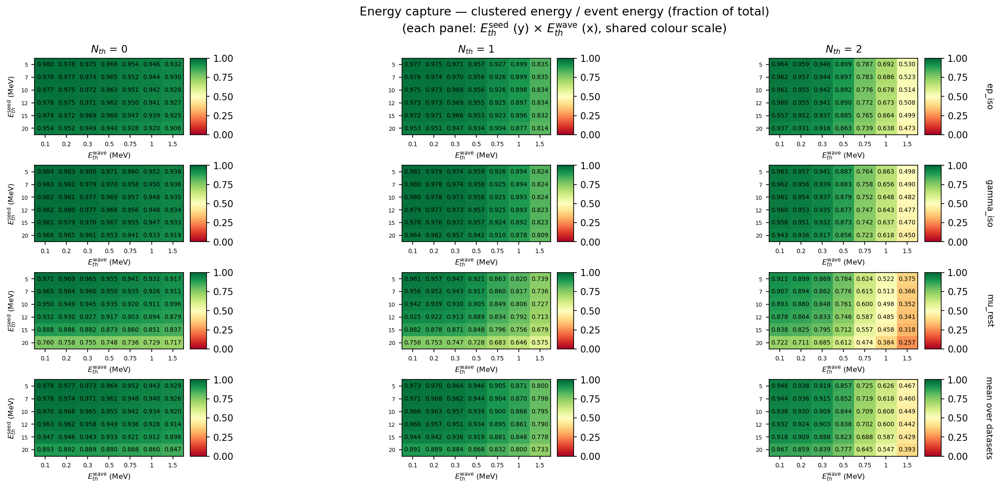
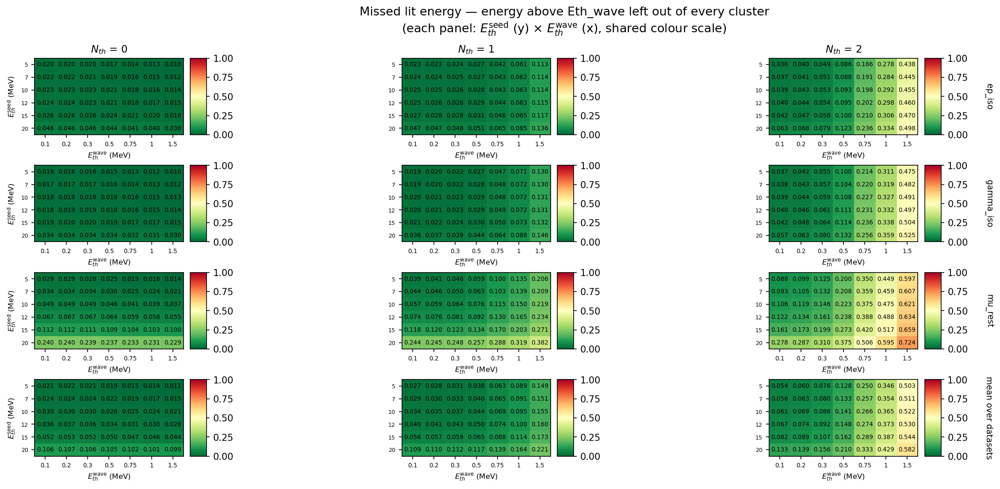
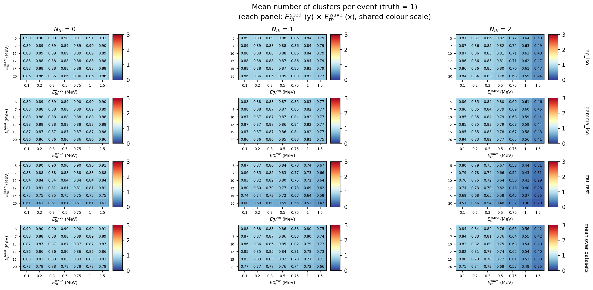
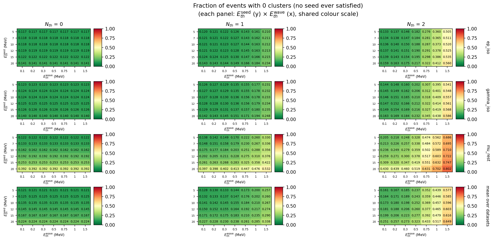
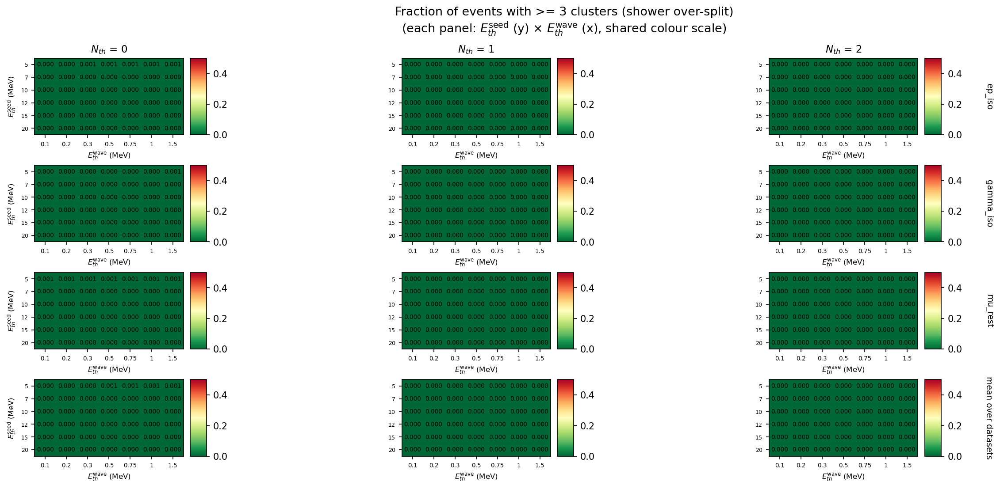
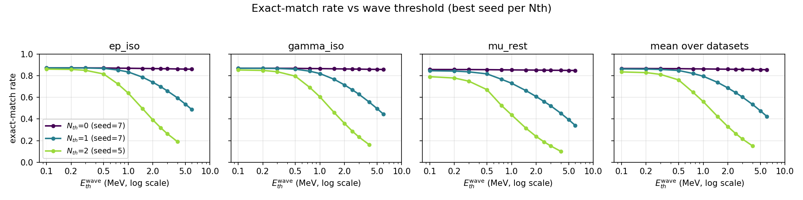
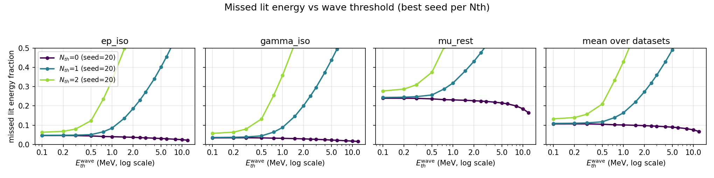

# 精细参数扫描（2026-10-16，能量阈值加密）

本文件记录第二次两阈值重建扫描：相比 [26-09-23](../26-09-23/README.md)，**把波前能量阈值
`Eth_wave` 在 0.1–2 MeV 区间加密**，并把邻居数阈值 `Nth` 由 4 组缩减为 3 组。目的正是让
"能量阈值"这条物理轴显出结构，并把热图按 `Nth` 分面板绘制，而不是把 `Nth` 平均掉。

---

## 1. 扫描配置

| 项 | 值 |
|:--|:--|
| 数据集 | `ep_iso` / `gamma_iso` / `mu_rest`，各 50 000 事例（1M 的前 5%） |
| `Eth_seed` | 5, 7, 10, 12, 15, 20 MeV（与上次相同，该轴灵敏度低） |
| `Eth_wave` | **0.1, 0.2, 0.3, 0.5, 0.75, 1.0, 1.5, 2.0, 2.5, 3.0, 4.0, 5.0, 6.0, 8.0, 10.0, 12.0** MeV（16 点，仅 `wave < seed`） |
| `Nth` | **0, 1, 2**（去掉上次表现最差的 `Nth = 3`） |
| 点数 | 85 × 3 × 3 = **765**，0 失败，总耗时 2902 s（18 进程） |
| 拓扑 | `ecal_neighbor_info.root`（568 晶体，4 近邻） |
| 事例数/数据集 | 50 000 |

与上一轮的对比：

| | 26-09-23 | 本轮 26-10-16 |
|:--|:--|:--|
| `Eth_wave` 网格 | 0.5, 1, 2, 3, 5, 8, 12（7 点，最细间隔 0.5） | 16 点，**0.1–2 MeV 内间隔 0.1–0.25** |
| `Nth` | 0, 1, 2, 3 | 0, 1, 2 |
| 点数 | 420 | 765 |
| 能量相关指标 | 3 个 | 9 个（新增未簇化能量、被漏掉的"点亮"能量、中位收束率等） |

复现命令：

```bash
cd pytrial
ECAL_SWEEP_N_EVENTS=50000 ECAL_SWEEP_NTHS=0,1,2 \
ECAL_SWEEP_NEIGHBOR_FILE=ecal_neighbor_info.root \
python3 sweeps/run_sweep.py          # 765 点；写入 results/sweep/26-10-16/sweep_summary.csv
python3 sweeps/analyze.py            # 热图（按 Nth 分面板）+ 剖面 + 表格
```

---

## 2. 数据可用性说明（重要）

仓库中 `data/processed/*.root`、`data/raw/*.root` 由 **Git LFS** 跟踪，但本机原先未安装
`git-lfs`，工作区内只有 133 字节的指针文件，**扫描所需的全部事例数据缺失**。

已按以下方式恢复（未修改任何原有数据）：把 `git-lfs` 3.5.1 安装到本地 `.tools/`（已加入
`.gitignore`），用公开仓库匿名 LFS 端点只取回 `data/processed/**` 三个文件（约 232 MB；
`data/raw/**` 未取回，因为重建只读 `processed/`）：

```bash
export PATH="$PWD/.tools:$PATH"
git lfs fetch --include="data/processed/**" origin
git lfs checkout
```

恢复后校验：三个文件均为 **ROOT Version 64004**，大小 77.4 / 71.9 / 70.1 MB，
`EdepOfEachEvt` 各 **1 000 000** 事例；拓扑 `ecal_neighbor_info.root` 含 568 晶体、
`neighbors` 与 `second_neighbors` 两个分支。**无文件缺失，扫描得以完成。**

---

## 3. 结果总览

### 3.1 每个 `Nth` 的最优点（三数据集平均）

| `Nth` | 最优 seed | 最优 wave | exact-match | 能量捕获 | 未簇化能量 | 漏掉的点亮能量 |
|--:|--:|--:|--:|--:|--:|--:|
| **0** | **7** | **0.1** | **0.8677** | 0.9755 | 0.0245 | 0.0242 |
| 1 | 7 | 0.1 | 0.8634 | 0.9708 | 0.0292 | 0.0289 |
| 2 | 5 | 0.1 | 0.8358 | 0.9460 | 0.0540 | 0.0536 |

### 3.2 单数据集最优（任意 `Nth`）

| 数据集 | `Nth` | seed | wave | exact-match | 能量捕获 | MAE |
|:--|--:|--:|--:|--:|--:|--:|
| `ep_iso` | 0 | 12 | 0.1 | **0.8790** | 0.9761 | 0.1210 |
| `gamma_iso` | 0 | 12 | 0.1 | 0.8743 | 0.9816 | 0.1257 |
| `mu_rest` | 0 | 5 | 0.1 | 0.8597 | 0.9709 | 0.1409 |

`ep_iso` 的 0.8790 与上一轮最好点（`Nth=0, seed=12, wave=0.5`，0.8786）基本持平——
**接受度地板约 0.88 已到顶**（见 §4.4），进一步加密只能改善能量指标，不能显著提高簇数准确率。

### 3.3 展示图（按 `Nth` 分面板；每格都是 `Eth_seed` × `Eth_wave`）

图例：**行 = 数据集（含三数据集平均），列 = `Nth`**，同一张图内共用色标，因此可以竖向比较
数据集、横向比较邻居数阈值。


*`heatmap_exact_match_rate_per_nth.png` — 准确匹配率（波前阈值 0.1–1.5 MeV 放大版）。*



*`heatmap_energy_captured_fraction_per_nth.png` — 能量捕获率（全部团簇能量 / 事例总能量）。*



*`heatmap_lit_energy_missed_fraction_per_nth.png` — 高于 `Eth_wave` 却未进入任何团簇的能量占比。*



*`heatmap_mean_clusters_per_nth.png` — 平均团簇数（真值为 1）。*



*`heatmap_frac_0_per_nth.png` — 0 团簇事例比例（种子判据从未满足）。*



*`heatmap_frac_3plus_per_nth.png` — ≥3 团簇事例比例（簇射被过度拆分）。*

每张指标另有 `*_per_nth_full.png`：**完整 16 点 `Eth_wave` 轴、不标注数字、用等值线表示**，
用于观察大尺度趋势（`exact_match_rate` 放大版另有逐 `Nth` 单图 `heatmap_exact_match_nth{0,1,2}.png`）。

### 3.4 剖面图：阈值把物理转折点暴露出来



*`profile_exact_match.png` — 每个 `Nth` 取各自最优 seed，exact-match 随 `Eth_wave` 的变化。*



*`profile_missed_energy.png` — 同上，被漏掉的点亮能量占比。*

---

## 4. 结论

### 4.1 加密后 `Eth_wave` 的物理意义非常清楚：它是一个**单调的过分裂/丢能量权衡旋钮**

当 `Nth ≥ 1` 时，把 `Eth_wave` 从 0.1 抬到 3 MeV 会同时：

* 破坏簇数准确率（`Nth=1, seed=7`：**0.863 → 0.645**；`Nth=2, seed=5`：**0.836 → 0.216**）；
* 降低能量捕获率（`Nth=2, seed=5`：**0.946 → 0.236**）；
* 抬高未簇化能量（同一行：**0.054 → 0.764**）。

原因是清楚的：单粒子簇射的横向尺度只有 4–6 块晶体，总能量中位数约 53 MeV，晶体间距 46 mm。
`Eth_wave` 一旦升到 1 MeV 以上，就把簇射外圈的软沉积挡在波前之外，连通区被切断 → 同一簇射
裂成多个团簇（`frac_3plus` 上升）或直接漏掉（未簇化能量上升）。**转折区恰好落在
0.3–2 MeV**，而旧网格（0.5, 1, 2, 3）只有 3 个采样点，看不出这条曲线。

### 4.2 转折区在 0.1–0.5 MeV 之间，最优点是网格下界

`Nth=2, seed=5`（数据集中均）：

| `Eth_wave` (MeV) | 0.1 | 0.2 | 0.3 | 0.5 | 0.75 | 1.0 | 1.5 | 2.0 | 3.0 |
|:--|--:|--:|--:|--:|--:|--:|--:|--:|--:|
| exact-match | **0.836** | 0.830 | 0.813 | 0.762 | 0.647 | 0.561 | 0.423 | 0.330 | 0.216 |
| 能量捕获 | 0.946 | 0.938 | 0.919 | 0.857 | 0.725 | 0.626 | 0.467 | 0.363 | 0.236 |
| 未簇化能量 | 0.054 | 0.060 | 0.076 | 0.129 | 0.250 | 0.346 | 0.503 | 0.609 | 0.740 |

`0.1 → 0.5` 已损失 **7.4 个百分点**的 exact-match 与 **8.9 个百分点**的能量捕获；
`0.1 → 0.2` 只损失 0.6 个百分点。**最优波前阈值应取 0.1–0.2 MeV，而不是上一轮推荐的
0.5 MeV**——这正是提高颗粒度带来的直接收益。所有 `Nth` 的最优点都被推到网格下界 `0.1 MeV`，
说明真正的平台可能更低（但低于约 0.1 MeV 已接近数值噪声，收益有限）。

### 4.3 `Nth` 仍是主导参数，但缩小差距后结论更精确

| `Nth` | 最佳 mean exact-match | 相对 `Nth=0` 的损失 | 该点能量捕获 |
|--:|--:|--:|--:|
| 0 | 0.8677 | — | 0.9755 |
| 1 | 0.8634 | −0.43 pp | 0.9708 |
| 2 | 0.8358 | −3.19 pp | 0.9460 |
| 3（上轮） | 0.5333 | −33 pp | 0.6097 |

把邻居要求放到**种子判据**上，`Nth=3` 是灾难性的，`Nth=2` 也有明显代价；只有 `Nth=0/1`
在最优波前阈值下几乎等价（差 0.43 pp）。**"是否要求至少 1 个近邻"是抗噪与接受度之间的
唯一有意义的取舍**，而它只在 `Eth_wave` 足够低时才成立——这正是上一轮把 `Nth` 与 `Eth_wave`
混在一起平均后看不出的一点。

### 4.4 接受度地板约 0.88

`Nth=0, seed=7` 时 0 团簇比例为 **0.1248**，且从 0.1 到 12 MeV 完全不随 `Eth_wave` 变化；
`frac_3plus ≈ 0.0001–0.0002`。也就是说约 **12.5% 的事例总沉积能量低于种子阈值**（几乎没有
可见能量），任何阈值都不可能给出 1 个团簇。因此**理论上限就是 ~0.875**，本扫描已达到该上限：
`ep_iso 0.8790` 甚至略高于三数据集平均的地板，说明它的事例能量分布略偏高。

### 4.5 数据集差异

`mu_rest` 的 exact-match 明显低于 `ep_iso`/`gamma_iso`（0.860 vs 0.879/0.874），且
`frac_0 ≈ 0.133` 高于另外两个（0.118 / 0.124）。μ 子静止衰变产生的电子能谱较软，更多事例落在
地板以下。三者的 `Eth_wave` 依赖形态一致，说明上述物理机制与粒子种类无关。

---

## 5. 推荐工作点

| 目标 | 建议 |
|:--|:--|
| 单粒子簇数最准、能量也最全 | **`Nth=0, Eth_seed=7, Eth_wave=0.1`**（mean exact 0.8677，能量捕获 0.9755） |
| 略抗噪（种子需 1 个近邻） | `Nth=1, Eth_seed=7, Eth_wave=0.1`（mean 0.8634，仅比 `Nth=0` 低 0.43 pp） |
| 若某数据集噪声更强 | `Nth=2, Eth_seed=5, Eth_wave=0.1`（mean 0.8358，代价约 3 pp） |
| 需要高纯净度、可牺牲效率 | 抬高 `Eth_wave`（如 2 MeV）可压低 `frac_3plus`，但 exact-match 掉到 0.33 以下，不建议 |

对全部三个数据集，**波前阈值都应压到 0.1–0.2 MeV**；种子阈值取 7–12 MeV 均可（该轴平坦）。

---

## 6. 产物

| 文件 | 内容 |
|:--|:--|
| `sweep_summary.csv` | **765 行**完整指标，32 列 |
| `best_params.md` / `best_params.html` | 各指标最优点、`Nth` 对最优点的作用、Top-10 点 |
| `heatmap_<metric>_per_nth.png` | 行=数据集、列=`Nth` 的 `seed × wave` 热图（0.1–1.5 MeV 放大、带数字） |
| `heatmap_<metric>_per_nth_full.png` | 同上，完整 16 点 `Eth_wave` 轴、等值线、无数值标注 |
| `heatmap_exact_match_nth{0,1,2}.png` | 每个 `Nth` 单独一张放大热图（含三数据集 + 平均） |
| `profile_exact_match.png` / `profile_energy_capture.png` / `profile_missed_energy.png` | 指标随 `Eth_wave` 的剖面（按 `Nth` 分色） |
| `tradeoff_scatter.png` | 簇数质量 vs 能量捕获（点大小 ∝ `Nth`，颜色 = seed） |
| `best_exact_match_rate_bars.png` | 每个数据集/`Nth` 的最优点柱状对比 |

关键指标列（CSV）：`exact_match_rate`、`energy_captured_fraction`、`energy_containment_mean/median`、
`energy_split_fraction`、`energy_unclustered_fraction`、`lit_energy_missed_fraction`、
`frac_events_containment_ge_90`、`frac_events_all_energy_one_cluster`、`frac_0/1/2/3plus`、
`MAE`、`RMSE`、`bias`、`recon_seconds`。

---

## 7. 未决事项

1. **仍缺多粒子判据。** 以上全部是单粒子样本，`exact_match` 只衡量"团簇数 = 1"，
   无法验证**分辨多粒子**的能力。需把三个单粒子数据集按已知重数叠加后重跑，或提供
   多粒子事例样本（旧的 `child_stitched_edeps.root` 因 `evt_stitch_child.py` 缺陷已废弃）。
2. ~~**`Eth_wave < 0.1 MeV` 未扫描。**~~ **已完成**，见
   [26-10-16-refined](../26-10-16-refined/README.md)：0.02/0.05 MeV 已补测，
   **0.02–0.1 MeV 是平台**（exact-match 差 <0.001，`Nth=2` 最多 0.0035），
   且 `frac_3plus` 不变，无噪声过分裂。
3. ~~**`Eth_seed` 轴仍可细化。**~~ **已完成**，见
   [26-10-16-refined](../26-10-16-refined/README.md)：5–10 MeV 内补了 6/8/9 MeV，
   确认 **6–8 MeV 为平台（峰在 7）**，并把 `mu_rest` 最优点从 `seed=5`（0.8597）改进到
   `seed=6`（0.8614）。
