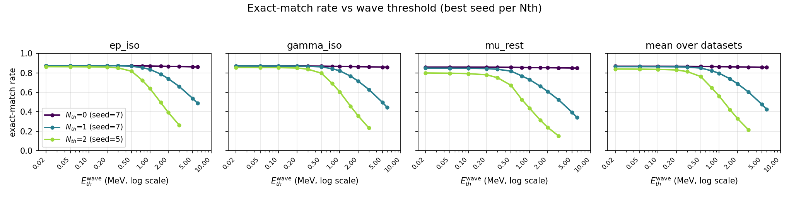
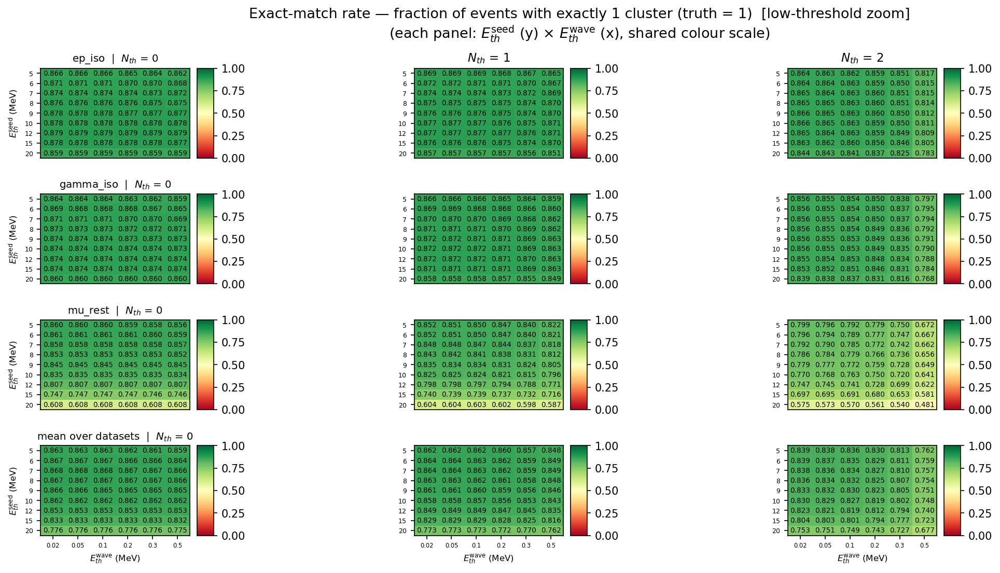

<!-- ---
marp: false
paginate: true
size: 16:9
--- -->

# ECAL 晶体聚类重建算法性能报告

**日期**：2026-10-18  
**对象**：`pytrial/reconstruction.py`（两阈值波前聚类）+ `pytrial/scoring.py`（评估）  
**数据**：MACE Phase-I 模拟，`ep_iso` / `gamma_iso` / `mu_rest` 三个单粒子样本  
**依据**：`results/sweep/` 下三次扫描，共 2301 个参数点（全部在修正后的探测器邻接表上）  
**一句话结论**：算法在单粒子样本上已经触及"能量接受度地板"（准确率 0.868，天花板约 0.875），参数也已经摸清；继续提升的关键不在单粒子，而在**多粒子分辨**与**抗合并/抗分裂的聚类后处理**。

---

## 0. 一页结论

| 问题 | 答案 |
|:--|:--|
| 这个算法做什么？ | 把量能器中属于同一个粒子的晶体能量沉积聚成一个"团簇"，输出每个事例有几个团簇、每个团簇包含哪些晶体 |
| 当前最优参数 | **`Nth = 0`，种子阈值 7 MeV，波前阈值 0.02–0.1 MeV**（推荐取 0.05 MeV） |
| 单粒子准确率 | **86.8%**（三数据集平均；受能量地板限制，实际上限约 87.5%） |
| 能量捕获 | **97.6%** 的事例总能量被收进团簇 |
| 主团簇能量收束 | 平均 **95.6%**，中位数 **99.0%** |
| 主要失败模式 | **12.5% 的事例一个团簇都没有**——不是聚类逻辑错了，而是这些事例本身能量太低（最大晶体 < 7 MeV），任何阈值都无法成簇 |
| 过分裂 | 仅 **0.74%**（≥3 团簇只有 0.01%） |
| 单粒子测试的局限 | 算法在单粒子下几乎是"要么 1 个、要么 0 个"，**测不出多粒子时最要命的"两个簇射粘成一个"** |
| 下一步 | ① 把多个单粒子事例拼成多粒子事例，建立多粒子测试；② 在此基础上加"抗合并"判据和聚类后处理 |
| 单点耗时 | 5 万事例约 **20 秒**（单核）；1116 点用 18 进程约 20–25 分钟 |

---

## 1. 背景与算法

### 1.1 要解决的问题

电磁量能器（ECAL）由许多晶体组成。一个粒子穿过探测器时，会在若干相邻晶体里留下能量沉积；一个事例可能有一个或多个粒子，于是能量分布会形成一簇一簇的"小山包"。

**聚类重建**的任务就是：只看每块晶体的能量，把属于同一个粒子的晶体归到一起，输出"这个事例有几个团簇、每个团簇包含哪些晶体"。

当前测试用的是**单粒子样本**：每个事例按"恰好 1 个初级粒子"构造。因此理想的聚类结果就是**恰好 1 个团簇**。对单粒子样本，只有两种错误：

* **未成簇**：一个团簇都没有（漏掉）；
* **过分裂**：一个簇射被切成 2 个或更多团簇。

多粒子样本还会多出第三种、也是最难处理的错误：**合并**——两个相邻簇射被粘成一个团簇。本报告会在第 4 节说明，为什么单粒子样本看不到这种错误。

### 1.2 核心思想：两个能量阈值 + 波前生长

算法可以想象成"点火"：

1. **找种子（火种）**：从能量最高的晶体开始，如果它的能量超过**种子阈值** `Eth_seed`，并且周围"点亮"的邻居足够多，就把它当作一个团簇的起点。
2. **波前生长（火势蔓延）**：从种子出发，沿着晶体邻居关系一层层向外扩散；只有能量超过**波前阈值** `Eth_wave` 的未聚类邻居才会被吸进来。
3. **换下一个种子**：一个团簇长完后，从剩下的晶体里再找下一个种子，重复上述过程，直到找不到种子。
4. **输出**：每个团簇记录事例编号和晶体列表。

三个参数各管一件事：

| 参数 | 通俗解释 | 调高会怎样 | 调低会怎样 |
|:--|:--|:--|:--|
| `Eth_seed`（种子阈值） | "多高能量才有资格当火种" | 更保守：噪声种子少，但会漏掉软簇射（未成簇增加） | 更激进：软簇射也能起簇，但低能噪声容易生成多余团簇 |
| `Eth_wave`（波前阈值） | "多软的晶体才能被火烧到" | 只收簇射核心：能量闭合变差，簇射容易被切断、分裂 | 把外圈软沉积也收进来：能量更完整，但相邻簇射容易被软沉积"桥接"而合并 |
| `Nth`（近邻数阈值） | "火种周围至少要有几个已点亮的邻居" | 更抗噪，但典型单粒子簇射只有约 4–8 块点亮晶体，要求太高会大量丢事例 | 不要求邻居，接受度最高，但噪声种子也更容易起簇 |

一句话记忆：**`Eth_seed` 管"敢不敢起簇"，`Eth_wave` 管"往外吸多软"，`Nth` 管"种子要多孤立才被认可"。**

需要特别指出，当前算法**没有**做以下事情：

* 没有"能量山谷/势垒"判据——只要邻居能量够，波前就会穿过去，因此两个相邻簇射之间的软沉积可能把它们连成一个；
* 没有局部极大值/分水岭种子——种子只按全局能量从高到低选，先到先得；
* 没有分裂/合并后处理——晶体被某个种子吸收后不再重新分配；
* 没有使用晶体坐标、簇射形状或时间信息——"相邻"完全由探测器邻接表定义。

这些"没有"正是第 4 节改进方向的来源。

### 1.3 当前聚类流程

```text
一个事例：568 块晶体的能量
        │
        ▼
按能量从高到低找种子（E ≥ Eth_seed，且 ≥ Nth 个邻居 E ≥ Eth_wave）
        │
        ▼
从种子沿邻居向外生长（只吸收 E ≥ Eth_wave 的未聚类晶体）
        │
        ▼
得到一个团簇 → 记录晶体列表
        │
        ▼
还有种子吗？──是──> 回到"找种子"
        │否
        ▼
输出：这个事例的所有团簇
```

实现细节、伪代码、复杂度和回退逻辑见**附录 B**。

---

## 2. 测试方法

### 2.1 测试样本

| 样本 | 物理含义 | 平均总能量 | 平均点亮晶体数 | 特点 |
|:--|:--|--:|--:|:--|
| `ep_iso` | 电磁簇射 | 46.5 MeV | 7.8 | 能量较高，最容易 |
| `gamma_iso` | 光子簇射 | 45.4 MeV | 6.9 | 与电磁样本接近 |
| `mu_rest` | μ 静止衰变 | 32.0 MeV | 6.6 | 能谱最软，最难 |

每个样本有 100 万事例；参数扫描用前 5 万事例（1M 的 5%），以兼顾统计量和耗时。详细的数据结构、邻接表统计和原始数据处理见**附录 A**。

### 2.2 测试指标

对单粒子样本（真值 = 1），核心指标是：

| 指标 | 通俗解释 | 目标 |
|:--|:--|:--|
| **准确率**（exact-match） | 团簇数正好等于 1 的事例比例 | 越高越好 |
| **未成簇率** | 一个团簇都没有的事例比例 | 越低越好 |
| **过分裂率** | 团簇数 ≥2 的事例比例 | 越低越好 |
| **MAE** | 团簇数与 1 的平均偏差 | 越低越好 |
| **能量捕获率** | 被团簇收进去的能量 / 事例总能量 | 越高越好 |
| **主团簇收束率** | 最大团簇的能量 / 事例总能量 | 越高越好 |
| **未聚类能量** | 1 − 能量捕获率 | 越低越好 |

指标的精确定义、分母和计算细节见**附录 C**。

> **单粒子指标有一个天生的天花板**：如果某个事例的所有晶体能量都低于种子阈值，那么无论算法多好，都不可能成簇。因此"准确率"的上限不是 1，而是"至少有一个晶体超过种子阈值"的事例比例。这一点是理解后文结果的关键。

### 2.3 扫描参数集

三次扫描逐步细化，全部使用相同的 3 个数据集、每个 5 万事例：

| 轮次 | 目的 | 种子阈值 (MeV) | 波前阈值 (MeV) | `Nth` | 点数 |
|:--|:--|:--|:--|:--|--:|
| 26-09-23 | 正确拓扑上的首次全扫描（粗网格） | 5, 7, 10, 12, 15, 20 | 0.5, 1, 2, 3, 5, 8, 12 | 0, 1, 2, 3 | 420 |
| 26-10-16 | 加密波前阈值，按 `Nth` 分面板 | 同上 | 0.1 … 12（16 点） | 0, 1, 2 | 765 |
| 26-10-16-refined | 补 <0.1 MeV 平台、加密 5–10 MeV 种子 | 5, 6, 7, 8, 9, 10, 12, 15, 20 | 0.02, 0.05, 0.1 … 12（16 点） | 0, 1, 2 | 1116 |

合计 **2301 个参数点**。完整的参数网格和复现命令见**附录 D**。

---

## 3. 测试结果

### 3.1 总体最优

三次扫描各自的最优点（三数据集平均）：

| 轮次 | 最优点 | 准确率 | 能量捕获 |
|:--|:--|--:|--:|
| 26-09-23 | `Nth=0, seed=7, wave=0.5` | 0.8660 | 0.9613 |
| 26-10-16 | `Nth=0, seed=7, wave=0.1` | 0.8677 | 0.9755 |
| **26-10-16-refined** | **`Nth=0, seed=7, wave=0.02`** | **0.8678** | **0.9764** |

从 0.5 MeV 降到 0.1 MeV 带来的提升最明显（准确率 +0.17 个百分点、能量捕获 +1.4 个百分点）；从 0.1 MeV 再降到 0.02 MeV 已经没有实质变化（+0.01 / +0.09 个百分点）。**所以 0.02–0.1 MeV 是一个平台，推荐取中间的 0.05 MeV。**

最优点（`Nth=0, seed=7, wave=0.02`）的完整表现：

| 指标 | 数值 |
|:--|--:|
| 准确率 | **86.78%** |
| 过分裂率 | 0.74% |
| 未成簇率 | 12.48% |
| 平均团簇数 | 0.883 |
| MAE | 0.132 |
| 能量捕获 | **97.64%** |
| 主团簇收束（均值 / 中位数） | 95.59% / 99.00% |
| 未聚类能量 | 2.36% |
| 收束 ≥90% 的事例比例 | 93.05% |
| 全部能量收进团簇（单团簇且 ≥99.9%） | 约 36% |

最后一行值得单独说明：准确率是 86.8%，但"能量完全闭合且只有一个团簇"只有约 36%。也就是说，**很多事例虽然只给出 1 个团簇，但仍有平均约 4% 的软能量留在团簇外**。如果物理分析要求能量闭合，需要更低的波前阈值，或者加"回收未聚类软晶体"的后处理。

### 3.2 三个参数分别起什么作用

#### （1）`Nth`：最重要的参数，0 和 1 几乎等价，2 起明显变差

在 `seed=7, wave=0.02` 下（三数据集平均）：

| `Nth` | 准确率 | 能量捕获 | 未成簇率 |
|--:|--:|--:|--:|
| 0 | **0.8678** | **0.9764** | 0.1248 |
| 1 | 0.8641 | 0.9723 | 0.1309 |
| 2 | 0.8376 | 0.9480 | 0.1605 |

* `Nth=0 → 1` 只损失 0.37 个百分点，基本可以认为等价；
* `Nth=0 → 2` 损失约 3 个百分点；
* 作为参考，粗扫描中 `Nth=3`（wave=0.5）只有 0.5333，比 `Nth=0` 低约 33 个百分点，已不可用。

原因很直观：一个典型的单粒子电磁簇射只有约 4–8 块点亮晶体（均值 6.6–7.8），晶体间距（约 46 mm）已经接近簇射的横向尺度。要求种子周围有 2–3 个点亮邻居，等于要求簇射"又宽又亮"，会直接抹掉大量低能簇射。

**结论：如果只关心单粒子接受度，`Nth` 取 0 或 1；不要把邻居数要求放在种子上。**

#### （2）`Eth_wave`：单调的"过分裂 / 丢能量"旋钮，转折在 0.3–2 MeV

以 `Nth=1, seed=7` 为例（三数据集平均）：

| 波前阈值 (MeV) | 0.02 | 0.1 | 0.3 | 0.5 | 1.0 | 2.0 | 3.0 | 5.0 |
|:--|--:|--:|--:|--:|--:|--:|--:|--:|
| 准确率 | **0.8641** | 0.8634 | 0.8588 | 0.8493 | 0.7957 | 0.6876 | 0.6042 | 0.4758 |
| 能量捕获 | 0.9723 | 0.9708 | 0.9622 | 0.9440 | 0.8698 | 0.7371 | 0.6395 | 0.4959 |
| 未聚类能量 | 0.0277 | 0.0292 | 0.0378 | 0.0560 | 0.1302 | 0.2629 | 0.3605 | 0.5041 |

* **0.02–0.1 MeV 是平台**：三者准确率差 <0.001，能量捕获差 <0.002；
* **0.2 MeV 起开始塌落**，0.5 MeV 已损失 1.5 个百分点准确率、2.8 个百分点能量捕获；1 MeV 损失 6.8 / 10 个百分点；
* 低阈值没有带来"噪声过分裂"：`frac_3plus`（≥3 团簇比例）在 0.02–0.2 MeV 基本不变（约 10⁻⁴ 量级），平均团簇数也几乎不变。低阈值多吸进来的是同一簇射的外圈软沉积，而不是新的独立团簇。

**结论：`Eth_wave` 应压到 0.02–0.1 MeV；0.1 MeV 以上每抬高一点，都在用"分裂/漏能量"换"少收软沉积"，得不偿失。**



*图 1：准确率随波前阈值的变化（对数横轴）。三条曲线在 0.02–0.1 MeV 重合，之后按 `Nth` 由小到大依次提前塌落。*



*图 2：0.02–0.5 MeV 低阈值放大热图。行是数据集（含平均），列是 `Nth`；0.02/0.05/0.1 三列几乎同色，平台一目了然。*

#### （3）`Eth_seed`：6–8 MeV 是一个宽平台，峰值在 7

在 `Nth=0, wave=0.02` 下（三数据集平均）：

| 种子阈值 (MeV) | 5 | 6 | **7** | 8 | 9 | 10 | 12 | 15 | 20 |
|:--|--:|--:|--:|--:|--:|--:|--:|--:|--:|
| 准确率 | 0.8634 | 0.8670 | **0.8678** | 0.8674 | 0.8655 | 0.8625 | 0.8534 | 0.8326 | 0.7755 |
| 能量捕获 | 0.9791 | 0.9778 | 0.9764 | 0.9748 | 0.9729 | 0.9706 | 0.9642 | 0.9483 | 0.8941 |
| 未成簇率 | 0.1207 | 0.1225 | 0.1248 | 0.1276 | 0.1310 | 0.1350 | 0.1452 | 0.1669 | 0.2244 |

* 6–8 MeV 是一个很宽的平台，峰值在 7；6 和 7 只差 0.08 个百分点；
* 种子再低（5 MeV）会放进更多低能噪声簇；再高（≥9 MeV）开始丢掉真实簇射的软事例，未成簇率单调上升；
* **准确率和能量捕获的最优种子并不完全相同**：种子 5 MeV 的能量捕获最高（0.9791），但准确率稍低（0.8634）。如果物理目标偏能量闭合，可以取 5–6 MeV。

**结论：`Eth_seed` 取 6–8 MeV 都可以，默认 7 MeV 是稳妥选择。**

### 3.3 三个样本的差异

在共同工作点（`Nth=0, seed=7, wave=0.05`）：

| 样本 | 准确率 | 过分裂率 | 未成簇率 | MAE | 能量捕获 | 主团簇收束 |
|:--|--:|--:|--:|--:|--:|--:|
| `ep_iso` | 0.8741 | 0.82% | 11.77% | 0.126 | 0.9787 | 95.80% |
| `gamma_iso` | 0.8709 | 0.55% | 12.36% | 0.129 | 0.9835 | 97.99% |
| `mu_rest` | 0.8583 | 0.88% | 13.29% | 0.142 | 0.9661 | 92.87% |

`mu_rest` 在三个指标上都最差，过分裂率也最高。原因是它最"软"：平均总能量 32 MeV，比电磁样本低约 30%，最大晶体能量的中位数只有 23 MeV，更多事例落在种子阈值附近——既容易掉到接受度地板以下，也更容易在低阈值下产生次要簇。

各数据集单独调参的最优结果：

| 样本 | 最优点 | 准确率 | 能量捕获 |
|:--|:--|--:|--:|
| `ep_iso` | `Nth=0, seed=12, wave=0.02` | **0.8790** | 0.9771 |
| `gamma_iso` | `Nth=0, seed=12, wave=0.02` | 0.8744 | 0.9824 |
| `mu_rest` | `Nth=0, seed=6, wave=0.02` | 0.8614 | 0.9694 |

### 3.4 失败模式与接受度地板

在最优点，失败模式非常集中：

| 结果 | 比例 |
|:--|--:|
| 0 团簇（未成簇） | **12.48%** |
| 1 团簇（正确） | **86.78%** |
| 2 团簇（过分裂） | 0.73% |
| ≥3 团簇 | 0.01% |

在"至少给出 1 个团簇"的事例中，过分裂率只有 **0.85%**。也就是说，**当前算法在单粒子样本上几乎是"要么 1 个、要么 0 个"**。

那 12.48% 的未成簇是怎么来的？它和"最大晶体能量是否超过种子阈值"完全对应：

| 种子阈值 | 5 MeV | 7 MeV | 10 MeV | 12 MeV | 15 MeV | 20 MeV |
|:--|--:|--:|--:|--:|--:|--:|
| 最大晶体能量低于阈值的比例（三样本平均） | 12.07% | **12.48%** | 13.50% | 14.52% | 16.69% | 22.44% |
| 实测未成簇率（`Nth=0`） | 12.07% | **12.48%** | 13.50% | 14.52% | 16.69% | 22.44% |

两行完全一致。这说明：**单粒子阶段的"未成簇"是能量接受度地板，不是聚类逻辑的失败**。这些事例的总沉积很低：约 11–12% 的事例总能量低于 1 MeV，而 `P(max E < 种子阈值)` 正好等于未成簇率；没有任何阈值能让它们成簇。算法在单粒子样本上能做的，已经接近极限。

还要注意统计误差：5 万事例下，单数据集准确率的标准误约 **0.15 个百分点**，三数据集平均约 **0.087 个百分点**。因此：

* seed 6/7/8（0.8670/0.8678/0.8674）之间、wave 0.02/0.05/0.1（0.8678/0.8677/0.8677）之间的差异**都在 1–2 个标准误内，不能当作真实排序**；
* 只有 ≥1 个百分点的差异（如 `Nth` 0→2、wave 0.1→0.5、seed 7→12）才是稳健的。

**所以正确的说法是"平台/区间"，而不是"精确最优点"。**

### 3.5 性能

* 单点（5 万事例、单核）：约 **20 秒**（重建 16.5 秒 + 评估 3.5 秒）；
* 100 万事例：约 **7 分钟/点**（单核）；
* 1116 点扫描：约 **6.2 CPU 小时**，用 18 个进程约 **20–25 分钟**（理想情况）；
* 当前实现有一个潜在的性能隐患：波前去重使用线性扫描，若多粒子/低阈值导致"数百块晶体的大团簇"，时间复杂度会退化。单粒子样本最大团簇只有 17 块，尚未触发。详见**附录 B/E**。

---

## 4. 问题与后续方向

### 4.1 核心问题：单粒子测试已经饱和

* 最优点准确率 0.8678，天花板 0.8752，**只差 0.7 个百分点**；
* 过分裂只有 0.74%，≥3 团簇只有 0.01%；
* 参数平台内的差异都在统计误差量级。

**继续在单粒子样本上扫参数、换阈值，收益已经非常有限。** 当前最需要的不是"再调一个参数"，而是**换一个能区分算法优劣的测试集**。

单粒子样本还有两个结构性盲点：

1. 它只能测"漏掉"和"分裂"，**测不到"合并"**；
2. 它没有"两个簇射有多近"这个变量，因此无法评价算法在不同重叠程度下的表现。

### 4.2 方向一：拼接单粒子事例，测试多粒子分辨能力

**这是优先级最高的方向**，因为它是判断"算法改进是否有意义"的前提。

#### 为什么必须做

* 单粒子下算法几乎不分裂（0.85%），**无法暴露多粒子时最主要的失效模式——两个相邻簇射经软沉积桥接被合并成一个团簇**；
* 当前所有指标都只对"团簇数 = 1"敏感，无法评价"能否把 N 个簇射分成 N 个团簇"；
* 没有多粒子真值，任何"改进算法"的说法都缺乏判据。

#### 怎么做

把 N 个单粒子事例的晶体能量逐块相加，合成一个多粒子事例，同时保留每个初级粒子原来的能量分布（真值）。建议：

1. **逐初级记录真值**：拼接前保留每个单粒子事例的晶体能量图，拼接后记录"每块晶体属于哪个初级粒子"（或标记为重叠/共享）。
2. **控制重叠**：按能量加权质心计算每个簇射的位置，要求两两质心距离大于 R（例如 2–3 个晶体间距），并单独留出"允许重叠"的子样本；扫描距离，得到"合并率随距离变化"的曲线。
3. **扫描重数**：N = 1, 2, 3, 4, 5；每档至少 2 万事例；可以固定总能量或固定单粒子能量。
4. **混合粒子种类**：至少覆盖"同种相邻"和"异种相邻"。

现有的 `evt_stitch_child.py` 不能直接用：它只存了总粒子数 `NTrack`，没有逐初级的晶体归属，也没有控制空间重叠；输入文件还是已废弃的旧文件。细节见**附录 E**。

#### 看什么指标

除了现有的"团簇数是否等于 N"，还要加簇级匹配指标：

| 指标 | 含义 |
|:--|:--|
| **簇级效率** | 每个真实簇射被找回的比例 |
| **簇级纯度** | 每个重建团簇中属于同一个真实簇射的能量比例 |
| **合并率** | 两个真实簇射被合成一个团簇的比例 |
| **分裂率** | 一个真实簇射被拆成多个团簇的比例 |
| **合并率 vs 距离** | 横轴是两簇射质心距离，纵轴是合并率——这是最能说明算法好坏的曲线 |

#### 建议的成功判据

* N=2–3 时，能正确分出 N 个团簇的比例达到单粒子准确率的 80% 左右；
* 两簇射相距 2 个晶体间距时，合并率低于 10%；
* 单粒子准确率不低于 0.86（不能为了多粒子牺牲单粒子）；
* 能量捕获不低于 0.97。

这些是建议目标，不是现有结果。

### 4.3 方向二：改进算法

按"预期收益 / 实现成本"排序，建议如下：

| 方向 | 核心改动 | 新增参数 | 预期收益 | 成本 |
|:--|:--|:--|:--|:--|
| **A. 抗合并** | 波前传播时不允许沿能量陡降方向走（"势垒感知"） | 能量比阈值 α 或 β | 显著降低相邻簇射合并 | 中 |
| **B. 更好的种子** | 种子必须是局部极大值，或用"突出度"排序（分水岭） | 突出度阈值 | 减少"一个簇射的种子被另一个抢走" | 中 |
| **C. 聚类后处理** | 对已生成的团簇做分裂、合并、边界重分配、去噪、能量回收 | 最小簇能量、合并距离 R、最小晶体数 | 修正残余的合并/分裂，提高能量闭合 | 中高 |
| **D. 自适应阈值** | `Eth_wave` 随种子能量缩放，而不是全局固定 | 缩放系数 γ | 兼顾高能簇射与低能簇射 | 低 |
| **E. 几何/形状** | 使用晶体坐标、质心、簇射宽度，而不只是邻接表 | 半径/宽度阈值 | 判据更物理，可输出簇射位置 | 中 |
| **F. 机器学习** | 用 GNN/分类器学习边界晶体归属 | 网络超参数 | 潜力大，但需要多粒子真值 | 高 |
| **G. 性能** | 去重改集合、numpy 向量化、C++/numba | — | 10–100 倍加速 | 低中 |

下面用尽量少的术语解释最关键的三个。

#### A. 抗合并：势垒感知的波前

当前波前只看"邻居能量是否超过 `Eth_wave`"，不看"从父晶体到邻居是不是一路下坡"。两个相邻簇射之间的软沉积会把它们连成一个连通区，波前就顺着这座"软桥"走过去，把两个簇射合成一个。

改进思路：传播时额外要求邻居能量不低于父晶体的某个比例：

```text
允许 c → nb 传播，当且仅当
    E[nb] ≥ Eth_wave
    且 E[nb] ≥ α · E[c]          （α 例如 0.05–0.3）
```

物理含义：要求能量沿传播方向缓慢下降，遇到深谷就停。预期对单粒子接受度影响很小（单粒子簇射本身是单峰），但能明显降低多粒子合并率。代价是需要多粒子样本才能标定 α。

#### B. 更好的种子：局部极大值 / 分水岭

当前种子按全局能量从高到低选，先到先得。多粒子时，一个高能簇射的某个晶体可能先做种子，把另一个簇射的种子"吃掉"。

改进思路：种子必须是**局部极大**（能量高于所有邻居），或者用**突出度**（局部极大相对最近鞍点的高度）排序；更彻底的做法是分水岭：每个"山头"一个种子，晶体按"最陡上升"归属。这样两个簇射各有一个种子，不容易互相吞并。

#### C. 聚类后处理

即使波前有势垒，仍可能有残留的合并或碎片。可以加一层后处理：

| 操作 | 规则 | 目的 |
|:--|:--|:--|
| 分裂（split） | 含 ≥2 个局部极大的团簇，按局部极大做 k-means/watershed/图割 | 拆开被合并的簇射 |
| 合并（merge） | 两团簇质心距离 < R 且连接处能量 > 阈值 | 合并同一簇射的碎片 |
| 重分配（reassign） | 边界晶体按"到各种子质心的距离/能量"重新分配 | 修正"先到先得"的偏差 |
| 去噪（noise cut） | 去掉能量或晶体数低于阈值的团簇 | 抑制低能噪声簇 |
| 能量回收 | 把团簇外、仍高于更松阈值的软晶体按最近邻回收 | 提高能量闭合（当前均值 95.6%） |

这些操作都需要多粒子样本调参；单粒子样本只能验证"不破坏已有接受度"。

#### D–G. 其他方向

* **自适应阈值**：`Eth_wave` 不再固定，而是 `max(E0, γ·E_seed)`。高能簇射用更高绝对阈值，低能簇射保留低阈值，兼顾两头。
* **几何/形状**：引入晶体三维坐标、能量加权质心、簇射宽度（Molière 半径），用距离和形状区分"单簇射软尾"与"第二个簇射"，同时输出簇射位置/方向供下游使用。
* **机器学习**：以晶体为节点、能量/邻居能量/坐标为特征，用 GNN 或逐晶体分类器学习边界归属。需要多粒子真值；建议在 A–C 建立基线后再上。
* **性能**：把波前去重的线性扫描改成集合/布尔数组，消除 O(k²)；用 numpy 向量化、numba/C++ 重写热循环。`cpp/Reconstruction.C` 是旧副本，有语法错误，不建议直接用。

### 4.4 建议的工作包

| 工作包 | 内容 | 产出 | 优先级 |
|:--|:--|:--|:--|
| **W1** | 新拼接器：N=1–5、逐初级真值、重叠控制、混合种类 | 多粒子样本 + 拼接说明 | ★★★ |
| **W2** | 当前算法在多粒子样本上的基线：准确率、合并/分裂率 vs 距离 | 基线报告 + 曲线 | ★★★ |
| **W3** | 势垒感知波前 + 局部极大种子；在多粒子样本上扫描 | 改进前后对比 | ★★☆ |
| **W4** | 后处理：split/merge/reassign/noise cut/能量回收 | 后处理模块 + 对比 | ★★☆ |
| **W5** | 性能：集合去重、numpy/C++，把单点从 20 秒降到 <5 秒 | 加速版 | ★☆☆（可与 W3 并行） |
| **W6** | （可选）GNN/逐晶体分类器 | 探索性 | ★☆☆ |

### 4.5 当前推荐工作点（单粒子）

| 目标 | 建议 |
|:--|:--|
| 单粒子簇数最准 | **`Nth=0, Eth_seed=7 MeV, Eth_wave=0.05 MeV`**（0.02/0.05/0.1 统计等价，取平台中央更稳） |
| 兼顾能量捕获 | `Nth=0, Eth_seed=6 MeV, Eth_wave=0.02 MeV` |
| 能量优先 | `Nth=0, Eth_seed=5 MeV, Eth_wave=0.02 MeV` |
| `mu_rest` 专用 | `Nth=0, Eth_seed=6 MeV, Eth_wave=0.02 MeV` |
| 抗噪（种子需 ≥1 邻居） | `Nth=1, Eth_seed=7 MeV, Eth_wave=0.05 MeV` |
| 不建议 | `Nth=2` 及任何 `Eth_wave ≥ 1 MeV` 的组合 |

---

## 5. 结论

1. **算法已经是一个可靠的超阈值聚类器**：最优参数下，单粒子准确率 **86.8%**、能量捕获 **97.6%**、主团簇收束中位数 **99.0%**、过分裂 **0.74%**。
2. **单粒子接受度已到顶**：12.5% 的未成簇完全由"最大晶体能量低于种子阈值"解释，与聚类逻辑无关；最优点的准确率与天花板只差 0.7 个百分点。
3. **参数已经摸清**：`Nth` 是主导参数（0≈1 ≫ 2 ≫ 3）；`Eth_wave` 是单调旋钮，平台 0.02–0.1 MeV、转折 0.3–2 MeV；`Eth_seed` 平台 6–8 MeV。平台内的差异多在统计误差内，应表述为区间而非精确点。
4. **下一步的瓶颈不是单粒子，而是多粒子**：单粒子下算法几乎不分裂，测不出"相邻簇射合并"这一多粒子主要失效模式。**必须先建立多粒子拼接样本与簇级匹配指标，再谈算法改进。**
5. **改进方向明确**：势垒感知传播、局部极大/分水岭种子、聚类后 split/merge/reassign、自适应阈值、几何/形状判据；性能上把线性去重改成集合，并考虑 C++/numba。
6. **工程注意事项**：计数截断已修；波前断流回退是启发式规则；`lit_energy_missed_fraction` 只作相对诊断；`chi2/KS` 不是单粒子主指标。详见**附录 E**。

---

# 附录

> 以下内容面向需要复现、修改代码或深入核对数字的项目开发者；普通读者可以跳过。

## 附录 A：数据结构与数据说明

### A.1 输入事例

| 对象 | 类型 / 结构 | 说明 |
|:--|:--|:--|
| `EdepOfEachEvt/Edeps` | `vector<float>`，长度 **568** | 每个事例一条；第 *i* 个元素是晶体 *i* 的能量沉积（MeV）；能量为 0 的晶体为零压缩（数组仍存 568 个 float） |
| 事例数 | 三个样本各 **1 000 000** | 扫描使用前 **50 000** 事例（5%） |
| 真值 | 每事例 **恰好 1 个初级粒子** | 当前 processed 文件只有 `Edeps` 分支，**没有 `NTrack`**；单粒子真值由样本构造保证 |

事例级能量分布（前 5 万事例）：

| 样本 | 总能量均值 / 中位数 (MeV) | 最大晶体能量均值 / 中位数 (MeV) | 点亮晶体数均值 / 中位数 | 总能量 <1 MeV 的比例 |
|:--|--:|--:|--:|--:|
| `ep_iso` | 46.5 / 53.9 | 32.6 / 36.2 | 7.8 / 8 | 11.3% |
| `gamma_iso` | 45.4 / 53.1 | 32.9 / 37.0 | 6.9 / 7 | 12.2% |
| `mu_rest` | 32.0 / 35.6 | 22.6 / 23.3 | 6.6 / 7 | 11.0% |

### A.2 拓扑 / 邻接表

| 对象 | 结构 | 统计 |
|:--|:--|:--|
| `ECALCrystalNeighbors/neighbors` | `vector<int>` | 568 条目；每晶体 **4–6 个最近邻，平均 5.83**；晶体间距约 46 mm |
| `ECALCrystalNeighbors/second_neighbors` | `vector<int>` | 568 条目；每晶体 **7–12 个二阶邻居，平均 11.30**，用于波前断流时的回退 |

> **拓扑历史（重要）**：早期 `ecal_neighbor_info_added.root` 的边中位数 434.8 mm（约 9.4 倍晶距），与真实最近邻重合度只有 7.4%。基于旧表的 26-09-14/16 结果已废弃，**不纳入本报告**。本报告所有数字都使用重新生成的 `ecal_neighbor_info.root`（568 条目，已验证）。

### A.3 输出

| 对象 | 结构 | 说明 |
|:--|:--|:--|
| `ECALClusters/EvtID` | `int` | 事例编号 |
| `ECALClusters/ModIDList` | `vector<int>` | 该团簇包含的晶体编号列表 |

每个团簇写一条 entry；没有团簇的事例**不写** entry。这一点在评估时会带来计数截断问题，见附录 E。

### A.4 原始数据与预处理

原始文件是 MACE Phase-I Geant4 输出，含 `G4Run0/ECALSimHit`（逐 hit 的 `ModID`、`Edep`、时间）与 `G4Run0/SimDecayVertex`（次级粒子 PDG）。同一晶体在一个事例中可能出现多次击中；`pre_ana_duplicate_mod_hit` 的统计表明这些重复击中的时间差在 **ns 量级**，来自同一粒子轨迹，因此按晶体**求和**是正确的（`data/read_edep_of_each_evt.C`），不应做时间过滤。

### A.5 数据可用性

processed ROOT 文件由 **Git LFS** 跟踪。若工作区只有 133 字节的指针文件，需要先安装 `git-lfs`，然后：

```bash
git lfs fetch --include="data/processed/**" origin
git lfs checkout
```

本报告使用的三个 processed 文件分别为 77.4 / 71.9 / 70.1 MB，各 100 万事例；拓扑文件 28 KB，568 条目。

---

## 附录 B：算法伪代码、复杂度与实现细节

### B.1 参数与默认值

| 参数 | 类型 | 函数默认 | 作用 |
|:--|:--|--:|:--|
| `Eth_seed` | float (MeV) | 10 | 成为种子所需的最小晶体能量 |
| `Eth_wave` | float (MeV) | 5 | 加入波前/团簇所需的最小晶体能量 |
| `Nth` | int | 3 | 种子所需的点亮邻居数（邻居 E ≥ `Eth_wave`） |
| `n_fallback_chance` | int | 1 | 每个团簇允许的 gap-jumping 次数 |
| `nMod` | int | 568 | 晶体总数（由邻接表条目数确定） |
| `neighbor_file_name` | str | `ecal_neighbor_info.root` | 拓扑文件 |

### B.2 伪代码

```text
load neighbors[], second_neighbors[] from topology (nMod = 568)

for each event:
    E[0..nMod-1] = Edeps padded to nMod
    state[0..nMod-1] = 0                      # 0 = unclustered
    order = indices sorted by E descending
    seed_ptr = 0

    while True:
        # 1) 找下一个种子
        while seed_ptr < nMod and not seedable(order[seed_ptr]):
            seed_ptr += 1
        if seed_ptr == nMod: break

        seed = order[seed_ptr]
        state[seed] = 1
        cluster = [seed]
        wave = neighbors[seed]
        fallback = 0
        level = 1

        # 2) 波前生长
        while wave:
            level += 1
            next_wave = []
            for c in wave:
                last_c = c
                if state[c] == 0 and E[c] >= Eth_wave:
                    state[c] = level
                    cluster.append(c)
                    for nb in neighbors[c]:
                        if nb not in next_wave:
                            next_wave.append(nb)

            # 3) gap-jumping：本层没有新晶体时，跳到最后一个访问晶体的二阶邻居
            if not next_wave and fallback < n_fallback_chance:
                next_wave = second_neighbors[last_c]
                fallback += 1

            wave = next_wave

        emit cluster (EvtID, cluster)

    seedable(c) := state[c] == 0
                    and E[c] >= Eth_seed
                    and count(nb in neighbors[c] with E[nb] >= Eth_wave) >= Nth
```

### B.3 复杂度

| 环节 | 复杂度 | 说明 |
|:--|:--|:--|
| 按能量排序 | O(nMod log nMod) / 事例 | 纯 Python `sorted` |
| 种子扫描 | O(nMod × deg) / 事例 | 每个晶体最多检查一次；`deg ≈ 5.8` |
| 波前生长 | O(Σ 访问晶体 × deg × dedup) | 每个已聚类晶体最多访问一次 |
| `nb not in next_wave` | **O(frontier²) 最坏** | 使用 Python list 线性扫描；大团簇时会变慢 |
| 单点实测 | **≈ 20 s / 5 万事例** | 重建 16.5 s + 评估 3.5 s（单核，空载） |

单粒子样本最大团簇 17 块（均值 7），尚未触发严重退化。

### B.4 输出与回退行为

* BFS 层数 `level` 被记录但下游未使用；输出只保留成员关系。
* `n_fallback_chance` 默认 1，即每个团簇最多回退一次；回退使用 `wave` 循环最后一个晶体 `last_c` 的二阶邻居，可能产生非局部连接。
* 算法没有分裂/合并后处理；晶体一旦被吸收，不会重新分配。

---

## 附录 C：指标定义、完整数值与统计细节

### C.1 计数类

| 指标 | 定义 |
|:--|:--|
| `exact_match_rate` | `n_clusters == 1` 的比例 |
| `over_cluster_rate` | `n_clusters > 1` 的比例 |
| `under_cluster_rate` | `n_clusters < 1`（即 0 团簇）的比例 |
| `MAE` | `mean(|n_clusters − 1|)` |
| `RMSE` | `sqrt(mean((n_clusters − 1)²))` |
| `bias` | `mean(n_clusters) − 1` |
| `frac_0/1/2/3plus` | 团簇数为 0/1/2/≥3 的比例 |

### C.2 能量类

| 指标 | 定义 / 分母 |
|:--|:--|
| `energy_captured_fraction` | Σ(所有团簇能量) / Σ(事例总能量) |
| `energy_containment_mean/median` | 领头团簇能量 / 事例总能量 |
| `energy_split_fraction` | (Σ团簇能量 − 领头团簇能量) / 总能量 |
| `energy_unclustered_fraction` | 1 − captured（**绝对量，推荐**） |
| `lit_energy_missed_fraction` | 高于 `Eth_wave` 但未被团簇吸收的能量 / 高于 `Eth_wave` 的总能量（**阈值相对量，仅诊断**） |
| `frac_events_containment_ge_90` | 领头团簇收束 ≥90% 的事例比例 |
| `frac_events_all_energy_one_cluster` | 所有团簇能量之和 ≥99.9% 的事例比例；**分母为总能量 >0 的事例**。历史列名是 "one_cluster"，但实现量是"所有团簇之和"；严格"单团簇且 ≥99.9%"在本样本下只差 <0.2 pp |

### C.3 统计量

| 指标 | 说明 |
|:--|:--|
| `chi2_ndf` | 团簇数分布对 Poisson(λ=1) 的 χ²/ndf |
| `ks_D` | 团簇数分布对 Poisson(1) 的 KS 距离 |

> 单粒子真值是确定的 1，不是 Poisson(1)；这两个量只作为"分布是否向 0 堆积"的粗诊断，**不是主要优化目标**。

### C.4 统计误差

`exact_match_rate` 是二项比例。5 万事例、p ≈ 0.87 时：

* 单数据集标准误 ≈ **0.15 个百分点**；
* 三数据集平均标准误 ≈ **0.087 个百分点**。

平台内 <0.3 个百分点的差异不应视为真实排序。

### C.5 最优点完整数值（三数据集平均，`Nth=0, seed=7, wave=0.02`）

| 指标 | 值 |
|:--|--:|
| `exact_match_rate` | 0.8678 |
| `over_cluster_rate` | 0.0074 |
| `under_cluster_rate` | 0.1248 |
| `MAE` | 0.1323 |
| `RMSE` | 0.3640 |
| `bias` | −0.1172 |
| `mean_clusters` | 0.8828 |
| `frac_0 / 1 / 2 / 3plus` | 0.1248 / 0.8678 / 0.0073 / 0.0001 |
| `energy_captured_fraction` | 0.9764 |
| `energy_containment_mean / median` | 0.9559 / 0.9900 |
| `energy_split_fraction` | 0.0022 |
| `energy_unclustered_fraction` | 0.0236 |
| `frac_events_containment_ge_90` | 0.9305 |
| `frac_events_all_energy_one_cluster` | 0.3627（严格单团簇：0.3609） |

---

## 附录 D：扫描参数集与复现

### D.1 完整网格

| 轮次 | `Eth_seed` (MeV) | `Eth_wave` (MeV) | `Nth` | 点数 |
|:--|:--|:--|:--|--:|
| 26-09-23 | 5, 7, 10, 12, 15, 20 | 0.5, 1, 2, 3, 5, 8, 12 | 0, 1, 2, 3 | 420 |
| 26-10-16 | 5, 7, 10, 12, 15, 20 | 0.1, 0.2, 0.3, 0.5, 0.75, 1, 1.5, 2, 2.5, 3, 4, 5, 6, 8, 10, 12 | 0, 1, 2 | 765 |
| 26-10-16-refined | 5, 6, 7, 8, 9, 10, 12, 15, 20 | 0.02, 0.05, 0.1, 0.2, 0.3, 0.5, 0.75, 1, 1.5, 2, 3, 5, 6, 8, 10, 12 | 0, 1, 2 | 1116 |

所有点均要求 `Eth_wave < Eth_seed`。

### D.2 复现

```bash
cd pytrial

# 26-10-16-refined（1116 点，本报告主数据）
bash sweeps/run_refined.sh              # 扫描 + 分析
bash sweeps/run_refined.sh --csv-only   # 从缓存重建 CSV + 图

# 26-10-16（765 点，config.py 默认网格）
python3 sweeps/run_sweep.py
python3 sweeps/analyze.py

# 26-09-23（420 点，粗网格）
ECAL_SWEEP_RESULTS_DATE=26-09-23 \
ECAL_SWEEP_SEEDS=5,7,10,12,15,20 \
ECAL_SWEEP_WAVES=0.5,1,2,3,5,8,12 \
ECAL_SWEEP_NTHS=0,1,2,3 \
python3 sweeps/run_sweep.py
```

`sweeps/config.py` 的网格支持 `ECAL_SWEEP_SEEDS` / `ECAL_SWEEP_WAVES` 覆盖；`ECAL_SWEEP_RESULTS_DATE` 控制结果目录，`ECAL_SWEEP_TAG` 控制工作区缓存目录，两者已解耦，不同轮次可以并存。

---

## 附录 E：已知问题与修正

1. **`_read_cluster_counts` 计数截断（已修）**  
   团簇树只存"至少 1 个团簇"的事例；原实现用 `max(EvtID)+1` 作为事例总数，若末尾若干事例为 0 团簇，会被静默丢弃。  
   * 影响范围（26-10-16-refined）：1116 点中 **312 点** `N_events < 50000`，全部是 `Nth=1/2` 的高种子/高波前阈值角（最小 44 220）；**所有 `Nth=0` 点与 Top-10 点均为 50 000，不受影响**。  
   * 已修正 `scoring._read_cluster_counts`：提供 `n_events` 时补齐长度。归档 CSV 建议在修正后重打分（只影响极端低接受度角，不改变本报告结论）。

2. **gap-jumping 回退的启发式**  
   `next_wave = sec_neighbors[cur_id]` 使用 `wave` 循环的最后一个 `cur_id`，且每个团簇只触发一次。它可能从"最后访问的晶体"跳到非最邻近的二阶邻居，制造非局部连接。建议改为"从本层能量最高的晶体"或"从断流处最近的晶体"跳。

3. **`lit_energy_missed_fraction` 是阈值相对量**  
   它只统计"高于 `Eth_wave` 的能量"中被漏掉的比例；抬高 `Eth_wave` 会让分母变小，因此不能用于跨阈值比较。绝对比较请用 `energy_unclustered_fraction`。

4. **`chi2_ndf` / `ks_D` 的参考分布不合适**  
   单粒子真值是 1，不是 Poisson(1)；这两个量只作粗诊断。

5. **没有 timing**  
   当前数据只有能量；多粒子/重叠簇射的分离会显著受益于 ns 级时间信息（原始 SimHit 有时间分支，但 processed 文件未保留）。

6. **`frac_events_all_energy_one_cluster` 的语义与分母**  
   历史列名写的是 "one_cluster"，但实现量是"所有团簇能量之和 ≥99.9%"，且分母是**总能量 >0 的事例**。严格"单团簇且 ≥99.9%"在本样本下只差 <0.2 pp。已在 `run_task.py` 中加注释说明。

7. **扫描运行时间受外部 CPU 争用影响**  
   26-10-16-refined 的实际墙钟时间约 1.5–2 小时（18 进程），高于理想的 20–25 分钟；空载实测单点仍为约 20 秒，因此不是算法退化。

8. **旧拼接器 `evt_stitch_child.py` 不可直接复用**  
   它读取已废弃的 `edep_of_each_evt_20260401.root`，只存 `NTrack`，没有逐初级晶体归属，也没有控制空间重叠。新多粒子测试需要重写。

---

## 附录 F：产物索引与术语

### F.1 产物

> 路径相对 `pytrial/results/sweep/`。

| 路径 | 内容 |
|:--|:--|
| `26-09-23/` | 粗网格 420 点；README、CSV、热图 |
| `26-10-16/` | 波前加密 765 点；按 `Nth` 分面板热图、能量指标、剖面 |
| `26-10-16-refined/` | 低阈值 + 种子加密 1116 点；低阈值放大图、最终推荐 |
| `26-10-16-refined/sweep_summary.csv` | 1116 × 32 指标完整记录 |
| `26-10-16-refined/best_params.md` | 各指标最优点、`Nth` 作用、Top-10 |
| `perf_report_1018.md` | 本文件 |

### F.2 术语

| 术语 | 含义 |
|:--|:--|
| 种子（seed） | 开始一个团簇的高能晶体 |
| 波前（wavefront） | 从种子向外逐层传播的邻接晶体集合 |
| 点亮（lit） | 晶体能量 ≥ `Eth_wave` |
| 过分裂（over-split） | 一个真实簇射被重建为 ≥2 个团簇 |
| 合并（merge） | 两个真实簇射被重建为 1 个团簇（单粒子样本无法观测） |
| 接受度地板 | 因总沉积/最大晶体能量低于阈值而无法成簇的事例比例 |
| 收束（containment） | 领头团簇能量 / 事例总能量 |

---

*报告完。所有数字来自 `results/sweep/` 下三次扫描的 CSV；图中路径相对本文件。*
