# ECAL 聚类算法在 γ 本底注入样本上的性能报告

**日期**：2026-11-06  
**对象**：`pytrial/reconstruction.py`（两阈值波前聚类）、`pytrial/bkg_est_add/`（γ 本底模型与注入）、`pytrial/sweeps/`（扫描与评估）  
**数据**：MACE Phase-I 模拟，`ep_iso` / `gamma_iso` / `mu_rest` 三个单粒子信号样本，以及对应的 `*_bkg` 本底注入样本  
**依据**：新扫描 `results/sweep/26-11-06/`（972 个本底点 + 12 个无本底控制点）；无本底基线为 `results/sweep/26-10-16-refined/`（1116 点）与 `perf_report_1018.md`  
**一句话结论**：γ 本底的主要威胁不是能量污染，而是**低种子阈值下由本底 hit 产生的假团簇**。在无本底最优的 `seed=7, Nth=0` 下，`ep_iso` 准确率从 0.874 跌到 0.743；把种子阈值提高到 10–13 MeV（或要求 1 个近邻）后，准确率恢复到 0.878。若三个样本必须共用一组参数，推荐 `Nth=1, seed=8 MeV, wave=0.02–0.05 MeV`；与同参数无本底相比，残余本底代价仅约 0.12 个百分点。

---

## 0. 摘要

| 项目 | 结果 |
|:--|:--|
| 本底模型 | 30 μSv/h、100 ns 时间窗、单 hit 平均 5.0 MeV；每事例 **2.4247** 个本底 hit，91.1% 事例至少 1 个 hit |
| 样本层面的影响 | 平均给每个事例增加 **12.1 MeV**；`ep_iso`/`gamma_iso`/`mu_rest` 的平均总能量从 46.5/45.4/32.0 升到 58.7/57.5/44.1 MeV |
| 共同最优工作点 | **`Nth=1, Eth_seed=8 MeV, Eth_wave=0.02–0.05 MeV`** |
| 共同工作点性能（三样本平均） | 准确率 **0.8614**，重建效率 **0.8668**，信号纯度 **0.9913**，假团簇 **0.001/事例**，信号能量捕获 **0.9687**，本底捕获 **0.0309** |
| 同参数无本底对照 | 准确率 0.8626；**残余本底代价 0.12 个百分点** |
| 相对无本底全局最优 | 无本底最优 0.8678（`seed=7, Nth=0`）；本底共同最优低 **0.64 个百分点**，主要来自参数被迫移动，而非能量污染 |
| 低种子失效 | `seed=7, Nth=0` 时假团簇 **0.187/事例**，准确率从无本底的 0.8678 跌到 **0.7393**（−12.9 个百分点） |
| 单样本最优 | `ep_iso`：`seed=13, Nth=0, wave=0.02` → **0.8783**（无本底 0.8790）；`gamma_iso`：`seed=14, Nth=0` → **0.8739**（0.8744）；`mu_rest`：`seed=7, Nth=1` → **0.8423**（无本底全局最优 0.8614） |
| 能量-效率 | 50% 效率点约在 12–21 MeV（取决于样本）；>40 MeV 后效率 >0.95；本底与无本底曲线在重调参数后几乎重合 |
| 能量响应（E>20 MeV） | 信号部分偏差约 −2% 到 −3.4%，分辨率约 3.8%–6.2%；本底使领头簇能量偏差向正方向移动约 0.8–1.1 个百分点，分辨率变差约 0.8–1.3 个百分点 |
| 主要结论 | 本底不会显著破坏能量重建，但会**改变最优种子阈值**；单粒子指标中的"准确率"必须与纯度/假团簇率一起看，否则会被假团簇虚高 |

---

## 1. 动机与背景

### 1.1 上一阶段的无本底结果

`perf_report_1018.md` 记录了三次无本底扫描合计 2301 个参数点；本报告用其中 refined 主数据 1116 点作为基线。两阈值波前算法在单粒子样本上的最优工作点为 `Nth=0`、`Eth_seed=7 MeV`、`Eth_wave=0.02–0.1 MeV`；三数据集平均准确率 **0.8678**、能量捕获 **0.9764**、主簇收束中位数 **0.9900**；未成簇率 12.48% 与 `P(max E < Eth_seed)` 完全一致，是能量接受度地板；单粒子过分裂仅 0.74%。

这些结果是在**没有探测器本底**的理想样本上得到的。真实探测器工作在环境 γ 本底中，必须回答三个问题：

1. 本底会不会改变最优参数？
2. 本底带来的新失效模式是什么？
3. 重建效率随事例能量如何变化？

### 1.2 本阶段新增的样本

`data/processed/` 新增三个本底注入文件：

```
edep_of_each_evt_ep_iso_bkg.root
edep_of_each_evt_gamma_iso_bkg.root
edep_of_each_evt_mu_rest_bkg.root
```

它们的**事例顺序与无本底文件完全一致**，`Edeps` 为"信号 + 本底"的逐晶体总能量，并新增 `NBkg` 分支记录该事例注入的本底 hit 数。因此对同一事例索引，可以同时读取 `*_bkg` 与无本底文件，把每个重建团簇的晶体能量**逐晶体分解**为信号部分和本底部分。这是本报告所有新指标（纯度、假团簇率、本底捕获率、能量响应）的基础。

> **样本说明（重要）**：`mu_rest` 样本是 **μ 子静止衰变产生的米歇尔电子（Michel electron）** 的事例，不是 μ 子径迹事例。其能谱比 `ep_iso`/`gamma_iso` 更软（平均总能量约 32 MeV），对种子阈值更敏感。旧报告中的"μ 静止衰变"应理解为"μ 静止衰变产生的米歇尔电子"。

#### 1.2.1 探测器、拓扑与文件

MACE ECAL 是 GP(8,0) 球壳量能器：内/外半径 260/540 mm，晶体长 280 mm，共 **568** 个 CsI 晶体（GP(8,0) 的 642 个面减去上下游缺口），总质量约 2331 kg。聚类使用的邻接表 `data/utilities/ecal_neighbor_info.root` 有 568 个节点，每个晶体平均 **5.83** 个直接邻居、**11.30** 个二阶邻居。探测器几何和事件显示见 2026-10 报告/PPT 的 detector/event-map 图；本报告图 3 给出一个含本底事例的显示。

| 文件 | 事例数 | 分支 | 用途 |
|:--|--:|:--|:--|
| `edep_of_each_evt_ep_iso.root` | 1,000,000 | `Edeps` | 无本底 e± 信号 |
| `edep_of_each_evt_gamma_iso.root` | 1,000,000 | `Edeps` | 无本底 γ 信号 |
| `edep_of_each_evt_mu_rest.root` | 1,000,000 | `Edeps` | 无本底 μ→e 米歇尔电子 |
| `edep_of_each_evt_*_bkg.root` | 1,000,000 | `Edeps`, `NBkg` | 信号 + γ 本底 |
| `sweeps/subsets/processed/subset_*.root` | 50,000 | `Edeps`（bkg 子样本含 `NBkg`） | 扫描用子样本 |

### 1.3 本底模型

本底不是直接模拟的，而是用"剂量率 + 假定沉积能谱 + 晶体体积 + 泊松统计"的保守数值方法估计，详见 `pytrial/bkg_est_add/README.md`。核心参数：

| 量 | 值 | 说明 |
|:--|--:|:--|
| 环境剂量率 | 30 μSv/h | 光子取 w_R = 1，1 Sv = 1 Gy |
| 事例时间窗 | 100 ns | 任务给定 |
| 单晶体体积 | 910.086 cm³ | GP(8,0) 棱台精确公式 |
| 晶体数 / 总质量 | 568 / 2331.3 kg | 上下游各一个缺口 |
| 单 hit 平均沉积 | 5.001 MeV | N(5 MeV, 2 MeV²) 截断于 0 |
| 本底事例率 | 2.4247×10⁷ s⁻¹ | 全部晶体 |
| 每事例本底 hit 期望 | **2.4247** | `n_bkg = r_bkg × 100 ns` |
| 泊松概率 | P(0)=0.0885, P(1)=0.2146, P(2)=0.2602, P(3)=0.2103 | 91.1% 事例至少 1 个 hit |

注入时对每个事例抽 `k ~ Poisson(2.4247)`，在 568 个晶体中均匀有放回地抽 `k` 个编号，按截断正态抽 `k` 个能量并累加到 `Edeps`。三个数据集的逐事例回读校验全部 PASS：`NBkg=0` 的事例与原始文件逐位相同，`NBkg>0` 的事例差值最大偏差 **0.000 MeV**，泊松分布与晶体编号均匀性检验 p 值均 >0.3（详见附录 A）。

**模型的主要系统不确定度**：把环境剂量率直接当作 CsI 吸收剂量率（未做 CsI/空气质能吸收系数修正），以及假定沉积谱为 N(5, 2²)。这两项都会带来 O(1) 量级的不确定度；本报告的结果应理解为"在该保守本底模型下的相对趋势"，不应用于绝对产额。

### 1.4 样本层面的本底影响

| 样本 | 信号平均总能量 (MeV) | 含本底平均总能量 (MeV) | 平均本底能量 (MeV) | 信号总能量 <1 MeV | 含本底总能量 <1 MeV |
|:--|--:|--:|--:|--:|--:|
| `ep_iso` | 46.5 | 58.7 | 12.13 | 11.3% | 1.0% |
| `gamma_iso` | 45.4 | 57.5 | 12.14 | 12.2% | 1.1% |
| `mu_rest` | 32.0 | 44.1 | 12.09 | 11.0% | 1.0% |

* 本底平均给每个事例增加约 **12.1 MeV**，约为电磁样本信号能量的 26%、μ 样本的 38%；
* 91% 的事例至少有一个本底 hit；
* 本底 hit 在探测器中是**随机、孤立**的：它们可能单独超过种子阈值形成假团簇，也可能落在信号簇射旁边被波前吸收，污染重建能量。

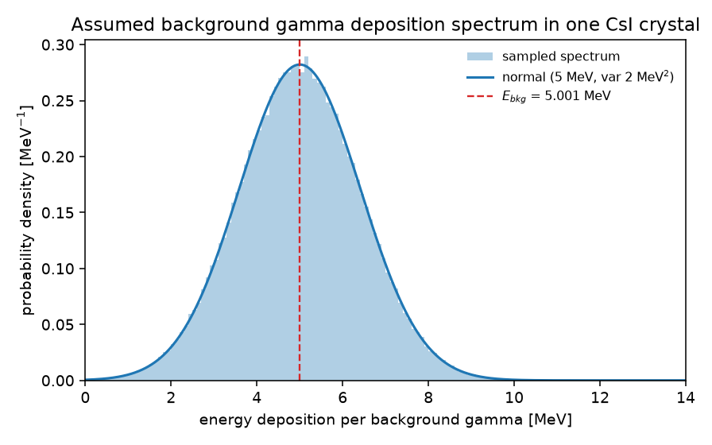

*图 1：模型假定的单 hit 沉积能谱（截断正态，均值 5 MeV）。*

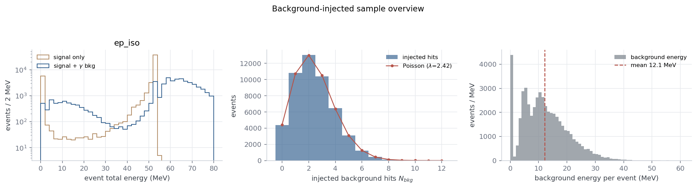

*图 2：本底注入后的样本总览（左：信号与含本底的总能量分布；中：每事例本底 hit 数的泊松分布；右：每事例本底能量，均值约 12.1 MeV）。*

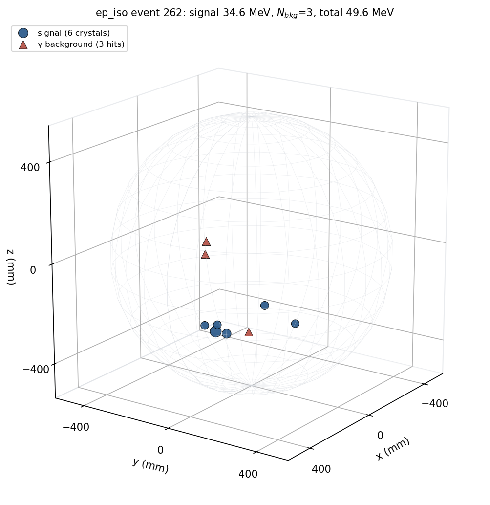

*图 3：一个含本底事例的三维显示（蓝点：信号晶体；红三角：本底 hit）。本底 hit 随机分布在探测器中，通常远离信号簇射；但若落在信号附近，会被波前吸收。*

---

## 2. 算法回顾

算法仍是 `reconstruction.py` 的两阈值波前聚类：

1. **选种**：按晶体能量从高到低扫描，能量 ≥ `Eth_seed` 且至少 `Nth` 个邻居能量 ≥ `Eth_wave` 的未聚类晶体成为种子；
2. **波前生长**：从种子沿邻接表逐层扩散，未聚类且能量 ≥ `Eth_wave` 的邻居入簇；
3. **迭代**：一个团簇长完后，从剩余晶体继续选种，直到没有种子；
4. **输出**：每个团簇写一条 `ECALClusters` entry（`EvtID` + `ModIDList`）。

当前代码与 2026-10 报告相比有一处实现差异：多粒子阶段把 **gap-jumping 回退（无新晶体时跳到二阶邻居）关闭了**。这对准确率影响很小（在测试点上 <0.1 个百分点），但会使能量捕获低约 0.2 个百分点。因此本报告的"无本底对照"优先使用**同一代码、同一网格**重跑的控制点；历史 26-10-16-refined 结果作为大范围参数景观的参考，并在文中明确标注。

算法细节、伪代码和复杂度见 `perf_report_1018.md` 附录 B；本报告不再重复。

---

## 3. 新的评价指标

本底注入后，只数团簇数已经不够：一个由本底 hit 产生的假团簇也可能让"团簇数 = 1"，从而**虚高准确率**。因此新增以下指标（逐事例、逐团簇计算）：

| 指标 | 定义 | 用途 |
|:--|:--|:--|
| 信号能量 `E_sig` | 同一事例在无本底文件中的 `Edeps` 总和 | 横轴"样本事例能量" |
| 本底能量 `E_bkg` | `*_bkg` 总能量 − `E_sig` | 本底污染量 |
| 团簇信号能量 | 团簇成员晶体在无本底文件中的能量和 | 区分信号簇/本底簇 |
| **重建效率** | 团簇数 ≥1 的事例比例 | 是否给出候选簇 |
| 准确率 | 团簇数 = 1 的事例比例 | 单粒子计数正确性 |
| **信号纯度** | Σ团簇内信号能量 / Σ团簇内总能量 | 团簇中信号占比 |
| **假团簇率** | 信号能量 <1 MeV 的团簇数 / 事例数 | 本底造成的假簇 |
| **本底捕获率** | Σ团簇内本底能量 / 事例总本底能量 | 本底被吸进团簇的比例 |
| **领头簇本底占比** | 领头簇内本底能量 / 领头簇总能量 | 能量污染 |
| **信号收束率** | 领头簇内信号能量 / `E_sig` | 信号能量完整性 |
| **能量响应** | `(E_lead − E_sig)/E_sig` 的均值与 RMS | 重建能量偏差/分辨率 |

能量相关曲线按 `E_sig` 分箱（0–5, 5–10, …, 55–60, 60–80 MeV），本底相关曲线按 `NBkg` 分箱（0, 1, 2, 3, ≥4）。能量响应汇总量限制在 `E_sig ≥ 20 MeV` 的信号区，避免低能地板事例主导比值。

> **准确率的陷阱**：在本底样本中，准确率可能**高于**无本底样本，因为一个本底假团簇可以"填补"原本 0 团簇的低能事例。判断算法在本底下的真实表现必须同时看纯度、假团簇率和本底捕获率，不能只看准确率。

---

## 4. 扫描设置

| 项 | 值 |
|:--|:--|
| 数据集 | `ep_iso_bkg`, `gamma_iso_bkg`, `mu_rest_bkg` |
| 事例数 | 每样本前 **50 000**（与无本底扫描一致） |
| `Eth_seed` | 5, 6, 7, 8, 9, 10, 11, 12, 13, 14, 15, 18 MeV（12 点） |
| `Eth_wave` | 0.02, 0.05, 0.1, 0.2, 0.3, 0.5, 0.75, 1.0, 2.0 MeV（9 点） |
| `Nth` | 0, 1, 2 |
| 点数 | 12 × 9 × 3 × 3 = **972**，0 失败 |
| 拓扑 | `ecal_neighbor_info.root`（568 晶体） |
| 无本底对照 | 在共同最优点和各样本最优点用当前代码重跑 12 个控制点 |
| 总耗时 | 972 点约 **67 min**（18 进程并行），单点约 75 s（重建约 30–40 s，含本底分解的评估约 35–45 s） |

种子阈值从 5 MeV 延伸到 18 MeV：本底 hit 的沉积谱均值为 5 MeV，种子阈值必须在"挡住本底假种子"和"保留软信号"之间重新平衡。波前阈值保留 0.02–2.0 的低阈值区，因为无本底扫描已证明 >2 MeV 会严重丢失信号尾部；2.0 MeV 作为高阈值锚点。

---

## 5. 测试结果

### 5.1 最优工作点

#### 每个 `Nth` 的最优点（三样本平均）

| `Nth` | `Eth_seed` (MeV) | `Eth_wave` (MeV) | 准确率 | 效率 | 过分裂 | 假团簇/事例 | 纯度 | 信号捕获 | 本底捕获 | 偏差 (E>20 MeV) |
|--:|--:|--:|--:|--:|--:|--:|--:|--:|--:|--:|
| 0 | 10 | 0.02 | 0.8601 | 0.8656 | 0.0054 | 0.003 | 0.9909 | 0.9684 | 0.0319 | −1.75% |
| **1** | **8** | **0.02** | **0.8614** | **0.8668** | 0.0054 | **0.001** | **0.9913** | **0.9687** | 0.0309 | −1.74% |
| 2 | 6 | 0.02 | 0.8379 | 0.8421 | 0.0042 | 0.001 | 0.9914 | 0.9477 | 0.0298 | −1.64% |

* `Nth=0` 与 `Nth=1` 的最优点只差 **0.13 个百分点**，在统计误差（三样本平均约 0.09 个百分点）内近似等价；
* `Nth=2` 低约 **2.35 个百分点**，主要因为软信号被邻居数要求抹掉；
* 三个 `Nth` 的波前阈值都取在网格下界 0.02 MeV，说明低阈值平台仍然成立。

#### 每个样本的最优点（任意 `Nth`）

| 样本 | `Nth` | `Eth_seed` | `Eth_wave` | 准确率 | 效率 | 纯度 | 假团簇/事例 | 信号捕获 |
|:--|--:|--:|--:|--:|--:|--:|--:|--:|
| `ep_iso` | 0 | 13 | 0.02 | **0.8783** | 0.8802 | 0.9925 | 0.000 | 0.9746 |
| `gamma_iso` | 0 | 14 | 0.02 | **0.8739** | 0.8747 | 0.9928 | 0.000 | 0.9799 |
| `mu_rest` | 1 | 7 | 0.02 | **0.8423** | 0.8550 | 0.9876 | 0.007 | 0.9557 |

* 电磁样本（`ep_iso`/`gamma_iso`）可以用较高的种子阈值（13–14 MeV）把本底假种子压到 0，同时信号几乎不损失；
* `mu_rest` 的能谱更软，种子阈值不能太高，最优退回到 `seed=7, Nth=1`，用"1 个近邻"抑制假种子；
* 三个样本的最优种子差异，正是"共同工作点必须妥协"的原因。

### 5.2 种子阈值：本底抑制的主开关

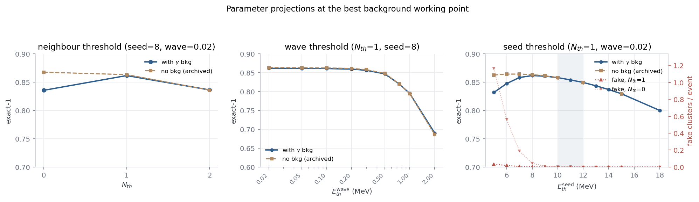

*图 4：在共同最优点（左：`Nth`；中：`Eth_wave`；右：`Eth_seed`）的参数投影。蓝线为含本底，棕色虚线为归档的无本底结果；右图红色虚线为假团簇/事例（`Nth=1` 与 `Nth=0`）。*

无本底时，种子阈值 7 MeV 是最优；加入本底后，**低种子阈值会大量产生假团簇**：

| 工作点（三样本平均） | 准确率 | 假团簇/事例 | 信号纯度 |
|:--|--:|--:|--:|
| `seed=7, Nth=0` | **0.7393** | **0.1872** | 0.9403 |
| `seed=7, Nth=1` | 0.8580 | 0.0062 | 0.9896 |
| `seed=8, Nth=1`（共同最优） | 0.8614 | 0.0014 | 0.9913 |
| `seed=10, Nth=0` | 0.8601 | 0.0030 | 0.9909 |
| 无本底全局最优（`seed=7, Nth=0`） | 0.8678 | — | — |

原因很直接：本底单 hit 的沉积谱均值为 5 MeV，`P(E ≥ 7 MeV) ≈ 16%`；每事例平均 2.4 个 hit，因此约 **0.38 个 hit/事例** 超过 7 MeV。当 `Nth=0` 时，任意一个这样的 hit 都可以单独成为一个种子，形成**假团簇**。把种子阈值提高到 10 MeV，`P(E ≥ 10) ≈ 0.6%`，假种子率降到约 0.015/事例；提高到 13–14 MeV，假种子基本消失。

**两条可用的抗本底策略**：

1. **提高种子阈值**（`Nth=0`，seed≈10–14 MeV）：把本底 hit 挡在种子条件之外，适合电磁样本；
2. **要求 1 个近邻**（`Nth=1`，seed≈7–8 MeV）：相邻晶体同时被本底击中的概率很低，因此近邻要求可以高效抑制孤立假种子，同时保留软信号。

在本扫描中，两条策略的全局平均性能非常接近（0.8601 vs 0.8614）；选择哪一条取决于样本能谱和是否需要保留低能信号。

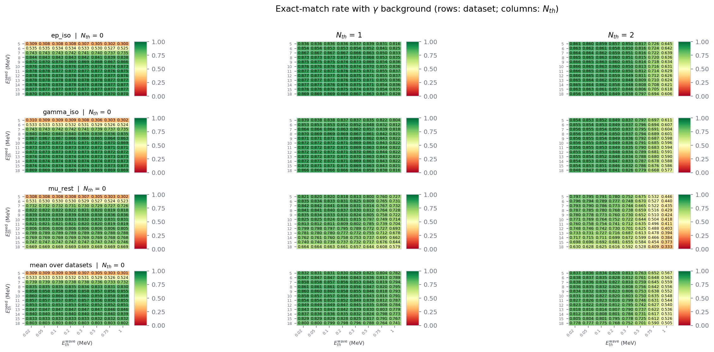

*图 5：含本底准确率热图（行：样本+平均；列：`Nth`）。低种子、`Nth=0` 的红色区域就是假团簇主导区；`Nth=1` 把它压回绿色。*

### 5.3 `Nth`：低种子时需要 1 个近邻，高种子时 0/1 等价

* 在 `seed=7`：`Nth=0` 的假团簇率 0.187，准确率 0.739；`Nth=1` 把假团簇率压到 0.006，准确率回到 0.858；`Nth=2` 虽然假团簇更少，但软信号损失明显（0.8379 的平均最优）。
* 在 `seed=10–14`：`Nth=0` 和 `Nth=1` 的准确率只差 0.1–0.2 个百分点，假团簇都已接近 0；`Nth=2` 仍低约 2.4 个百分点。
* **结论**：本底并不要求 `Nth>1`；一旦种子阈值足够高，`Nth=0` 与 `Nth=1` 等价。`Nth=1` 是更稳健的选择，因为它对低种子/软样本更宽容。

### 5.4 `Eth_wave`：低阈值平台不变，本底污染很小

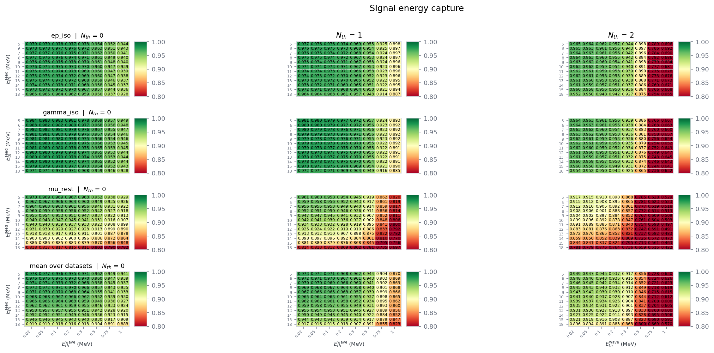

*图 6：信号能量捕获率热图（行：样本+平均；列：`Nth`）。低波前阈值区域捕获率最高；高阈值区域信号尾部丢失。*

* 在共同最优点，`Eth_wave=0.02–0.1 MeV` 是平台；`0.5 MeV` 起准确率/捕获率开始下降，`1–2 MeV` 明显变差。这与无本底结论一致。
* 本底能量污染很小：在最优点，**本底捕获率约 3.1%**，**领头簇本底占比约 0.7%–1.0%**，信号纯度约 **99.0%–99.2%**。低波前阈值多吸进来的主要是信号簇射外圈软沉积，而不是本底（本底 hit 是随机孤立的，落在信号邻域的概率低）。
* 因此，**波前阈值不需要为本底而上调**；保持 0.02–0.1 MeV 既能保留信号能量闭合，又不会显著增加本底污染。

### 5.5 能量-效率曲线（本报告新增的核心指标）

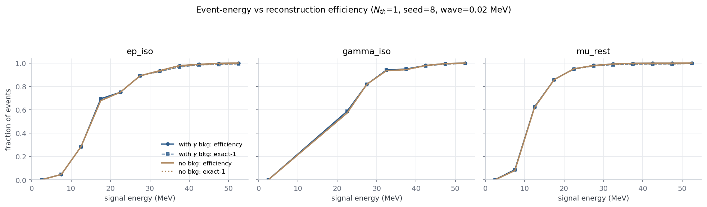

*图 7：样本事例能量（信号部分）与重建效率/准确率的关系，共同最优点（`Nth=1, seed=8, wave=0.02`）。实线：含本底效率；虚线：含本底准确率；棕色：同参数无本底对照。*

| 信号能量 (MeV) | `ep_iso` 效率 | `gamma_iso` 效率 | `mu_rest` 效率 |
|--:|--:|--:|--:|
| 2.5 | 0.002 | 0.001 | 0.002 |
| 7.5 | 0.046 | — | 0.087 |
| 12.5 | 0.283 | — | 0.625 |
| 17.5 | 0.694 | — | 0.858 |
| 22.5 | 0.750 | 0.587 | 0.950 |
| 27.5 | 0.890 | 0.817 | 0.979 |
| 32.5 | 0.934 | 0.941 | 0.992 |
| 37.5 | 0.978 | 0.949 | 0.997 |
| 42.5 | 0.988 | 0.979 | 0.999 |
| 47.5 | 0.997 | 0.995 | 0.999 |
| 52.5 | 1.000 | 1.000 | 1.000 |

* **效率的定义是"至少给出 1 个团簇"**；它与准确率在低能区接近，在高能区略高（准确率还要求团簇数恰好为 1）。
* 50% 效率点：`ep_iso` 约 14–15 MeV，`gamma_iso` 约 21–22 MeV，`mu_rest` 约 11–12 MeV。μ 样本虽然更软，但因为其信号能量集中在 20–50 MeV，效率在 15 MeV 后快速上升；γ 样本的低能事例较少，曲线在 20 MeV 以下样本量不足（表中以"—"表示）。
* **含本底与无本底曲线在重调参数后几乎重合**：在 20–50 MeV，二者的效率/准确率差异小于 0.5 个百分点。这说明本底没有破坏能量-效率响应；关键是不要把种子阈值设在本底假种子主导的区域。
* 低能端（<10 MeV）效率接近 0，是能量接受度地板：这些事例的信号能量本身不足以起簇；本底虽然可能产生假团簇，但在 `Nth=1, seed=8` 下假团簇率只有 0.1%，不足以显著改变曲线。

### 5.6 `NBkg` 依赖：低种子失效的直接证据

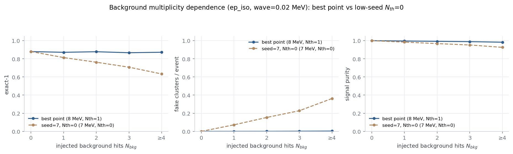

*图 8：`ep_iso` 的准确率、假团簇率、信号纯度随注入本底 hit 数的变化。蓝线：共同最优点（`seed=8, Nth=1`）；棕线：无本底最优的 `seed=7, Nth=0`。*

| `NBkg` | 0 | 1 | 2 | 3 | ≥4 |
|:--|--:|--:|--:|--:|--:|
| `seed=7, Nth=0` 准确率 | 0.8805 | 0.8138 | 0.7625 | 0.7080 | **0.6331** |
| `seed=7, Nth=0` 假团簇/事例 | 0.0000 | 0.0723 | 0.1534 | 0.2277 | **0.3625** |
| `seed=7, Nth=0` 纯度 | 1.0000 | 0.9845 | 0.9680 | 0.9527 | **0.9265** |
| `seed=8, Nth=1` 准确率 | 0.8798 | 0.8719 | 0.8781 | 0.8674 | 0.8725 |
| `seed=8, Nth=1` 假团簇/事例 | 0.0000 | 0.0002 | 0.0005 | 0.0016 | 0.0034 |
| `seed=8, Nth=1` 纯度 | 1.0000 | 0.9965 | 0.9928 | 0.9893 | 0.9834 |

* 在无本底最优的 `seed=7, Nth=0`，准确率随 `NBkg` **单调下降**：`NBkg=0` 时 0.8805，`NBkg≥4` 时 0.6331；假团簇率从 0 升到 0.3625/事例。这是本底假团簇的直接证据。
* 在共同最优点 `seed=8, Nth=1`，准确率在 0.867–0.880 之间，**基本不随 `NBkg` 变化**；假团簇率 ≤0.0034/事例，纯度 ≥0.983。这说明该工作点对本底 multiplicity 是稳健的。
* 图中"最佳点"的准确率在 `NBkg=1/3` 处略低，是统计涨落（`NBkg=1/3` 分箱约 1 万事例，标准误约 0.3 个百分点），不是物理趋势。

### 5.7 纯度、假团簇与能量响应

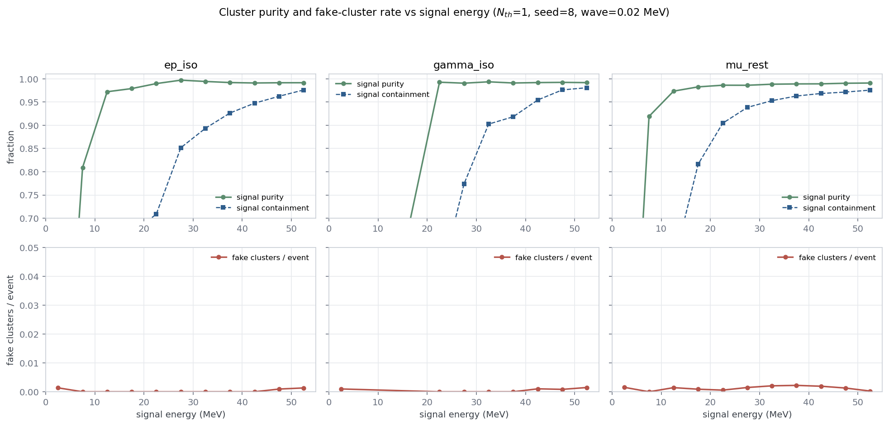

*图 9：共同最优点下，信号纯度/信号收束率（上）与假团簇率（下）随信号能量的变化。*

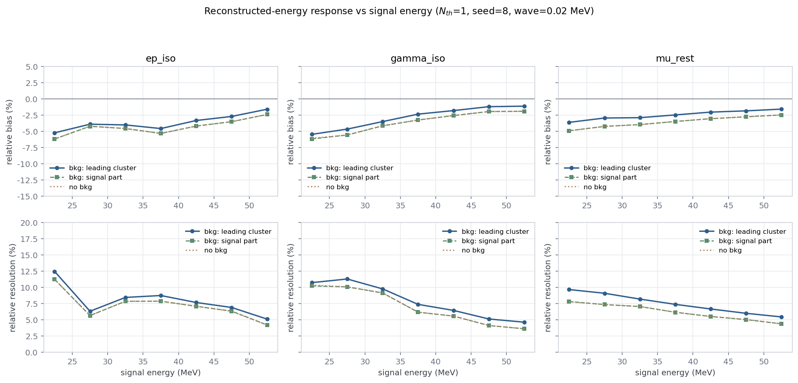

*图 10：重建能量响应随信号能量的变化（共同最优点）。上：相对偏差；下：相对分辨率。蓝线：领头簇总能量（含本底）；绿线：领头簇中的信号部分；棕色虚线：无本底对照。*

| 样本（E>20 MeV） | 领头簇偏差 | 领头簇分辨率 | 信号部分偏差 | 信号部分分辨率 |
|:--|--:|--:|--:|--:|
| `ep_iso` | −1.69% | 5.34% | −2.51% | 4.47% |
| `gamma_iso` | −1.16% | 4.82% | −1.95% | 3.82% |
| `mu_rest` | −2.38% | 7.44% | −3.43% | 6.18% |

* **能量污染很小**：含本底的领头簇偏差比"信号部分"高约 0.8–1.1 个百分点（本底把能量往上推），分辨率差约 0.8–1.3 个百分点；这与本底捕获率 ~3%、领头簇本底占比 ~0.7–1.0% 一致。
* **信号部分的响应与无本底对照几乎完全重合**（棕色虚线压在绿线上），说明本底没有改变算法的能量重建逻辑，只是在少数事例中给领头簇增加了额外能量。
* 纯度在低能端（5–14 MeV）明显下降（`ep_iso` 约 0.81 起），因为低能信号事例更容易被本底假团簇污染；高能端纯度稳定在 0.99 左右。
* 整体假团簇率 ≤0.002/事例（`NBkg≥4` 分箱为 0.0034）；在低能端略升，但仍远低于低种子/Nth0 的 0.19/事例。

### 5.8 与无本底基线的比较

#### 同参数 vs 全局最优

| 比较方式 | 无本底 | 含本底 | 差值 |
|:--|--:|--:|--:|
| 无本底全局最优（`seed=7, Nth=0`） | 0.8678 | **0.7393**（同参数） | **−12.85 个百分点** |
| 含本底共同最优（`seed=8, Nth=1`） | 0.8626（同参数控制） | **0.8614** | **−0.12 个百分点** |
| 含本底共同最优 vs 无本底全局最优 | 0.8678 | 0.8614 | **−0.64 个百分点** |

这张表区分了两件事：

1. **参数被迫移动的代价**：本底使 `seed=7, Nth=0` 失效，必须移动到 `seed=8, Nth=1`；该点本身在无本底下只有 0.8626，比无本底全局最优低 0.52 个百分点；
2. **同一参数下的残余本底代价**：在 `seed=8, Nth=1`，含本底 0.8614、无本底 0.8626，只差 0.12 个百分点。**能量污染造成的直接损失很小，主要代价是参数移动。**

#### 各样本最优点的对照

| 样本 | 含本底最优 | 同参数无本底 | 残余本底代价 | 无本底全局最优 | 相对全局最优 |
|:--|--:|--:|--:|--:|--:|
| `ep_iso` | 0.8783 (`seed=13, Nth=0`) | 0.8786 | −0.03 pp | 0.8790 | −0.07 pp |
| `gamma_iso` | 0.8739 (`seed=14, Nth=0`) | 0.8740 | −0.01 pp | 0.8744 | −0.05 pp |
| `mu_rest` | 0.8423 (`seed=7, Nth=1`) | 0.8477 | −0.54 pp | 0.8614 | −1.91 pp |

* 电磁样本（`ep_iso`/`gamma_iso`）在重调种子后几乎完全恢复无本底性能：残余代价 0.03/0.01 个百分点，相对全局最优 0.07/0.05 个百分点。
* `mu_rest` 是受影响最大的样本：残余本底代价 0.54 个百分点，且因为最优种子从无本底的 6 MeV 移到 7 MeV、`Nth` 从 0 移到 1，相对无本底全局最优损失 1.91 个百分点。主要原因是 μ 样本的能谱软，提高种子会损失信号尾部，而降低种子又会引入假团簇；只能在两者之间取折中。
* 三个样本共用一组参数时，共同最优被 μ 样本拖低：0.8614，比无本底全局最优低 0.64 个百分点。**如果粒子种类已知，应按样本分别设置种子阈值**。

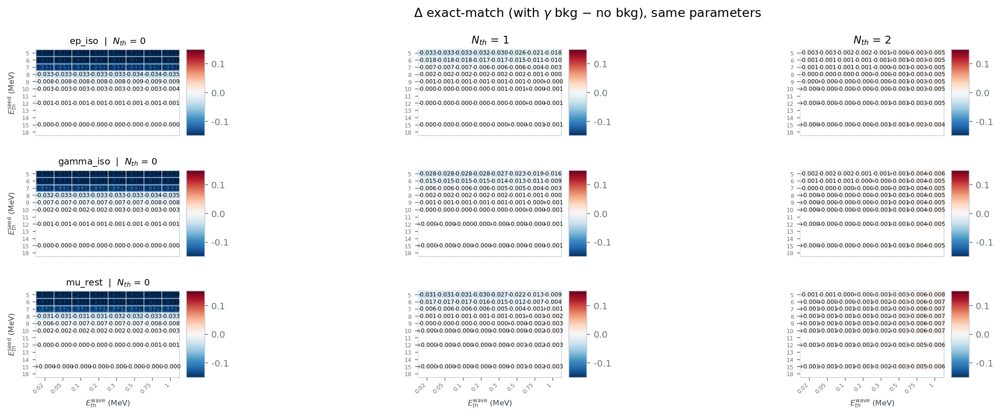

*图 11：同参数下准确率差值（含本底 − 无本底；蓝=本底更差，红=本底更好）。低种子、`Nth=0` 的深蓝区域是假团簇造成的；`Nth=1` 后差值迅速接近 0。高波前阈值处出现少量红色，是假团簇"填补"0 团簇事例造成的准确率虚高，需结合纯度/假团簇率判断。*

> 差值热图中种子 11、13、14、18 的空白，是因为归档无本底网格没有这些种子（旧网格为 5,6,7,8,9,10,12,15,20）；同参数控制点已在 5.8 节的对照表中单独给出，不受空白影响。

### 5.9 数据集差异与失败模式

**数据集差异**：

* `ep_iso` 与 `gamma_iso` 的能谱相近，最优种子 13–14 MeV，准确率 0.874–0.878，能量响应也最好（分辨率 3.8%–5.3%）。
* `mu_rest` 的能谱最软（平均 32 MeV，最大晶体能量中位数 23 MeV），最优种子只能取 7 MeV + `Nth=1`；准确率 0.842，分辨率 7.4%（含本底）。它是本底环境下最难的样本。
* 三样本的共同工作点对 `ep_iso`/`gamma_iso` 不是最优（它们本可以更高种子），但能保证 μ 样本可用；若物理分析按粒子种类分开，建议分别设置。

**失败模式**：

1. **假团簇（低种子、高 NBkg）**：本底 hit 单独超过种子阈值，形成 1 个主要由本底组成的团簇。表现：假团簇率升高、纯度下降、准确率在低种子下崩塌；`Nth≥1` 或提高种子可抑制。
2. **信号丢失（高种子、软样本）**：种子阈值提高后，软信号事例没有晶体超过阈值，未成簇率上升。μ 样本在 seed=12 时 `P(max crystal < seed) ≈ 19%`，种子不能无限提高。
3. **能量污染（本底 hit 落在信号邻域）**：本底被波前吸收，领头簇能量偏高约 0.8–1.1 个百分点，分辨率变差约 0.8–1.3 个百分点；本底捕获率仅 ~3%，影响有限。
4. **准确率虚高（假团簇填补 0 团簇事例）**：在高波前阈值/低种子区域，本底假团簇可能让原本 0 团簇的事例变成 1 团簇，使准确率高于无本底。必须同时看纯度/假团簇率，不能只看准确率。

### 5.10 性能

* 单点重建约 **30–40 s**；加上本底分解（同时读信号与本底两个 ROOT 文件、逐团簇计算信号/本底能量）和分箱评估，单点总耗时约 **75 s**（18 进程并行）。
* 972 点扫描约 **67 min**（810 点 56.2 min + 162 点 11.0 min），0 失败。
* 本底分解的主要开销是逐事例读取两个 `Edeps` 向量和逐团簇求和；后续可把两个树合并读取、用 numpy 向量化，或直接在重建时顺带计算，预计可降到 40–50 s/点。
* 分箱结果（`tasks_bkg/bins/*.json`）与标量 CSV 分开存放，避免 CSV 膨胀；分析脚本直接读 bins 生成曲线。

---

## 6. 结论与推荐

### 6.1 主要结论

1. **本底的主要威胁是假团簇，不是能量污染。** 在无本底最优的 `seed=7, Nth=0`，本底假团簇率 0.187/事例，准确率从 0.8678 跌到 0.7393（−12.9 个百分点）；而本底被吸收进团簇的能量只占 ~3%，领头簇本底占比 ~0.7%–1.0%。
2. **种子阈值是本底抑制的主开关。** 把种子从 7 MeV 提高到 10–14 MeV，假团簇率降到 0.003 以下；或保持 7 MeV 但要求 `Nth=1`，假团簇率降到 0.006。两条策略的全局平均性能接近。
3. **重调参数后，残余本底代价很小。** 在共同最优点 `seed=8, Nth=1`，含本底 0.8614、同参数无本底 0.8626，只差 0.12 个百分点；电磁样本的残余代价 <0.05 个百分点。相对无本底全局最优的 0.64 个百分点损失，主要来自"参数被迫移动"，而不是本底污染。
4. **`mu_rest` 是最难的样本。** 其能谱软，种子不能提得太高；本底最优 `seed=7, Nth=1` 的准确率 0.8423，比无本底全局最优低 1.91 个百分点（其中 0.54 个百分点是残余本底代价，其余是参数移动）。
5. **能量-效率响应在重调后与无本底几乎重合。** 50% 效率点约 12–21 MeV，40 MeV 后效率 >0.95；本底没有改变效率曲线的形状。
6. **准确率必须与纯度/假团簇率联合使用。** 假团簇可以在高波前阈值/低种子区域"填补"0 团簇事例，使准确率虚高；本报告用纯度、假团簇率、本底捕获率来交叉验证。

### 6.2 推荐工作点

| 场景 | 推荐 | 依据 |
|:--|:--|:--|
| 三样本共用一组参数 | **`Nth=1, Eth_seed=8 MeV, Eth_wave=0.02–0.05 MeV`** | 平均准确率 0.8614，纯度 0.9913，假团簇 0.001，残余本底代价 0.12 pp |
| 已知是电磁样本（e±/γ） | `Nth=0, Eth_seed=13–14 MeV, Eth_wave=0.02 MeV` | ep 0.8783 / gamma 0.8739，假团簇 ≈0，几乎恢复无本底性能 |
| 已知是 μ 米歇尔电子 | `Nth=1, Eth_seed=7 MeV, Eth_wave=0.02 MeV` | 0.8423，比同参数 `Nth=0` 高约 10 pp，假团簇 0.007 |
| 希望保留较低种子（软样本） | `Nth=1, Eth_seed=7–8 MeV, Eth_wave=0.02–0.05 MeV` | 平均 0.858–0.861，假团簇 ≤0.006，纯度 ≥0.989 |
| 不要使用 | `Eth_seed=7 MeV + Nth=0`（无本底最优） | 本底假团簇导致 −12.9 pp |
| 不要使用 | `Nth=2` 或 `Eth_wave ≥ 0.5 MeV` | 软信号损失明显，准确率低 1–3 pp 以上 |

### 6.3 后续工作

1. **多粒子 + 本底**：本报告仍是单粒子样本；多粒子阶段（`MULTIPARTICLE_STAGE_PLAN.md`）需要与本底样本结合，评估相邻簇射合并率与假团簇的联合影响。
2. **时间信息**：本底 hit 在时间上与信号无关；如果保留 ns 级 timing，可用时间窗进一步抑制假团簇。当前 processed 文件没有 timing，原始 SimHit 有。
3. **本底模型系统误差**：剂量换算（1 Sv=1 Gy、未做 CsI/空气修正）和沉积谱假设是 O(1) 不确定度；需要用数据驱动或更真实的模拟校准。
4. **能量刻度与响应**：当前信号部分存在 −2% 到 −3.4% 的偏差，可通过刻度/后处理修正；本底使领头簇偏差向正方向移动约 1 个百分点。
5. **聚类后处理**：回收簇外软能量、拆分/合并、边界重分配，可进一步改善能量闭合和本底鲁棒性。
6. **性能**：把信号/本底两个 ROOT 树合并读取、向量化逐团簇求和，可把 75 s/点降到 40–50 s/点。

---

# 附录

## 附录 A：本底模型与注入的完整参数

### A.1 几何与剂量

| 量 | 值 |
|:--|--:|
| GP(8,0) 面数 | 642（12 五边形 + 630 六边形） |
| 内/外端面平均面积 | 1319.380 / 5691.289 mm² |
| 单晶体积（精确棱台） | 910.086 cm³ |
| 单晶质量（ρ=4.51 g/cm³） | 4.1045 kg |
| 实际晶体数 / 总质量 | 568 / 2331.3 kg |
| 剂量率 | 30 μSv/h |
| 总沉积功率 | 1.9428×10⁻⁵ W |
| 单 hit 平均沉积 | 5.0011 MeV |
| 本底事例率 | 2.4247×10⁷ s⁻¹ |
| 每事例期望 hit 数（100 ns） | 2.4247 |

### A.2 注入与校验

* 对每个事例抽 `k ~ Poisson(2.4247)`；在 568 个晶体中均匀有放回抽 `k` 个编号；按 N(5, 2²) 截断于 0 抽 `k` 个能量并累加到 `Edeps`；
* 输出保留 `Edeps` schema，新增 `NBkg` 分支；随机种子 `20261105`，可完全复现；
* 校验结果（三个数据集）：`NBkg=0` 事例逐位相同；`NBkg>0` 事例差值最大偏差 **0.000 MeV**；泊松 p=0.906/0.596/0.362；晶体编号均匀性 p=0.817/0.535/0.598；平均 hit 能量 4.9998/5.0000/5.0002 MeV，全部 PASS。

### A.3 系统不确定度

1. 剂量换算：1 Sv=1 Gy，未做 CsI/空气质能吸收系数修正；方向取决于本底能谱，量级 O(1)。
2. 沉积谱：N(5, 2²) 截断；`r_bkg ∝ 1/E_bkg`，若真实均值不同，按反比缩放。
3. 晶体体积：GP(8,0) 近似与 GDML 实测差约 2.7%（体积），对 n_bkg 的影响同量级。
4. 时间窗：100 ns 为任务给定；n_bkg 与窗长成正比。

## 附录 B：指标定义与计算细节

### B.1 逐事例/逐团簇

* `E_sig`：同一事例在无本底文件中的 `Edeps` 总和；
* `E_bkg = ΣEdeps_bkg − E_sig`；
* 团簇信号能量 `e_s = Σ_{mod∈cluster} Edeps_sig[mod]`；
* 团簇本底能量 `e_b = Σ Edeps_bkg[mod] − e_s`；
* 领头簇：按团簇总能量 `e_s + e_b` 取最大；
* 假团簇：`e_s < 1 MeV` 的团簇（纯本底簇；对 ep/gamma/mu 的信号簇射，1 MeV 远低于典型信号能量）。

### B.2 比率

* 重建效率：`N(n_clusters ≥1)/N`；
* 准确率：`N(n_clusters =1)/N`；
* 信号纯度：`Σe_s / Σ(e_s+e_b)`（所有团簇）；
* 本底捕获率：`Σe_b / ΣE_bkg`；
* 领头簇本底占比：`e_b^lead / (e_s^lead+e_b^lead)`；
* 信号收束率：`e_s^lead / E_sig`；
* 能量响应：`(e_lead − E_sig)/E_sig`；`e_lead` 可分别取总能量或信号部分；汇总量限制 `E_sig ≥20 MeV`。

### B.3 分箱

* 能量箱：0–5, 5–10, …, 55–60, 60–80 MeV；只显示 `N≥50` 的箱；
* NBkg 箱：0, 1, 2, 3, ≥4；每箱 0.4–1.3 万事例（50k 样本）；
* 每个箱分别累计事例数、≥1 簇数、=1 簇数、≥2 簇数、团簇数、假团簇数、信号/本底能量、领头簇信号/本底、偏差/RMS。

### B.4 统计误差

50 000 事例下，单样本准确率标准误约 **0.15 个百分点**，三样本平均约 **0.087 个百分点**。因此：

* `Nth=0` 与 `Nth=1` 的 0.13 个百分点差异、共同最优点的 0.12 个百分点残余本底代价，都在 ~1–1.5σ 内，应表述为"近似等价/残余代价很小"，而不是精确排序；
* `mu_rest` 的 1.91 个百分点损失、低种子的 12.9 个百分点崩塌是稳健的。

## 附录 C：扫描网格、复现与产物

### C.1 网格

| 轴 | 取值 |
|:--|:--|
| `Eth_seed` | 5, 6, 7, 8, 9, 10, 11, 12, 13, 14, 15, 18 MeV |
| `Eth_wave` | 0.02, 0.05, 0.1, 0.2, 0.3, 0.5, 0.75, 1.0, 2.0 MeV |
| `Nth` | 0, 1, 2 |
| 数据集 | `ep_iso_bkg`, `gamma_iso_bkg`, `mu_rest_bkg` |
| 事例数 | 50 000/样本 |

### C.2 复现

```bash
cd pytrial

# 1) 生成/刷新 50k 子样本（保留 NBkg）
ECAL_SWEEP_DATASETS=ep_iso,gamma_iso,mu_rest,ep_iso_bkg,gamma_iso_bkg,mu_rest_bkg \
ECAL_SWEEP_N_EVENTS=50000 \
python3 sweeps/prepare_subsets.py

# 2) 本底扫描（972 点）
ECAL_SWEEP_RESULTS_DATE=26-11-06 \
ECAL_SWEEP_TAG=bkg \
ECAL_SWEEP_DATASETS=ep_iso_bkg,gamma_iso_bkg,mu_rest_bkg \
ECAL_SWEEP_SEEDS=5,6,7,8,9,10,11,12,13,14,15,18 \
ECAL_SWEEP_WAVES=0.02,0.05,0.1,0.2,0.3,0.5,0.75,1.0,2.0 \
ECAL_SWEEP_NTHS=0,1,2 \
python3 sweeps/run_sweep.py

# 3) 无本底控制点（共同最优点 + 各样本最优点，共 12 点）
export ECAL_SWEEP_RESULTS_DATE=26-11-06
export ECAL_SWEEP_TAG=bkg
# 3a) 共同最优点 seed=8, wave=0.02, Nth=0/1/2，三个样本
for ds in ep_iso gamma_iso mu_rest; do
  for nth in 0 1 2; do
    python3 sweeps/run_task.py "$ds" 8 0.02 "$nth"
  done
done
# 3b) 各样本最优点
python3 sweeps/run_task.py ep_iso    13 0.02 0
python3 sweeps/run_task.py gamma_iso 14 0.02 0
python3 sweeps/run_task.py mu_rest    7 0.02 1

# 4) 重建 CSV + 出图
ECAL_SWEEP_DATASETS=ep_iso_bkg,gamma_iso_bkg,mu_rest_bkg \
ECAL_SWEEP_SEEDS=5,6,7,8,9,10,11,12,13,14,15,18 \
ECAL_SWEEP_WAVES=0.02,0.05,0.1,0.2,0.3,0.5,0.75,1.0,2.0 \
ECAL_SWEEP_NTHS=0,1,2 ECAL_SWEEP_RESULTS_DATE=26-11-06 ECAL_SWEEP_TAG=bkg \
python3 sweeps/run_sweep.py --csv-only
ECAL_SWEEP_DATASETS=ep_iso_bkg,gamma_iso_bkg,mu_rest_bkg \
ECAL_SWEEP_SEEDS=5,6,7,8,9,10,11,12,13,14,15,18 \
ECAL_SWEEP_WAVES=0.02,0.05,0.1,0.2,0.3,0.5,0.75,1.0,2.0 \
ECAL_SWEEP_NTHS=0,1,2 ECAL_SWEEP_RESULTS_DATE=26-11-06 ECAL_SWEEP_TAG=bkg \
python3 sweeps/analyze_bkg.py
```

### C.3 产物

| 路径 | 内容 |
|:--|:--|
| `results/sweep/26-11-06/sweep_summary.csv` | 984 行（972 本底 + 12 控制）× 53 列 |
| `results/sweep/26-11-06/best_params_bkg.md` | 各 `Nth`/样本最优点表 |
| `results/sweep/26-11-06/heatmap_exact_match_rate_bkg.png` | 准确率热图（按 `Nth` 分列） |
| `.../heatmap_*_bkg.png` | 假团簇、纯度、信号捕获、过分裂热图 |
| `.../parameter_curves_bkg.png` | 1D 参数投影（本底 vs 无本底） |
| `.../energy_efficiency_bkg.png` | 能量-效率/准确率（核心图） |
| `.../nbkg_performance_bkg.png` | 准确率/假团簇/纯度 vs NBkg |
| `.../purity_fake_vs_energy_bkg.png` | 纯度/收束/假团簇 vs 信号能量 |
| `.../response_bkg.png` | 能量偏差/分辨率 vs 信号能量 |
| `.../comparison_exact_bkg_minus_nobkg.png` | 同参数准确率差值热图 |
| `.../sample_overview_bkg.png` | 样本总能量/NBkg/本底能量分布 |
| `.../event_display_bkg.png` | 含本底事例三维显示 |
| `.../bkg_spectrum.png` | 假定本底沉积谱 |
| `sweeps/subsets/tasks_bkg/bins/*.json` | 每个点的能量/NBkg 分箱曲线 |

## 附录 D：已知问题与注意事项

1. **当前代码关闭了 gap-jumping 回退**（多粒子阶段改动）。本报告的控制点使用同一代码；归档 26-10-16-refined 使用回退开启，准确率差异 <0.1 pp、能量捕获差异约 0.2 pp。直接比较时需注意。
2. **准确率可被假团簇虚高**：在高波前阈值/低种子区域，本底假团簇填补 0 团簇事例，使准确率高于无本底。必须联合纯度/假团簇率判断。
3. **本底模型系统误差**：剂量换算与沉积谱假设为 O(1) 不确定度；本报告结论应理解为该模型下的相对趋势。
4. **无 timing**：processed 文件只有能量；时间信息可进一步抑制本底假团簇。
5. **单粒子样本**：本报告不涉及多粒子合并；多粒子样本需要 `MULTIPARTICLE_STAGE_PLAN.md` 的 Stage 2 协议，并与本底样本结合。
6. **归档无本底网格缺少种子 11/13/14/18**：比较热图这些列为空；同参数控制点已在 5.8 节表中单独给出。
7. **`_read_cluster_counts` 计数截断已修**：当前 CSV 的所有点 `N_events=50000`，无截断；旧 26-10-16-refined 归档中 312 个低接受度点曾受影响，但不影响本报告的最优点。
8. **分箱统计量**：低能端（<10 MeV）样本量小，效率/纯度曲线在个别箱有较大统计涨落；报告中的 50% 效率点为目测插值。

## 附录 E：与 2026-10 工作报告的关系

本报告的结构参考 **`private_docs/report-2026-10.zip`** 中的 15 页 deck 与 `report_assets/`（标题、算法任务/探测器/事例、样本、算法原理、流程、指标/网格、最优点、参数曲线、失效模式、能量捕获/收束、数据集差异、性能、总结、结论、附录）。新报告沿用其组织方式，但所有数字来自本次 26-11-06 的本底扫描，旧报告只作为无本底基线。

本报告沿用 `report-2026-10` 的结构（样本 → 算法 → 扫描 → 最优 → 参数曲线 → 失效 → 数据集差异 → 性能 → 结论），但内容聚焦于**本底注入后的新结果**：

* 无本底结果只作为基线（`perf_report_1018.md`；refined 主数据 1116 点，三次扫描合计 2301 点）；
* 旧报告的最优工作点 `seed=7, Nth=0` 在本底样本上**不再可用**（−12.9 pp），这是本次更新最重要的结论；
* 新增本底模型、信号/本底逐晶体分解、能量-效率曲线、纯度/假团簇/本底捕获、能量响应；
* 旧报告的多粒子计划（`MULTIPARTICLE_STAGE_PLAN.md`）与本报告互补；下一步应把多粒子样本与本底样本结合。

---

*报告完。所有数字来自 `results/sweep/26-11-06/sweep_summary.csv` 与 `tasks_bkg` 的逐点 JSON/分箱 JSON；图中路径相对本文件。*
