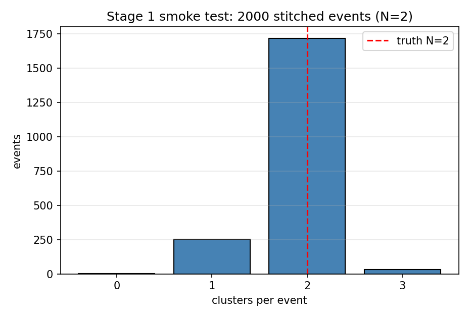

# Stage 1 冒烟测试：最简计数拼接（方案 A）

**日期**：2026-10-29  
**阶段**：Stage 1 / 方案 A  
**状态**：✅ 通过  
**目标**：验证“多粒子拼接 → 当前重建 → 计数评估”链路，不评价多粒子分辨性能。

---

## 1. 测试内容与原理

### 1.1 测什么

方案 A 是最简拼接：把 N 个单粒子事例的 `Edeps` 逐晶体相加，只记录总粒子数 `NTrack=N`，不记录每个初级粒子的能量归属。本次取 **N=2、2 000 个拼接事例**，目的是检查：

* 拼接后的 ROOT 结构是否正确（`Edeps` 长度、`NTrack`、源事例索引）；
* 逐事例能量是否守恒；
* 当前 `reconstruction.py` 能否处理多粒子输入；
* 计数指标（exact-2、欠/过分裂、MAE、RMSE 等）是否可正确计算；
* 结果是否可复现。

**不测**：逐初级真值、效率/纯度、合并/分裂。这些需要方案 B（Stage 2）的逐初级能量矩阵。

### 1.2 为什么可以逐晶体相加

探测器对能量沉积的响应近似线性；两个粒子在探测器内互不影响时，同一块晶体上的总能量就是两个粒子贡献之和。因此把两个单粒子事例的 `Edeps` 相加，等价于“两个粒子同时打到探测器”的能量图。该近似只用于**能量图聚类**测试，**不能用于物理产额/效率**。

### 1.3 为什么还需要 Stage 2

方案 A 只知道“总数 = 2”。如果一个事例只给出 1 个团簇，可能是：

* 两个簇射被合并成一个（真正的合并错误）；
* 其中一个簇射太软，没有达到种子阈值（漏掉）；
* 两者都有。

方案 A 无法区分。方案 B 会记录每个初级粒子对每块晶体的能量贡献，从而把“合并”和“漏掉”分开。

---

## 2. 测试数据与参数

| 项 | 值 |
|:--|:--|
| 输入样本 | `data/processed/edep_of_each_evt_ep_iso.root`（100 万事例） |
| 源 pool | 前 20 000 事例中总能量 >0 的事例（17 996 个） |
| 拼接重数 | N = 2 |
| 拼接事例数 | 2 000 |
| 随机种子 | 20261018（`numpy.random.default_rng`，PCG64） |
| 采样方式 | 每个拼接事例内不放回抽 2 个源事例 |
| 重建参数 | `Nth=0`, `Eth_seed=7.0 MeV`, `Eth_wave=0.05 MeV` |
| 输出数据 | `data/stitched_ep_iso_n2_2k.root` |
| 团簇输出 | `results/clusters_ep_iso_n2_2k_nth0_seed7_wave0.05.root` |

> 选择 `ep_iso` 是因为它能量较高、单粒子表现最好，适合先验证链路。Stage 2 起会覆盖三种样本和混合种类。

---

## 3. 拼接算法

```text
读取 ep_iso 前 20 000 个事例的 Edeps
过滤：只保留 sum(Edeps) > 0 的事例（17 996 个）
for 每个拼接事例（2 000 个）:
    idx = rng.choice(pool, size=2, replace=False)
    Edeps_stitched = Edeps[idx[0]] + Edeps[idx[1]]
    NTrack = 2
    SourceIdx = idx
写 ROOT（树 EdepOfEachEvt）:
    Edeps     : vector<float>[568]   # 重建使用
    NTrack    : int                  # = 2
    SourceIdx : vector<int>[2]       # 源事例索引，便于复现/调试
```

实现：`stitch_smoke.py` 调用 `pytrial/stitching.py` 的 `load_edeps`、`positive_energy_mask`、`stitch_count_only`、`write_stitched`。

---

## 4. 测试执行

```text
读取拼接样本 → 当前 reconstruction.py（Nth=0, seed=7, wave=0.05）
            → ECALClusters
            → evaluation/counts.py 计算计数指标
```

运行脚本：`run_smoke.py`。它会在 `work/` 下建立 `processed/` 与 `utilities/` 符号链接（重建要求的标准目录结构），调用现有重建，然后计算指标、画分布图、写检查结果。

---

## 5. 测试结果

### 5.1 计数指标（N=2，2 000 事例）

| 指标 | 值 |
|:--|--:|
| 事例数 | 2 000 |
| 真值 N | 2 |
| **exact-2（团簇数 = 2）** | **0.8575**（1 715 / 2 000） |
| 欠分裂（团簇数 < 2） | 0.1260 |
| 过分裂（团簇数 > 2） | 0.0165 |
| MAE | 0.1430 |
| RMSE | 0.3795 |
| bias（mean − 2） | −0.1100 |
| 平均团簇数 | 1.8900 |
| 标准差 | 0.3633 |
| 最小 / 最大团簇数 | 0 / 3 |

团簇数分布：

| 团簇数 | 0 | 1 | 2 | 3 |
|:--|--:|--:|--:|--:|
| 事例数 | 1 | 251 | 1 715 | 33 |
| 比例 | 0.0005 | 0.1255 | 0.8575 | 0.0165 |



*图：2 000 个 N=2 拼接事例的团簇数分布；红色虚线为真值 N=2。*

### 5.2 检查项

| 检查 | 结果 |
|:--|:--|
| 拼接样本条目数 = 2 000 | ✅ |
| 每个事例 `NTrack == 2` | ✅ |
| 每个事例 `Edeps` 长度 = 568 | ✅ |
| 每个事例 `SourceIdx` 长度 = 2 | ✅ |
| 逐事例能量守恒（最大绝对误差） | ✅ 1.53×10⁻⁵ MeV（容差 10⁻³ MeV） |
| 团簇输出存在 | ✅ |
| 2 000 个事例全部计入 | ✅ |
| 指标均为有限值 | ✅ |
| **总体** | **✅ 通过**（`results/checks.json` 中 `passed: true`） |

### 5.3 结果解读

* **链路是通的**：拼接、重建、计数评估全部正常，能量守恒到 float32 精度。
* **85.75% 的 N=2 事例给出恰好 2 个团簇**，说明当前算法在“两个非空簇射”的简单情形下多数能分开。
* **12.6% 欠分裂**：其中 251 个事例只给出 1 个团簇，1 个事例给出 0 个。方案 A 无法判断这是“两个簇射合并”还是“其中一个太软没起簇”。
* **1.65% 过分裂**：33 个事例给出 3 个团簇，可能是某个簇射被切成两块。
* 由于 pool 已过滤掉总能量为 0 的事例，这个 12.6% 不是单粒子的 12.5% 能量地板；它主要来自“软簇射未起簇”和“合并”的混合。**Stage 2 会用逐初级真值把两者分开。**

> 本次是冒烟测试，0.8575 不应作为算法性能结论；它只说明指标管线工作正常，并给出 Stage 2 的对照起点。

---

## 6. 复现方法

### 6.1 前置条件

* 已获取 `data/processed/edep_of_each_evt_ep_iso.root`（Git LFS；若只有指针文件，先 `git lfs fetch --include="data/processed/**" origin && git lfs checkout`）；
* Python 环境有 ROOT、numpy、matplotlib。

### 6.2 命令

```bash
cd pytrial/smoke_tests/simple_evt_stitch

# 1) 生成拼接样本（写出 data/stitched_ep_iso_n2_2k.root 和 meta.json）
python3 stitch_smoke.py

# 2) 运行当前重建 + 计数评估（写出 results/）
python3 run_smoke.py
```

### 6.3 预期输出

* `data/stitched_ep_iso_n2_2k.root`：2 000 个 N=2 事例；
* `results/metrics.json` / `metrics.csv`：计数指标；
* `results/checks.json`：检查项，`passed: true`；
* `results/count_distribution.png`：分布图；
* `results/clusters_...root`：团簇输出。

固定随机种子 20261018，重复运行应得到相同指标（ROOT 浮点求和顺序一致）。

---

## 7. 文件说明

| 文件 | 内容 |
|:--|:--|
| `stitch_smoke.py` | 方案 A 拼接算法（读源样本、过滤、相加、写 ROOT） |
| `run_smoke.py` | 调用当前重建 + 计数评估 + 画图 + 检查 |
| `meta.json` | 生成配置与能量守恒检查 |
| `data/stitched_ep_iso_n2_2k.root` | 测试数据（2 000 个 N=2 拼接事例） |
| `results/metrics.json` / `.csv` | 计数指标 |
| `results/checks.json` | 检查项与总体通过状态 |
| `results/count_distribution.png` | 团簇数分布 |
| `results/clusters_...root` | 当前算法的团簇输出 |

核心代码（与冒烟测试分离）：

* `pytrial/stitching.py`：拼接核心（Stage 1 的 count-only 路径；Stage 2 的逐初级真值在此扩展）；
* `pytrial/evaluation/counts.py`：计数指标；
* `pytrial/evaluation/matching.py`、`energy.py`：Stage 2/3 的评估接口（当前为占位）；
* `pytrial/geometry.py`：晶体位置/质心/距离（Stage 3 使用）。

---

## 8. 局限与下一步

**局限**：

* 只有 `ep_iso`、N=2、2 000 事例；没有 N=3/4，没有混合种类；
* 没有逐初级真值，无法测效率、纯度、合并率、分裂率；
* 只用了单粒子最优参数，没有在多粒子样本上重扫阈值；
* pool 过滤了零能量事例，不代表完整样本的接受度。

**下一步（Stage 2 / 方案 B）**：

* 在 `stitching.py` 中实现逐初级能量矩阵（`TruthCrystal`/`TruthPrimary`/`TruthEnergy`/`TruthCentroid`）；
* 实现 `evaluation/matching.py`（重叠矩阵 + 匈牙利匹配 + 效率/纯度/合并/分裂）和 `evaluation/energy.py`；
* 生成 N=2/3/4、同种/混合、各 20 000 事例的样本；
* 给出第一版多粒子基线（计数 + 匹配 + 能量），并区分“合并”与“漏掉”。
